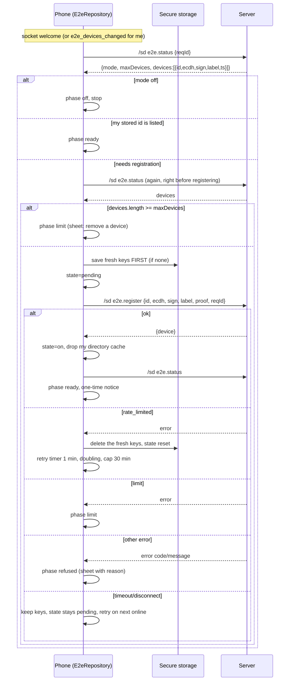
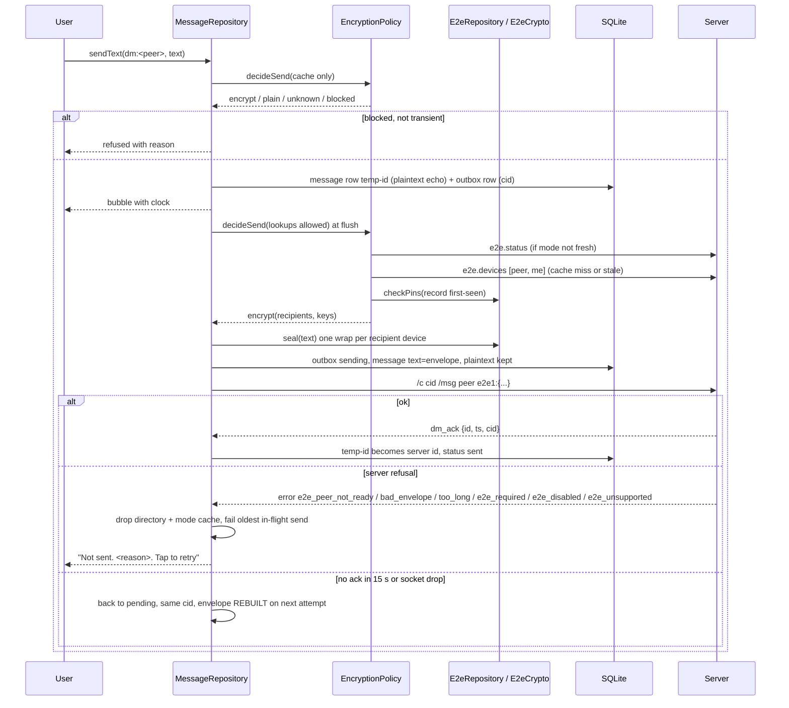
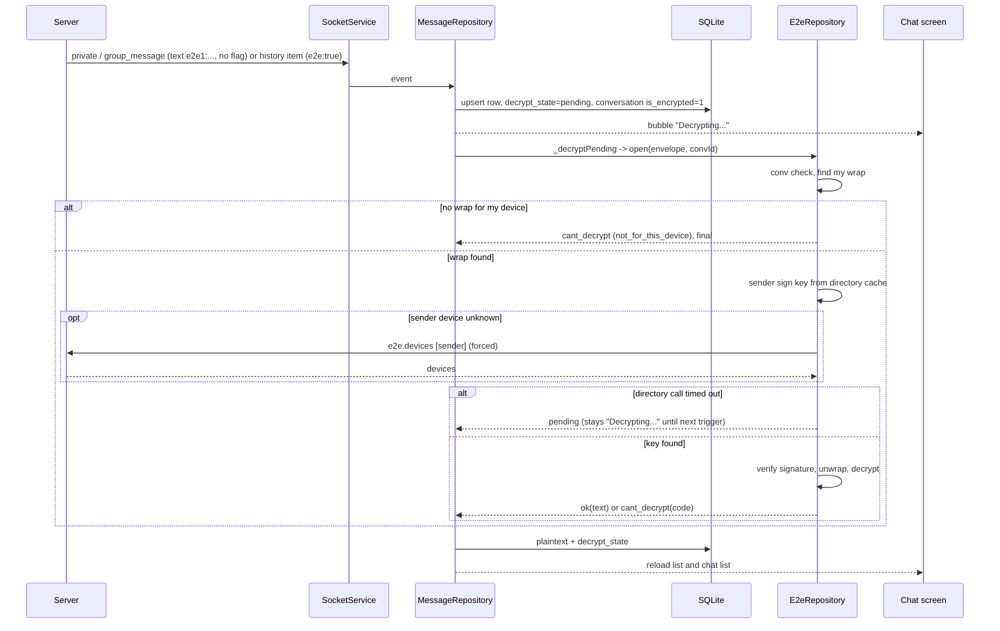

# End-to-end encryption in the Connectum Flutter app

Audience: backend and web team, debugging "message not readable / not shown for some time" across the whole system.

How this was produced: read from the mobile source and `mobile-handoff/e2e.md` only. Nothing was run, built, committed or sent to a server. "Not verified" marks anything not confirmed in code. No keys, tokens, envelopes, message text or personal data appear here; `<peer>`, `<dev>`, `<cid>` are placeholders. Names in `code font` are files, classes or methods under `lib/` unless stated.

Source map:

| Area | Where |
|---|---|
| Primitives (encodings, envelope build/open, safety number) | `data/e2e/e2e_crypto.dart` (`E2eCrypto`), `e2e_models.dart`, `e2e_random.dart` |
| Key storage | `data/e2e/e2e_key_store.dart` (`E2eKeyStore`) |
| Device label | `data/e2e/e2e_device_label.dart` |
| Registration, directory, pins, open, seal | `data/repositories/e2e_repository.dart` (`E2eRepository`) |
| Send rule | `data/repositories/encryption_policy.dart` (`EncryptionPolicy.decide`, `decideSend`) |
| Outbox, receive, history, decrypt queue | `data/repositories/message_repository.dart` (`MessageRepository`) |
| Chat-list previews | `data/repositories/conversation_repository.dart` |
| Socket | `data/socket/socket_service.dart` (`SocketService`) |
| Schema | `data/db/app_database.dart` (migrations 6 and 7) |
| UI | `features/security/*` (Security screen and setup sheets), `features/conversation/*`, `features/debug_e2e/*` |

---

## 1. Overview and glossary

**In plain language.** Every phone or browser that wants to read secure messages is a *device*. A device makes two key pairs and registers the public halves with the server. To send a direct message (DM), the sender makes a fresh random message key, encrypts the text with it, then locks (wraps) that message key once for every registered device of the recipient and once for every registered device of the sender (including the sending device). The result, the *envelope*, is signed by the sending device and sent as the message text (`e2e1:` + JSON). The server stores and relays it, and hands each reader only the wraps for that reader's devices. A reader finds the wrap for its own device, checks the sender's signature using the sender's public signing key from the directory, unwraps and decrypts. A message can only be read by a device that was in the sender's device list at the moment of sending. There is no re-wrap, no recovery, no backup.

On mobile this is automatic: nothing is switched on per chat. After entering an organisation whose mode is not `off`, the app registers the phone by itself (section 4).

| Term | Meaning in this system |
|---|---|
| Device | One registered install (a browser profile or a phone install). 32 lowercase hex chars id. Max per person comes from `e2e.status.maxDevices` (e2e.md: 10). |
| Receive key | The device's P-256 ECDH key pair. The public half is `ecdh` in the directory; the private half wraps/unwraps message keys. |
| Signing key | The device's P-256 ECDSA key pair. The public half is `sign` in the directory; the private half signs registration proofs and envelopes. |
| Envelope | The message text for an encrypted message: `e2e1:` + one-line JSON (`v, mid, from, dev, conv, ts, ek, iv, ct, sig, keys`). |
| Wrap | The message key encrypted for one recipient device: `keys[<deviceId>] = {iv, w}`. |
| Directory | The server's list of registered devices per user (`e2e.devices`, `e2e.group_devices`). The app caches it in memory. |
| Pin | Trust-on-first-use record of a device's `ecdh`/`sign` the first time the app sees it (table `e2e_pins`). A later different key for the same device id blocks sending until the person taps "Trust new key". |
| `mid` | 22-char random id inside the envelope. Not the server's message id. |
| `cid` | Client id of a send (`m-` + UUID), used for ack matching and duplicate protection. Unrelated to `mid`. |

---

## 2. What mobile supports today

| Capability | Behaviour (source) |
|---|---|
| Send DM text | Yes. Encrypted whenever `EncryptionPolicy.decide` says so (section 6). |
| Send DM reply | Yes, `/replydm <peer> <replyToId> e2e1:{...}` (`MessageRepository._commandFor`). The `replyTo` id is outside the envelope. |
| Read DMs (live, history, previews) | Yes (section 7). |
| Read group messages | Yes: same open path, expected label `group:<name>`. Sender key is looked up with `e2e.devices` for the sender (not `e2e.group_devices`). |
| Send in a group that counts as encrypted | **Blocked.** `EncryptionPolicy.decideSend` returns blocked "Can't send in encrypted groups from mobile yet". The composer closes with that text. A group counts as encrypted when the conversation/message carries the e2e flag, or mode is `required`, or (mode `optional`, thread has no history, and `e2e.group_devices` shows another member with a device). In `optional` mode a group that already has plain history stays plain and sends plain. |
| Attachments | The composer's Attach button only shows "Coming soon" (`ConversationController.tapPlaceholder`); no attachment send exists in any chat, so there is no encrypted-attachment send. `E2eCrypto.encryptFile/decryptFile` exist and are exercised only by the `/debug/e2e` self-test; nothing in the chat UI uses them. A received `[ATTACHMENT:{...}]` inside an envelope would be shown as its decrypted text (not verified live). |
| Edit own message in an encrypted thread | **Not possible.** `MessageRepository.editText` returns false for an encrypted message; an edit queued in the outbox that reaches an encrypt verdict fails with "Editing isn't supported in encrypted chats yet". |
| Receive an edit of an encrypted message | Weak spot: `_onEdited` (live `edited`/`dm_edited`/`group_edited`) overwrites `text` and `edited_ts` but does not touch `decrypt_state`/`plaintext`, so the old plaintext keeps showing until the next history fetch changes the row (then `_upsert` sees different text and re-queues decryption). Not verified whether the server emits these events with an envelope. |
| `#` and leading `@` lines in an encrypted thread | **Blocked, never sent raw.** `MessageRepository._isCommandLike` = `^(#[A-Za-z]|@)`. At compose time (`sendText`) and again at flush time the app refuses: "Lines starting with # or @ can't be sent in encrypted chats yet". `CommandRepository` also holds `#dm` style commands in encrypted/unknown threads ("Can't send in encrypted chats from mobile yet"). A line like `#1 priority` is not command-like and is encrypted as text. |
| Forms | Never encrypted (CLAUDE.md; the web does the same). Not re-verified in code here. |
| Reactions | Allowed on encrypted messages; they are plain metadata outside the envelope (`ConversationController.canReact`). |
| Global room, hosts, workspace, AI | Never encrypted (`decideSend` returns plain for any kind other than `dm`/`group`). |
| Message search | No in-app message search found in `lib/` (grep); decrypted text is only used for display and previews. Not verified beyond that grep. |
| Push / background delivery | None. Messages appear only while the app is open and the socket is online. |

Plaintext is stored on the phone for decrypted messages (section 3.4).

---

## 3. Keys

### 3.1 Generation and algorithms (`E2eCrypto`, package `webcrypto`)

| Item | As implemented |
|---|---|
| Device id | 16 random bytes (`E2eRandom.bytes`, system CSPRNG via `fillRandomBytes`) as 32 lowercase hex |
| Receive key | `EcdhPrivateKey.generateKey(EllipticCurve.p256)` |
| Signing key | `EcdsaPrivateKey.generateKey(EllipticCurve.p256)` |
| Public key encoding | base64url, no padding, of the raw 65-byte uncompressed point (`exportRawKey`); import rejects anything not 65 bytes starting `0x04` (`bad_key`) |
| Signature | ECDSA P-256 / SHA-256, `signBytes` gives raw `r‖s` (64 bytes), base64url |
| base64url | `E2eCrypto.encode/decode`; decode is strict (only `A-Za-z0-9_-`, length%4 != 1, no `=`), else `bad_encoding` |
| Message encryption | AES-256-GCM, 12-byte IV, tag appended, AAD `e2e1-msg|<mid>|<conv>|<from>|<senderDev>` |
| Plaintext framing | UTF-8 of `{"v":1,"t":"<text>"}`, `uint32_BE(len) ‖ bytes ‖ zeros` padded to a multiple of 64; reader requires length ≥4, multiple of 64, `len ≤ total-4` |
| Wrap | One ephemeral ECDH P-256 key per message (`ek`). `shared = ECDH(eph, recipient.ecdh)` (32 bytes); HKDF-SHA-256 with salt = decoded `mid` (16 bytes), info = `connectum-e2e-wrap|<recipientDev>|<senderDev>`, 32 bytes; AES-256-GCM of the message key with AAD `e2e1-wrap|<mid>|<recipientDev>` |
| Signature input | `e2e1|<mid>|<from>|<dev>|<conv>|<ts>|<ek>|<iv>|<ct>` (strings as sent; `keys` not signed) |
| Registration proof | signature over `connectum-e2e-register|<user>|<id>|<ecdhPub>|<signPub>` (the base64url strings; `<user>` lower-case) |
| Conversation label | `E2eCrypto.dmLabel`: `dm:` + both names lower-cased, sorted, joined `|`; `groupLabel`: `group:` + lower-cased name |
| `ts` | `DateTime.now().millisecondsSinceEpoch` of the phone's clock, integer |
| Envelope reader | `parseEnvelope`: requires `v == 1`, string fields, integer `ts`, object `keys`; wraps missing `iv` or `w` are silently skipped |

These match `mobile-handoff/e2e.md` section 2 and are checked against `e2e-vectors.json` by the `/debug/e2e` self-test (appendix). Not checked here: running the vectors (no tests were run for this document).

### 3.2 Storage

`E2eKeyStore` uses `flutter_secure_storage` (Android Keystore-backed storage, iOS Keychain with `first_unlock_this_device`). One entry per organisation and user: key `e2e.device.<orgId>.<lowercase userId>`, value a JSON string holding the device id, both private keys as PKCS8 (base64url) and both public points. Keys are exportable bytes (unlike the web's non-extractable `CryptoKey`), so secure storage is the only barrier. The class never logs or returns key bytes except into `E2eDeviceKeys` in memory.

Other secure-storage values written by `E2eRepository` through `SessionStore.readValue/writeValue` (public or non-secret): `e2e.status.<org>.<user>` (mode, max, device ids/labels/ts, for the Security screen offline), `e2e.state.<org>.<user>` (`on`, `pending`, `out`, empty), `e2e.notice.<org>.<user>`. `EncryptionPolicy` writes `e2e.mode.<org>` (last known mode).

SQLite (`connectum.db`, version 7): `messages.plaintext`, `messages.decrypt_state` (migration 6), table `e2e_pins` (migration 7). `e2e_pins` is deliberately not in `_scopedTables`, so a session wipe does not delete pins.

### 3.3 Lifecycle

| Event | What happens to keys |
|---|---|
| Sign out / `session_replaced` / expired token | Kept. Only `E2eRepository` calls `E2eKeyStore.remove` (grep), and sign-out never does. Message rows and outbox are wiped by the existing session rules, so after a wipe the phone still has its keys but no old messages. |
| "Remove this device" (Security screen, and the debug screen) | `E2eRepository.removeThisDevice`: `e2e.remove {id}` (`not_found` counts as success), then `E2eKeyStore.remove`. The phone is marked `out` (`e2e.state` = `out`) first so the server's `e2e_devices_changed` push does not re-register it. It stays off until the person taps "Set up". |
| Removed from another device | Next `e2e.status` lacks our id: phase `removed`, sheet "This phone was removed from your encryption devices". Keys are not deleted; "Set up again" generates **new** keys and a new device id and replaces the old ones only after the server accepted the new device (`_registerThisPhone(isReplacing: true)`). |
| Uninstall / reinstall | New install means new keys and a new device id. Android: backups are off (`allowBackup=false`, `backup_rules.xml` excludes root/file/database/sharedpref/external) and app data goes with the uninstall (platform behaviour, not tested on a device). iOS: whether Keychain items survive an uninstall was not verified; do not assume either way. The old server-side device stays listed until removed ("Earlier installs stay listed until you remove them in Security"). Messages sent while the old device was listed but wrapped only for it cannot be read on the new install. |
| Backups | Android as above. iOS: the databases folder is flagged excluded from backup (`AppDatabase._open` via the `connectum/device` channel) and secure storage uses `first_unlock_this_device`. The merged release manifest has not been inspected for this document (open item in CLAUDE.md). |

### 3.4 Plaintext at rest

Decrypted text is stored unencrypted in SQLite (`messages.plaintext`, and the decrypted `conversations.last_text`). The envelope is kept as received in `messages.text`. This is a known, documented risk (section 12).

---

## 4. Registration

### 4.1 When it happens

`E2eRepository.ensureSetup()` runs automatically:

1. on every socket `welcome` (`SocketService.onOnline`), so on every connect and reconnect;
2. when `e2e_devices_changed` arrives for the signed-in user;
3. from a retry timer after `rate_limited` (section 4.4);
4. on the person's tap ("Set up", "Set up again", "Retry") via `setUpAgain()`.

It does nothing if there is no org/user in the session, the socket is offline, or a backoff is running. Only one run at a time.

Decision order inside `ensureSetup`:

| Situation | Result (`E2eSetupPhase`) |
|---|---|
| `e2e.status` fails (offline, timeout) | back to `idle`; tried again on the next online event |
| mode `off` or empty | `off`, nothing registered |
| keys stored and our id is in `devices` | `ready` (writes `on` if needed) |
| keys stored, id not listed, state not `pending` | `removed` (needs the person; no silent re-register) |
| no keys and state `out` | `optedOut` (the person removed this phone; Security offers "Set up") |
| otherwise (no keys, or keys with state `pending`) | register (below) |

State `pending` means "a registration with the stored keys was started": if the app was killed or the reply was lost, the next run re-sends `e2e.register` with the **same** keys (the server treats same id + same keys as a no-op per e2e.md).

### 4.2 Calls and what the app does with each reply

Text summary: read `e2e.status`; stop if mode is off or this phone is already listed; otherwise, if there is a free slot, create and store keys, mark `pending`, send `e2e.register` with a signed proof, and on success re-read the status and show a one-time notice.

Details:

- `e2e.register` args exactly: `id`, `ecdh`, `sign`, `label`, `proof`, plus `reqId` added by `SocketService.sdCall`. Label is `Connectum mobile (<model>)` (`E2eDeviceLabel.current`, model from the `connectum/device` channel; fallback `iOS`/`Android`), control chars stripped and cut to 60 in the manual path (`register`) but not trimmed in the automatic path (`_registerThisPhone`); a model name is short, so this is theoretical.
- `sdCall` timeout is 12 s. A timeout/disconnect (`SocketCallError.isConnectionGap`) keeps the keys and leaves the outcome unknown; the next `e2e.status` decides.
- A definitive refusal on a *new* registration deletes the keys it just created. A refusal while replacing keys leaves the old keys and sets state back to `on`.
- Notice: after a first successful registration the Home shell shows once: "Secure messaging is on in this organisation. Older messages can't be read on this phone." plus, if another listed device had the same label, " Earlier installs stay listed until you remove them in Security."
- The manual path `register(label, isConfirmed)` exists for the `/debug/e2e` screen only: it never regenerates existing keys and asks for a second tap.

### 4.3 Edge cases

| Case | Behaviour |
|---|---|
| Device limit reached | Checked before registering (`maxDevices > 0 && devices.length >= maxDevices`) and on server `limit`. Phase `limit`: sheet "Device limit reached"; the Security list lets the person remove a device, after which `setUpAgain` runs. No keys are created before the check. |
| Removed on the server | Phase `removed` (above). Messages sent after removal and before re-setup have no wrap for this phone; after "Set up again" the phone has a new id, so earlier messages stay unreadable. |
| Earlier installs of the same user | They stay in the directory and count towards the limit until removed. Other people keep wrapping for them, so envelopes get larger; nothing breaks. |
| Registered but `e2e.status` not yet read after restart | `isRegistered` is false until the first `refreshStatus`; `EncryptionPolicy.decide` then refuses encrypt ("this phone isn't registered") and `decideSend` re-reads the directory once if our id is missing from our own list. |
| Keys fail to load (`E2eKeyStore.load` catches any error and returns null) | Treated as no keys: `ensureSetup` sees `removed` or tries to register new keys. Not verified whether this can occur in practice. |

### 4.4 Retries and limits

- `rate_limited` on register: `_retryAfter` and a timer at 1 min, doubling to a 30 min cap; reset on success. Server limit per e2e.md: 30 registrations per hour per user.
- Registration is not retried on other refusals (`refused`); the person taps Retry.
- Every reconnect costs one `e2e.status` call per org session (plus `EncryptionPolicy._loadMode` may call it again, once per connection).

---

## 5. Device directory

### 5.1 How the app learns other people's devices

`E2eRepository.devicesOf(users, isForced)`:

- request `/sd e2e.devices {"users":[<lowercased names>], "reqId":...}`; response `data.users` = map name → list of `{id, ecdh, sign, label, ts}`;
- names are lower-cased and de-duplicated; a user absent from the result is stored as an empty list (so "no devices" is cached too, for 5 min);
- results are cached per user in memory (`_directory`), TTL `_directoryTtl` = **5 minutes**; only the stale/missing users are requested;
- `isForced: true` bypasses the cache for those users.

`E2eRepository.groupDevices(group)` calls `e2e.group_devices {group}` (uses `data.members`), **not cached**. It exists for the encrypted-group send path that is currently blocked; today only `EncryptionPolicy._lookupPeer` calls `e2e.group_devices` (directly), with its own 5-minute `_peers` cache, to decide whether a no-history group counts as encrypted.

### 5.2 Cache lifetime and invalidation

| Trigger | Effect |
|---|---|
| 5 minutes pass | entry stale; refreshed on next use |
| `e2e_devices_changed` with `data.user` | that user's entry removed; if it is me, `ensureSetup()` also runs. **Nothing else happens**: open conversations' composer gates and "Decrypting..." messages are not re-evaluated by this event. |
| `e2e_devices_changed` without a user | whole cache cleared |
| Own registration/removal | my entry removed |
| Server e2e send errors (`_onE2eError`) | peer and me removed, and the policy re-reads the mode |
| Session change (`_reset`) | all cleared |
| Socket reconnect | **not cleared** (only `EncryptionPolicy.onReconnected` resets the mode freshness). An `e2e_devices_changed` missed while the socket was down can leave a stale entry for up to 5 min. |
| App restart | cache is memory-only, so it starts empty |

### 5.3 Where the directory is used

- **Sending:** `EncryptionPolicy.decideSend` reads `cachedDevices([peer, me])`; if either is stale/missing it calls `devicesOf` (non-forced, only the stale ones). It forces a refresh of both only when the peer has devices and **my own** id is missing from my list. A fresh cache of 4 minutes is trusted as is, with no refresh before building the envelope (section 12).
- **Reading:** `E2eRepository.open` looks up the sender device's `sign` in `devicesOf([sender])`; if the device is not found it calls again with `isForced: true` (one refresh), then gives up.

### 5.4 Pinning and key change

- Table `e2e_pins(org_id, user_id, device_user, device_id, ecdh, sign, first_ts, trusted_ts)`.
- `checkPins(byUser, isRecord)`: for every listed device of the peer **and of me**, a device id seen before with a different `ecdh`/`sign` is a change; unseen device ids are pinned (`INSERT OR IGNORE`) only when `isRecord` is true (a real send, not the composer's cache-only check).
- A change makes `EncryptionPolicy.decide` return blocked (`"<peer>'s security key changed"` or `"Your security key changed on another device"`, with `isKeyChange`), the composer closes and the key-change sheet (`KeyChangeSheet`) offers a forced directory read (`reviewKeys`), the safety number (SHA-256 based, vector-checked) and "Trust new key" (`trust`: updates pins to what the sheet showed, stamps `trusted_ts`). The message is never sent plain and the changed device is not dropped from recipients (the web's drop-and-fall-back-to-plain quirk in e2e.md section 3 is **not** copied).
- **Reading does not check pins.** `E2eRepository.open` verifies the signature with the key the directory returns now.
- Key changes for the same device id should not happen with the registration rules in e2e.md (same id + other keys is `conflict`); pins mainly guard against a server returning other keys for a known id. Not verified live.

---

## 6. Sending a DM

### 6.1 Steps

1. **Compose** (`MessageRepository.sendText`): trim; empty → invalid; more than 2000 characters → `tooLong`; `temp-` reply target → invalid. Then `EncryptionPolicy.decideSend(convId, facts, isLookup: false)` (caches only, no network). A blocked verdict that is not transient refuses at once with a reason (`lastBlock`) and nothing is stored. A command-like line in an encrypted thread is refused (section 2).
2. **Local echo:** one transaction writes the message row (`msg_id = temp-<ms>`, `status = pending`, `cid = m-<uuid>`, `text = body`, and when the compose-time verdict was `encrypt`: `plaintext = body`, `decrypt_state = ok`, `is_encrypted_unsupported = 1`), an outbox row (`kind` `message` or `reply`, payload `{text, replyTo}` only, same `cid`) and the chat-list preview. So the user sees their own plaintext at once with a clock icon. If the verdict was `unknown` (no cache yet) the row is created as a plain-looking row and corrected at flush.
3. **Flush** (`flush`/`_flushPass`/`_send`): runs when the socket is online (on send, on welcome, after acks, after wake timers). One command in flight per conversation, oldest first. An entry that is `retry_count >= 5` fails with "too many attempts"; an entry first sent more than 23 hours ago fails with "couldn't confirm delivery".
4. **Decision again at flush time:** `decideSend` with lookups allowed: refresh mode via `e2e.status` if not fresh this connection (`_loadMode`); read the directory for `[peer, me]` (cache or `e2e.devices`); force-refresh if my id is missing from my own list; `checkPins(isRecord: true)`; then `EncryptionPolicy.decide`.
5. **Build the envelope** (`E2eRepository.seal` → `E2eCrypto.buildEnvelope`), only on an `encrypt` verdict: recipients = all peer devices + all my devices (de-duplicated by device id); `mid` = 22 chars of random; message key 32 random bytes, `iv` 12 random bytes; frame + AES-GCM with the message AAD; one ephemeral ECDH key; one wrap per recipient device (own HKDF info and AAD binding the recipient device and the sender device); `ts` = phone clock; signature over the string in 3.1; compact `jsonEncode` of `v, mid, from, dev, conv, ts, ek, iv, ct, sig, keys`. A final guard throws away anything that does not start with `e2e1:`.
6. **Persist state before sending:** the outbox row becomes `sending` (`retry_count + 1`, `attempt_ts`, `first_attempt_ts` kept), the message row becomes `status = sending`, `text = <envelope as sent>`, `plaintext = <my text>`, `decrypt_state = ok`, and the conversation is flagged encrypted.
7. **Wire:** `SocketService.sendCommand("/c <cid> /msg <peer> e2e1:{...}")` (reply: `/c <cid> /replydm <peer> <replyToId> e2e1:{...}`). Paced: at least 400 ms between lines on this socket (`_pace`), and a 2-4 s pause after a server "Too many commands" error. Server limit per CLAUDE.md: 30 commands per 10 s.
8. **Ack:** server event `dm_ack {with, id, ts, cid, status?, duplicate?}`. `_ack` matches the outbox row by `cid`; `_adopt` swaps `temp-…` for the server id, keeps my plaintext, sets `sent` (or `delivered` if the ack says so), removes the outbox row and moves the sync cursor (not on `duplicate: true`). A 15 s ack timer (`_ackTimeout`) runs per send.
9. **Later server copies:** when the server hands my own message back (history, `private` echo), `_upsert` keeps my plaintext (`isMineOpened`) but replaces `text` with the server's version, which the server has trimmed to my devices' wraps. So the full wrap list of what the phone sent survives only until the next time that row is rewritten.

### 6.2 The policy decision (`EncryptionPolicy.decide`)

| Mode | Peer devices (from directory) | My keys / registered | Thread flagged encrypted | Result |
|---|---|---|---|---|
| unknown (never read) | - | - | - | `unknown`: composer allows typing; the send waits (15 s defer, asked again) |
| `off` | - | - | - | plain |
| any non-off | any | no keys, mode `required` or peer has devices | - | setup pending (queued messages wait, 15 s defers) if setup is running, else blocked "Can't send securely right now: secure messaging isn't set up on this phone" |
| any non-off | none | - | yes, or mode `required` | blocked "`<peer>` hasn't set up encryption yet" |
| `optional` (any value other than `off`/`required`) | none | - | no | **plain** (send unencrypted, nobody locked out) |
| any non-off | some | keys but not in my registered list | - | blocked "…this phone isn't registered for secure messaging" |
| any non-off | some | registered | pin changed | blocked, key-change sheet |
| any non-off | some | registered | no pin change | **encrypt** for peer devices + my devices |

Notes: a thread is flagged encrypted when the conversation row has `is_encrypted = 1` (set from the server `e2e` flag in `/conversations`/history, from an `e2e1:` live message, or from our own encrypted send). History presence alone does not matter for a DM. Unknown mode strings other than `off`/`required` behave like `optional`.

### 6.3 Sequence

Text summary: the message is stored locally with its plaintext and a `cid`; at flush time the policy reads mode and directory, the app builds one envelope with a wrap for every device of the peer and of me, sends it as `/c <cid> /msg <peer> e2e1:{...}`, and swaps the temporary id for the server id on `dm_ack`.

### 6.4 Duplicate protection and retries

- Every send carries a `cid`; a retry reuses it; `duplicate: true` is treated as a normal ack (`_ack`).
- The outbox stores only `{text, replyTo}`, not the envelope. **Every attempt rebuilds the envelope** (new `mid`, `ek`, wraps, signature), possibly with a fresher directory. If the first attempt actually reached the server, the server's duplicate handling for that `cid` decides which envelope survives; the mobile code assumes the first one (assumption, section 11).
- After a socket drop, entries left in `sending` are put back to `pending` (`_recover`) and re-sent under the same `cid`, unless the 23 h cid memory has passed.
- Manual "Retry" (`MessageRepository.retry`) resets the retry count and the first-attempt time but keeps the `cid`.

### 6.5 When the app refuses or fails, and what the user sees

| Situation | Where | User sees |
|---|---|---|
| Peer has no device in `required` mode or in a thread known to be encrypted | compose (blocked) and flush | composer closed: "`<peer>` hasn't set up encryption yet" |
| This phone has no keys and setup is running | compose / flush | "Setting up secure messaging"; queued messages wait (15 s defers) |
| Phone has no keys and setup is not running (`limit`, `removed`, `refused`, `optedOut`) | compose / flush | "Can't send securely right now: secure messaging isn't set up on this phone" |
| Keys exist but our id not in the server list | compose / flush | "…: this phone isn't registered for secure messaging" |
| Pinned key changed (peer or my other devices) | compose / flush | "`<peer>`'s security key changed" or "Your security key changed on another device"; sheet with safety number |
| `e2e.devices` failed while online | flush | message fails: "Not sent. Can't send securely right now: couldn't check `<peer>`'s devices. Tap to retry" (a transient block does not close the composer at compose time) |
| Offline | flush | message stays pending (clock); nothing built until online |
| Mode never read and offline | flush | pending, retried every 15 s |
| Encrypted group | compose | "Can't send in encrypted groups from mobile yet" |
| `#`/`@` line in an encrypted thread | compose and flush | "Lines starting with # or @ can't be sent in encrypted chats yet" |
| Edit in an encrypted thread | outbox | "Editing isn't supported in encrypted chats yet" |
| Text over 2000 chars | compose | not sent (`tooLong`) |
| Envelope build threw | flush | "…: encryption failed" (debug log only has the exception class) |
| Server `e2e_peer_not_ready` | `_onE2eError` | "`<peer>` hasn't set up encryption yet" |
| Server `e2e_disabled` | | "Encryption is switched off for this organisation" |
| Server `too_long` | | "That message is too large to send securely" |
| Server `e2e_required`, `e2e_unsupported`, `bad_envelope` | | "Can't send securely right now: the server didn't accept the encrypted message" |
| 5 failed attempts / over 23 h unconfirmed | | "too many attempts" / "couldn't confirm delivery" |

Server e2e errors name no message; the app assigns the error to the **oldest in-flight send** (`_onE2eError`) and drops the directory cache so a retry reads fresh data. Failed e2e sends are **not** retried automatically; the person taps Retry. The app never falls back to plain after an encrypt verdict.

---

## 7. Receiving and reading

### 7.1 How an encrypted message is recognised

| Source | Detection (`MessageRepository._upsert`) |
|---|---|
| `history` list items | **only** the item's `e2e == true` flag. An `e2e1:` text without the flag in history would be stored as an ordinary plain message and displayed as raw text. |
| Live `private`, `group_message` (and `form_message` events through the same function) | flag **or** text starting with `e2e1:` (live events have no flag per e2e.md) |
| `/conversations` list rows (DMs only) | `item.e2e == true`: marks the conversation encrypted and stores the preview as `[encrypted message]`. `mobile-handoff/live-shapes.md` shows a sample row with no `e2e` key, whereas e2e.md says the server sets it; the app handles both. |
| `conv.list` (`syncInbox`) | not used for e2e (unread/read/pin/mute/archive/positions only) |

When an encrypted message is stored: `is_encrypted_unsupported = 1` (column name is historical), conversation `is_encrypted = 1`, `decrypt_state = 'pending'` unless the same text was already opened or found unreadable.

### 7.2 Opening (`E2eRepository.open` → `E2eCrypto.openEnvelope`)

Order of checks, each ending in a distinct internal code:

1. No device keys loaded → `no_device`.
2. `parseEnvelope` → `bad_envelope`.
3. Envelope `conv` differs from the label expected from the thread (`expectedConv`: DM from `dm:<peer>`, group from `group:<name>`) → `wrong_conversation`.
4. No wrap for my device id in `keys` → `not_for_this_device`. (Checked **before** any directory lookup, so no refresh is attempted.)
5. Sender signing key from the directory (`devicesOf([from])`, then once more with `isForced: true` if the device id is not in the list) → not found: `unknown_sender_device`.
6. Verify signature → `bad_signature`.
7. ECDH + HKDF + unwrap + decrypt + unframe + parse; `t` must be a string → `bad_payload` / `decrypt_failed`.
8. A directory lookup failure that is a connection gap (`timeout`, `disconnected`, `not_connected`) returns *pending* (not an error). Any other directory error (for example `rate_limited`) becomes `directory_<code>` and an unreadable message.

### 7.3 States and what each shows

| `decrypt_state` | Meaning | Bubble | Chat list |
|---|---|---|---|
| `ok` | opened; `plaintext` stored | the text (lock icon) | the text |
| `pending` | not tried yet, or could not be tried because the directory call hit a connection gap | "Decrypting..." (lock outline) | "Encrypted message" |
| `cant_decrypt` | any code in 7.2 except the pending case | "This message can't be read on this device"; no copy/reply in the actions sheet; as a quoted reply "Can't be read on this device" | "Encrypted message" |

The app shows **one** text for all unreadable reasons. The specific code exists only in debug builds' log (`e2e: message <id> <code>`).

### 7.4 When it retries and when it never will

`MessageRepository._decryptPending` loads all rows with `decrypt_state = 'pending'` and opens them **one after another** in a serialised chain. It is triggered by: app start, a session change, every socket `welcome`, and each upsert that created a pending row. There is **no timer** and no trigger on `e2e_devices_changed`.

| Case | Retried? |
|---|---|
| `pending` because the directory call timed out/disconnected | Yes, but only at the next trigger above (next reconnect or next incoming encrypted message). It may sit in "Decrypting..." until then. |
| Sender device not in the directory | One forced refresh inside the same attempt. If still missing → `cant_decrypt`, final. |
| `not_for_this_device`, `wrong_conversation`, `bad_signature`, `bad_envelope`, `bad_payload`, `decrypt_failed`, `no_device`, `directory_<code>` | **Never.** `cant_decrypt` is final: `_decryptPending` only selects `pending`, and `_upsert` keeps `cant_decrypt` while the stored text is unchanged. There is no "try again" action in the UI (none found in `lib/`). |
| A row whose text changes (edit seen via history, or a different envelope for the same server id) | Becomes `pending` again and is re-opened. |

A consequence for system debugging: a message that arrived while the phone's directory lookup for the sender failed with a non-gap error (for example rate limited) is permanently shown as unreadable on the phone even though a later retry would succeed.

### 7.5 What is stored, previews, search, replies, reactions

- `messages.text` = envelope as received; `messages.plaintext` = decrypted text; `Message.fromRow` shows `plaintext` only when `decrypt_state = 'ok'`.
- Chat-list preview: `_upsert` writes `[encrypted message]` into `conversations.last_text` for an encrypted message, and the list row joins the newest message so an opened message shows its plaintext. For a `/conversations` row whose message is not in the local table, `ConversationRepository._decryptPreviews` opens it (once per `conversations` event, DMs only) and rewrites `last_text` if it still equals `[encrypted message]`. For your own message the preview shows the plaintext kept locally.
- Search: not present (section 2).
- Replies: the quote shows the original's plaintext if it is `ok`, else "Can't be read on this device". The `replyTo` id is plain metadata.
- Reactions: plain metadata, work on encrypted messages.
- Delivered/read ticks: DMs only, from receipts and `dm_ack.status`; unaffected by decryption.
- Log lines are redacted: `Redact` replaces `text` with its length and hides `ecdh`, `sign`, `proof`, `token`.

### 7.6 Sequence

Text summary: the envelope is stored, shown as "Decrypting...", opened off the UI path (needs my wrap and the sender's signing key from the directory, with one forced refresh), then replaced by the text or by the permanent "can't be read on this device".

### 7.7 History, sync and gaps

- On every `welcome`, `_onOnline`: recover sends left in `sending`, flush, then `_syncAll`: `/conversations`, `/groups`-style list requests (`requestLists`), then **for each non-archived conversation in turn** `/history <scope>` (latest page of up to 50) with a 10 s wait each. If my last known server id is not in the latest page it pages back with `before <id>`, at most 10 pages (`_maxGapPages`), then flags a gap (`gap_to`) that "load older" can close.
- Opening a conversation also syncs its latest page.
- Live events and history for the same id are merged by `_upsert`; envelopes already opened or found unreadable are not re-opened.

---

## 8. "Messages not shown for some time": every mechanism that can delay or prevent readability on mobile

| # | Mechanism | Duration / rule | Code | Effect |
|---|---|---|---|---|
| 1 | Directory cache | 5 min per user, memory only; invalidated by `e2e_devices_changed` only if received; not cleared on reconnect | `E2eRepository._directoryTtl`, `_onEvent` | Sender side: a device registered by the peer less than 5 min ago (or an event missed while offline) gets **no wrap**. Reader side: stale list is refreshed once on an unknown sender device. |
| 2 | No refresh before building | the cache is trusted if fresh; forced refresh only if my own id is missing from my own list | `EncryptionPolicy.decideSend` | Same as 1; the phone never double-checks the peer. |
| 3 | Pending decrypt, no timer | re-tried only on start, session change, welcome, new pending row | `MessageRepository._scheduleDecrypt` | A timeout leaves "Decrypting..." until the next trigger. |
| 4 | Head-of-line in decrypt queue | rows are opened sequentially; each may wait up to 12 s on `e2e.devices` | `_decryptPending`, `SocketService.sdCall` | Many envelopes from unknown senders while the server is slow delay later rows. |
| 5 | `cant_decrypt` is final | never reopened unless the text changes | `_upsert`, `_decryptPending` | A transient non-gap error (`directory_<code>`) becomes permanent. |
| 6 | Directory call counts against the server limit | e2e.md: `e2e.devices` 600 per 600 s per user | `E2eRepository.devicesOf` | Not observed; if hit, readers get `directory_rate_limited` (final) and senders get a transient send failure. |
| 7 | Offline outbox | encryption happens at flush time, so nothing is built while offline; mode unknown or setup pending defers 15 s per try | `MessageRepository._send` | A message composed offline is not even encrypted until online; the sender's pending message shows plaintext locally. |
| 8 | Reconnect backoff | 1 s doubling to 30 s with ±30% jitter, attempt count capped at 10; handshake timeout 15 s; ping 20 s | `SocketService._scheduleRetry` | Time to see new messages after a drop. |
| 9 | Reconnect sync | one history request per conversation, serial, 10 s wait each; up to 10 gap pages of 50 | `_syncAll`, `_syncConversation`, `_fetchHistory` | A phone with many chats can take a long time to catch up; unreachable chats are skipped silently on timeout. |
| 10 | Send pacing | 400 ms between lines; 2-4 s pause on "Too many commands"; 30 commands per 10 s server limit; one in flight per conversation | `SocketService._pace`, outbox | Queue drains slowly after offline bursts. |
| 11 | Ack timeout and retry | 15 s ack timer; max 5 attempts; 23 h cid memory | `MessageRepository._ackTimeout` | A lost ack makes a second attempt with a **rebuilt** envelope under the same `cid`. |
| 12 | Registration rate limit backoff | 1 min doubling to 30 min | `E2eRepository._backoff` | While no keys exist the phone cannot read or send; messages that arrive in that window get `no_device` (final) and have no wrap for this phone anyway. |
| 13 | Device did not exist when the sender built the envelope | n/a | protocol | `not_for_this_device`, final, unrecoverable (no re-wrap). Includes: messages before this install, before a re-setup, and the up-to-5-min window of 1. |
| 14 | History without the `e2e` flag | n/a | `_upsert` (`isFromHistory`) | An envelope from history without `e2e: true` is shown as raw `e2e1:` text, not decrypted. |
| 15 | Preview text | `[encrypted message]` until opened | `_upsert`, `Conversation.fromRow` | Chat list shows "Encrypted message" even while the thread is readable if the row was never opened. |
| 16 | Edits of encrypted messages | see section 2 | `_onEdited` | Stale text until the next history fetch. |
| 17 | No push | app must be open and connected | CLAUDE.md permissions | A message sent while the phone is closed shows when the app next connects and syncs. |
| 18 | `e2e_devices_changed` does not re-trigger decryption or gates | n/a | `E2eRepository._onEvent` | Nothing refreshes automatically when a peer registers a device. |

### 8.1 Web side: what we infer or assume, and what we cannot see

Assumptions (from `mobile-handoff/e2e.md`, which was derived from the web source, not observed live):

- A1. The web caches the directory for 5 min and invalidates on `e2e_devices_changed` only if its socket is open (e2e.md section 4).
- A2. The web shows the same "This message can't be read on this device" text for `unknown_sender_device`, `no_device`, `decrypt_failed`, `wrong_conversation`, `bad_payload`, and distinct text only for `not_for_this_device`, `key_changed`, `bad_signature` (e2e.md section 4, inferred).
- A3. A web sign-out leaves its keys; clearing site data creates a new device id on next init (e2e.md section 4).
- A4. The server trims `keys` to the viewer's currently registered devices and checks that every person with at least one device has at least one wrap (e2e.md; read from `sd_e2e.erl`, not exercised).
- A5. The web signature check requires the sender's device to be currently registered; history from a removed device is unreadable by everyone (e2e.md).
- A6. The web may drop a peer device whose pinned keys changed and then send plain in `optional` mode (e2e.md section 3, inferred). Mobile does not do this.

We cannot see: the web's directory cache state at the time, which device id the browser used, whether the browser profile was reset, the web's decrypt error code (only the generic text), the server's stored envelope and wrap list, server-side timestamps of device registrations, or the deployed server version and organisation mode.

---

## 9. Observed incident (facts only)

Reported by the team, not independently observed by the mobile code:

- 2026-10-29, around 20:17: the phone sent an encrypted DM. The other person's **web** showed it as "can't be read on this device". Later, both sides could read it.
- Earlier messages sent from the other person's own browser also showed as unreadable on that same web client.

**Known:** the two facts above, as reported. The phone built a normal envelope with wraps for the devices its directory listed at the time (the app does not log or store the wrap list after the server's trimmed copy replaces it, section 6.1 step 9).

**Not known:** the message id and `cid`; the envelope's `dev`, `ts`, wrap list; the phone's cached peer device list at 20:17 and how old it was; whether the peer's web device was registered before 20:17, and when; the web's actual failure code; whether the phone itself showed the message as sent/delivered; whether "later readable" means a reload of the web, a directory refresh, a re-registration, or a server-side change.

Possible causes, not confirmed:

| Side | Possible cause | Fits "later both could read"? |
|---|---|---|
| Mobile | Phone's cached directory for the peer was up to 5 min old (or missed an `e2e_devices_changed`) and lacked the peer's browser device → no wrap for it (`not_for_this_device`). | Only if a different envelope later reached the web; a wrap cannot be added afterwards (no re-wrap). Unlikely by itself. |
| Mobile | Retry after an ack timeout rebuilt the envelope under the same `cid` (section 6.4); which version the server kept is unknown. | Possible if the first version lacked a wrap and the server later served a different one; speculative. |
| Web | Web's directory cache did not contain the phone's signing key (phone registered recently, or event not received) → `unknown_sender_device` shown as the generic text; later the cache refreshed and verification worked. | **Yes**, the most natural fit, because the wrap for the web device was present all along. |
| Web | The browser profile had reset/changed device ids; messages wrapped for an old id are unreadable for the new one. | Explains the earlier unreadable web-sent messages (e2e.md section 4 cause 1) but not the later success of the phone's message unless the message carried a wrap for the current id. |
| Server | Trimming of `keys` per viewer or delivering a different stored envelope at different times. | Unknown. |
| Either | Web decrypt error not tied to keys (for example a transient `init` failure; no device at that moment). | Plausible, unverifiable. |

Most informative next step: for that message id, get the server-stored envelope metadata (section 10.3) and the registration time of the web device ids involved.

---

## 10. Troubleshooting

### 10.1 Table

| Symptom | Likely cause | Check on mobile | Backend/web to collect | Mobile to collect |
|---|---|---|---|---|
| Web shows "can't be read" for a message from the phone | (a) no wrap for the web device in the envelope (phone's directory was stale); (b) web cannot find the phone's signing key (web cache); (c) web has a new device id | Debug build log lines `e2e: send refused (...)` (only on refusal). Debug socket screen shows `e2e=true <n>ch` per message. There is no existing tool to list the wraps (10.3). | Message id and server timestamp; envelope metadata: `dev`, `ts`, wrap device ids; the web user's device list with registration times (`e2e.devices` result) at and after send time; web's internal failure code | cid, send time on phone, `E2eRepository` device list for peer at the time (not logged today) |
| Phone shows "Decrypting..." for a long time | directory call timed out/offline; decrypt queue waiting for a trigger | Check socket state on the Debug socket screen; reconnect or open the chat (open triggers sync) | none | Whether the socket was online; log `e2e: message <id> <code>` after the next trigger |
| Phone shows "can't be read on this device" | final state; most often `not_for_this_device` (sent before this install or before registration) | Debug log: `e2e: message <id> <code>` (the code is only there); `/debug/e2e` shows this phone's id | Envelope metadata for the message id: is this phone's device id among the wraps; server trimmed list | The code from the log, phone device id (short), registration time |
| Phone cannot send, "isn't set up" / "isn't registered" | phase `limit`, `removed`, `refused`, `optedOut`, or status not yet read | Security screen (devices, phase sheet), `/debug/e2e` status panel | Device list and limit for the user, `e2e.register` error code if refused | `E2eRepository.lastError` (shown on `/debug/e2e` after a manual register) |
| Send fails "`<peer>` hasn't set up encryption yet" | peer has no device in directory, mode `required` | Debug log `e2e: send refused (e2e_peer_not_ready)` | peer's device list at that time | cid, time |
| Send fails "server didn't accept" | `bad_envelope`, `e2e_required`, `e2e_unsupported` | Debug log `e2e: send refused (<code>)` | server rejection reason; envelope size; wrap count vs the member rule | cid |
| Messages reach phone only after reopening/reconnecting | no push; sync only on welcome | Debug socket screen event log (last 20 lines) | whether the live event was emitted to the phone's connection | event log |
| Incoming envelope displayed as raw `e2e1:` text | history item without `e2e: true` | Debug socket screen list shows the row's flag | whether history sets `e2e` for every envelope | row `e2e` flag and length |
| Chat preview says "Encrypted message" | row not opened yet or unreadable | open the thread | none | state of the newest row |

### 10.2 Debug tools that exist (debug builds)

- `/debug/e2e` (`DebugE2eView`/`DebugE2eController`): self-test against the vectors (appendix); a panel showing this phone's device id (short), the server's device list for me with labels, mode and limit; "Refresh status (read only)", "Register this phone" and "Remove this device" (each needs a second tap; to be removed before release per CLAUDE.md).
- `/debug/socket` (`DebugSocketController`): last 20 socket events (redacted: no text, no keys, no tokens), a conversations list with the `e2e` flag, and a message list showing `msg_id`, `cid`, `status`, `e2e` flag and text length.
- Log lines present only when `kDebugMode`: `e2e: cannot read (<code>)`, `e2e: message <id> ok|<code>`, `e2e: could not encrypt (<code>|<exception type>)`, `e2e: send refused (<code>)`, `e2e: trusted new key for <user> device <id>`. No envelope or text is ever printed by these lines. Release builds print none of them.

### 10.3 Extracting envelope metadata

No existing tool prints envelope metadata. What exists: the stored envelope is in `messages.text`, and `E2eCrypto.parseEnvelope` returns version, `mid`, `from`, `dev`, `conv`, `ts`, lengths of `ek`/`iv`/`ct`/`sig` and the wrap map. Nothing in the UI exposes it.

Proposal (not built): a debug-only "Envelope info" action in the message actions sheet (or in `/debug/socket`) that, for the selected row, calls `E2eCrypto.parseEnvelope(row.text)` and prints only: `v`; `mid` length; `from`; `dev` (first 8 chars); `conv`; `ts` and its age relative to the server `ts`; lengths of `ek`, `iv`, `ct`, `sig`; number of wraps and each wrap device id (first 8 chars) with a mark for "this phone"; whether the wrap list contains my device id; whether the directory currently lists `dev` for `from`; and the result code of `openEnvelope` (`ok` or the code), never the plaintext or any key. Caveat for the team: for my own sent messages the stored `text` is replaced by the server's trimmed copy once the row is refreshed (section 6.1 step 9), so the original wrap list is only visible between flush and that refresh; the server copy is the reference for what was stored.

---

## 11. Server expectations (what the app depends on, as handled)

### 11.1 Calls (via `/sd <action> {args, reqId}` → `{type:"sd", reqId, ok, data | error:{code,message,details}}`)

| Call | Args sent | Reply fields used | App handling |
|---|---|---|---|
| `e2e.status` | `{}` | `mode` (string), `maxDevices` (int), `devices[]` of `{id, ecdh, sign, label, ts}` | `off`/empty → feature off. `required` is special in the policy; any other value behaves as `optional`. Saved to secure storage for offline Security screen. 12 s timeout. |
| `e2e.devices` | `{users:[lower-case names]}` | `users` map name → devices (keys compared lower-case) | Missing user = empty list, cached 5 min. Any error: send path "couldn't check devices" (transient); read path pending (gap) or `directory_<code>` (final). |
| `e2e.group_devices` | `{group}` | `members` map user → devices | Used only to decide whether a no-history group counts as encrypted; error is ignored (verdict stays unknown). |
| `e2e.register` | `{id, ecdh, sign, label, proof}` | success only; then re-reads `e2e.status` | Codes handled: `rate_limited`, `limit`; anything else is shown as `refused` with code and message. |
| `e2e.remove` | `{id}` | success only | `not_found` is treated as success. |
| `/c <cid> /msg <peer> e2e1:{...}` | one line ≤ about 120000 chars (envelope cap in e2e.md) | `dm_ack {with, id, ts, cid, status?, duplicate?}` | matched by `cid`; `duplicate:true` is a normal ack. |

### 11.2 Events and fields the app reads

- `sd_event e2e_devices_changed {data:{user}}`: section 5.2. Absent `user` clears the cache.
- Chat `error` events with `code` in `e2e_required`, `e2e_peer_not_ready`, `e2e_disabled`, `e2e_unsupported`, `bad_envelope`, `too_long`: no message id is expected; the app attributes them to the oldest in-flight send.
- `private`, `group_message`: `id`, `from`, `text`, `ts`; no e2e flag assumed.
- `history`: items with `id`, `from`, `text`, `ts`, `e2e` (bool), `replyTo`, `editedTs`, `deleted`, `reactions`; page info `hasMore`, `next`, `now`.
- `conversations` rows: `with`, `id`, `ts`, `from`, `text`, optional `e2e`, `archived`, `avatar`.
- `welcome` triggers registration/sync; `session_replaced` and handshake errors follow the Sessions rules in CLAUDE.md.

### 11.3 Limits the app knows about

Frame size: not verified (e2e.md also lists it as unchecked). Envelope and text caps from e2e.md: whole envelope ≤ 120000 chars; `ek`, `sig`, `w` ≤ 100 chars; `iv` ≤ 16; `ct` ≤ 120000; 1 to 250 wraps. The app's own text cap is 2000 characters. Registration: 30 per hour per user. `e2e.devices`: 600 per 600 s, 1 to 50 users per call. Device limit: `maxDevices` from `e2e.status` (10 in e2e.md). The app never splits an envelope; it never builds more than the number of devices the directory returned.

### 11.4 Assumptions to confirm with the backend

1. Same `cid` with a different envelope: the server returns `duplicate:true` and keeps the first.
2. `e2e_devices_changed` is delivered on registration as well as removal, to every connection that might send to or read from that user (not only the user's own).
3. History items for envelopes always carry `e2e: true`; `/conversations` rows carry it too (the live sample in `live-shapes.md` does not show it).
4. The server trims `keys` at read time to the viewer's currently registered devices, and the stored envelope keeps the full wrap list the sender sent.
5. An `e2e_peer_not_ready` or `bad_envelope` rejection leaves nothing stored and no ack.
6. Unknown `mode` strings other than `off`, `optional`, `required` do not occur.
7. Any `sd` error codes for `e2e.devices` besides those in e2e.md (the app treats unlisted ones as final for reads).

---

## 12. Known gaps, risks and ideas

Gaps and risks (all verified in code unless marked):

1. **5-minute directory cache with no refresh before sealing.** Missing wrap for a device registered in the last 5 min; events can be missed offline (cache not cleared on reconnect).
2. **`cant_decrypt` is final** and the app does not re-open on `e2e_devices_changed`, on chat open, or on a manual action; non-gap directory errors become permanent.
3. **No timer for `pending`** decryption.
4. **One generic "can't be read" text** on mobile too; reason code only in debug logs.
5. **Groups:** read only; sending is blocked wherever a group counts as encrypted, including (in `optional` mode) a new empty group where any member has a device.
6. **Plaintext stored in SQLite** (`messages.plaintext`, decrypted `last_text`); excluded from backups but not encrypted at rest.
7. **No key recovery, no multi-device history**; reinstall = new device, old messages unreadable.
8. **Retry rebuilds the envelope** (new `mid`) under the same `cid`; outbox does not store it.
9. **Edits of encrypted messages** are not supported on send and show stale text on receive until history refresh.
10. **History detection relies on the server `e2e` flag.**
11. **Server error attribution to the oldest in-flight send** can mark the wrong message if several are in flight in different conversations.
12. Pins not removed when devices disappear (grows; harmless). Not verified: behaviour of the Keychain across iOS uninstall.

Ideas (not implemented): force a directory refresh for `[peer, me]` before sealing when the cached entry is older than about 60 s, and on `bad_envelope`/`e2e_peer_not_ready` rebuild once automatically; clear the directory cache on `welcome`; re-trigger `_decryptPending` on `e2e_devices_changed`, on opening a chat, and on a short timer for `pending`; retry `cant_decrypt` once with a forced refresh when the code was `unknown_sender_device` or `directory_*`; show a distinct, short reason in the bubble; store the envelope in the outbox row so a retry reuses bytes; add the "Envelope info" debug action; make the server include the missing user(s) in `e2e_peer_not_ready`/`bad_envelope` details so the client can refresh exactly those.

### Questions for the backend team

1. Does the server set `e2e: true` on **every** history item and `/conversations` row whose text is an envelope? (`live-shapes.md` shows a row without it.)
2. When a device registers or is removed, who receives `e2e_devices_changed` (the user's own sockets only, or also peers sharing a chat)? Is it delivered if the receiving socket was connected after the change?
3. If the same `cid` arrives twice with different envelopes, which one is stored and what does the second ack look like? Do both get `duplicate:true`?
4. Is `keys` trimmed when stored or when served? Is the full wrap list kept? Can you, for a given message id, give us the wrap device ids and the time each device registered?
5. Can `e2e_peer_not_ready` / `bad_envelope` details name the user(s) or device(s) missing a wrap, so the client can refresh just those?
6. What is the maximum WebSocket text-frame size, and is anything between the client and server (proxy) smaller than the 120000-character envelope cap?
7. Do `e2e.devices` calls from a reader (one per unknown sender, plus a forced retry) count against 600 per 600 s per user, and what error code do we get? Should clients batch?
8. Any plan to re-wrap history for a newly registered device, or to expose a server-side "this envelope has no wrap for device X" signal so clients can show a precise reason?

---

## 13. Appendix: test vectors and the `/debug/e2e` self-test

**Vectors:** `mobile-handoff/e2e-vectors.json` (loaded as an asset; the asset entry in `pubspec.yaml` is to be removed with the debug route before release). Produced from the web's own `e2eCrypto.js` with fixed test device keys and injected randomness (per e2e.md section 8). Top-level sections: `devices` (5 test devices), `registration`, `envelopes` (4), `negative` (6: `ct modified`, `conv modified`, `opened by a device with no wrap`, `expectConv mismatch`, `wrong signing key for sender`, `mid modified`), `file`, `safetyNumber`, `deviceFingerprint`, `base64url`. Signatures are not reproducible (random nonce), so the app verifies vector signatures rather than comparing them.

**Self-test** (`DebugE2eController.run`, runs when the screen opens; also "Run again"). It uses only the vectors and fresh in-memory keys, no server calls; the screen's `Refresh status`, `Register` and `Remove` buttons are separate and do call the server.

| Group | What it checks |
|---|---|
| import fixed test keys | private scalars + public points import |
| envelopes | each device in `decryptsTo` opens each vector envelope to the expected text and sender; the vector `sig` verifies; rebuilding with the listed random values (`E2eRandom.fixed`: `mid`, message key, `iv`, ephemeral key, wrap IVs in order) reproduces all fields except `sig`; the rebuilt `sig` verifies |
| negatives | each of the 6 cases fails with the expected code |
| registration | the proof message equals the vector; the vector proof verifies; a fresh proof is 64 bytes and verifies |
| file | the file vector decrypts and re-encrypts byte-exactly; a damaged file is refused |
| safety number / fingerprint | match the vector values, order-independent |
| base64url | padding refused, edge cases |
| round trip | fresh keys: build, open on each recipient, a device without a wrap is refused; label normalisation |
| repository open | `E2eRepository.open` with injected keys/directory: ok, `not_for_this_device`, `wrong_conversation`, `unknown_sender_device` |
| send checks | envelope shape: prefix, single token, ASCII only, ≤120000 chars, `/c <cid> /msg <peer> <envelope>` splits into 5 tokens, own other device has a wrap, `ts` is an integer, `mid` 22 chars; size sweep; tampering with `ct`, `ts`, `conv`, `from`, `sig`, removed or altered wrap each fail with the right code |
| key store | save/load/remove round trip in secure storage |

Not run for this document; results are whatever the screen shows on the day.
