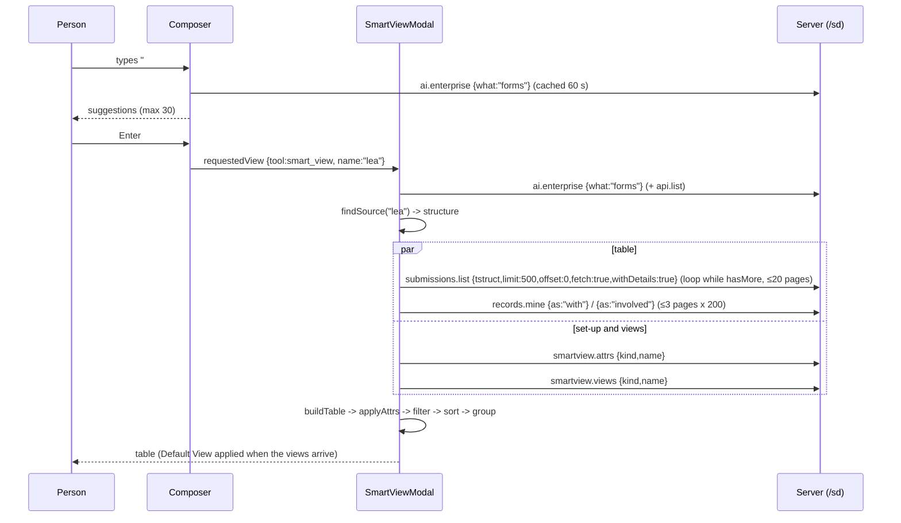
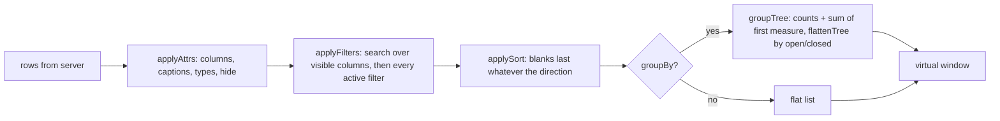
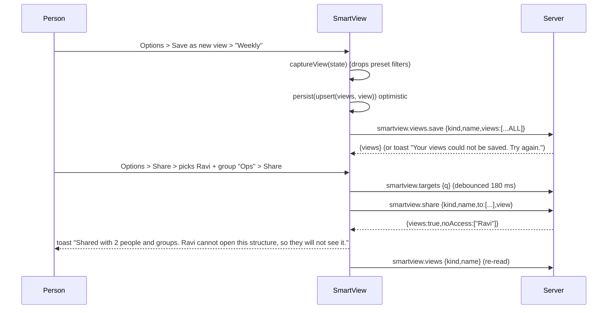

# Smart View for the mobile app: clone the web's Smart View exactly

**For:** the mobile team. **From:** the BE/Web side. **Written from:** the code of `dev` as of 16 Nov 2026 (`origin/dev` = `b2183507`; every file under `chat-app/features/smartView/`, `sd_smartview.erl`, `sd_svviews.erl`, `sd_svshare.erl`, `sd_svsheet.erl` is byte-identical on the branch this was written from). It is a documentation task: no application code was changed.

## 0. How to read this document

**Source tags.** Every statement carries one: `[code: path:line]` (paths are from `connectum/`), `[doc: file section]`, `[scenario: name]` (a test suite or script that exercises it) or `[UNSURE]`. `NOT BUILT` marks what the web does not have. Where a source line number is not given, the function or definition name is, and `grep` finds it in seconds.

**What was and was not verified (said plainly).**
- Everything below was read from the code. **No backend was run to write it** (the machine this was written on has no Redis and no `rebar3`), so **every JSON example in section 2 is RECONSTRUCTED from the code and the existing suites, not captured from a live run.** Each is marked `RECONSTRUCTED`. Section 6 gives the probe and the seed that produce the real ones on dev; please capture and diff them (that is acceptance test A0).
- The two scripts in section 6 (`tools/smartview-probe.mjs`, `tools/smartview-seed.mjs`) were syntax-checked (`node --check`) but **not run** against a backend.
- Where `docs/SMART_VIEW.md` and the code disagree, **the code wins** and the disagreement is listed in section 7.4 so nobody builds on the stale sentence.

**Words.** *Structure* = a form made in the builder (a "tstruct"); its answers are *records* (a record has a number, `id`). *Source* = what a Smart View opens: a structure or an API (a third and fourth kind are switched off, 1.4). *View* = a saved arrangement of the screen (search, filters, sort, grouping, columns), **not** data.

---

## 1. What Smart View is

### 1.1 In plain language
Smart View turns a **structure's records** (or an **API's rows**, or a spreadsheet from the person's device, or the person's open tasks and tickets) into **one table** that the person can search, filter, sort, group, chart, total, download, and save as named *views*. Opening a row opens the record in the structure's own form (to change it) or in a read-only form (to look). A person can also add records, delete their own, see a record's history, and share a *view* with colleagues. [doc: SMART_VIEW.md "What it does"]

**Who uses it:** everyone who is signed in. It adds **no permission of its own to see or change data** — what rows and which actions a person gets is the structure's own rules, decided by the server; the screen follows what the server says. The only new permission is `smartview.configure` ("Set up Smart views"), which lets someone set the **organisation-wide default** look of a source. [doc: SMART_VIEW.md "Changing records: the structure's own rules"; code: connectum-backend/src/people/sd_perm.erl:41]

**What the user sees from start to finish (web):**
1. Types `#view` (or `#view leave`) in the chat composer. A suggestion list shows what they may open.
2. A card opens inside My Workspace/the chat (compact), with **Expand** to the full-screen dialog.
3. Full screen: a **list of sources on the left** (Overview first), the chosen source as a **table** on the right, with KPI cards and charts above it *only if the source was set up to have them*, and a **footer bar** under the table with view tabs, the filter button and tool icons.
4. The person searches/filters/sorts/groups, saves a view tab, opens a row to read or edit the record, or downloads the table.

### 1.2 Where it lives in the web app
It is a **modal/dialog**, not a page or a tab. [code: chat-app/features/connectumChat/components/ChatModals.jsx:40 (`FULLSCREEN_MODALS` contains `"smart_view"`), :440 (`<SmartViewModal …/>`)]
- **Full screen modal** `SmartViewModal` (`modal === "smart_view"`). [code: ChatModals.jsx:440]
- **Compact card** inside the chat/My Workspace: the `#view` command sets `requestedView = {view:"tool", tool:"smart_view", param:{name}}`, which renders an `InlineAiCard` containing `SmartViewModal embedded`. **Expand** ("Open in the Smart view") opens the full modal on the same source. [code: chat-app/features/connectumChat/ConnectumChatScreen.jsx:1536-1546; chatActions/routeHashCommand.js:302-306]
- Relation to others: **My Workspace** hosts the compact card; **structures** are the main data source; **records/tickets** open in the structure's own form via host callbacks (`onEditRecord`, `onViewRecord`, `onAddRecord`, `onOpenThread`) — Smart View has no form of its own; **chats**: a record whose form has `recordThread: true` has a per-record conversation button; **Studio/Admin console**: an administrator can "Set up an API" from the card, and Customize (organisation default) needs `smartview.configure`. [code: SmartViewModal.jsx:20, :174; SmartView.jsx:640-644]
- A second, separate surface is the **Inbox** (`#inbox`, `HashInboxModal.jsx`), whose **Visualize** button opens Smart View on Tasks & tickets / Approvals / Reminders. `#view` and `#inbox` are two things. [doc: SMART_VIEW.md "`#view` and `#inbox` are two things"]

### 1.3 Every entry point

| # | Entry point | Exact behaviour | Who sees it | Source |
|---|---|---|---|---|
| E1 | `#view [name]` | Composer command. Aliases **`#smartview`** and **`#list`**. Arg `name` is type `source`, optional, `rest: true` (takes the rest of the line). `requires: "none"`, `available: true`. On send: `requestedView={view:"tool", tool:"smart_view", param:{name: rest\|\|""}}`. No name → the Overview pane. A name → `findSource` (exact match on name or caption, case-insensitive; else the first source whose name or caption **contains** it); no hit → the note "Nothing is called “X” that you can open." | everyone signed in (the *suggestions* are filtered per person) | [code: chat-app/features/connectumChat/data/hashCommandsCatalog.js:206-215; chatActions/routeHashCommand.js:33, 302-306; features/smartView/smartViewSources.js (`findSource`); SmartViewModal.jsx:32-40] |
| E2 | `#view ` suggestions | Read once a minute while typing (`listSources()`, cached 60 s in `sourcesRef`); **no server `/cmdcomplete` call**. Rules: only sources with `canFetch !== false`; `#list` shows structures only; a name that **starts with** the typed letters ranks before one that only contains them; then **structures a person made before built-in ones**, then server order; max **30** items. Each item: `value`=name, `label`=caption, `hint` = "your structure" / "built-in structure" / lower-cased kind label without trailing s ("api"), `sub` = "N fields" for structures. If exactly one item remains and its `value` equals the typed text, the list is empty so **Enter runs it**. | everyone | [code: Composer.jsx:83, 234-256, 414-437] |
| E3 | Card → **Expand** | Full modal opens on the same source with the left list **folded** (`opensFolded`: folded whenever a specific source is open; the Overview and plain list open unfolded). | everyone | [code: ConnectumChatScreen.jsx:1545; features/smartView/svLayout.js `opensFolded`; SmartViewModal.jsx:28] |
| E4 | Overview card (`ov-card`) | A card per openable structure; click opens that structure. | everyone | [code: StructureOverview.jsx:101] |
| E5 | Inbox → **Visualize** (folder or row) | Opens Smart View with `{kind, name, caption}` of `work` ("Tasks & tickets"), `approvals`, or `reminders`; with one structure picked in the Tasks & tickets "All kinds" list it opens **that structure's** own Smart View (`{structure: name}`). | everyone | [code: HashInboxModal.jsx:191; ChatModals.jsx:137; ConnectumChatScreen.jsx:1560] |
| E6 | File chip → **Open as a table** | In the file preview of a spreadsheet cell: opens that file as a table source (`kind:"file"`). | everyone | [doc: SMART_VIEW.md "Files in a cell: preview"; code: SmartView.jsx:792] |
| E7 | Hyperlink cell | A column set up as a link opens its target (a structure's single record, or another Smart View) **over** the current view (inline) or moves the window to it (non-inline; not possible in the chat card). | everyone | [code: SmartView.jsx:295-306] |
| E8 | "Open an Excel or CSV file" drop zone | Left list top (and in the compact picker): reads `.xlsx`/`.csv` **in the browser**, nothing sent until **Save**. | everyone | [code: SvOpenFile.jsx; SmartViewModal.jsx:159] |
| E9 | Deep links / URLs / push notifications | **NOT BUILT.** There is no URL, route or notification that opens Smart View; the only inputs are the `#` command and the Inbox buttons. `[UNSURE]` whether a mobile deep link is planned; none exists in the web. | — | [code: grep of `chat-app` for `smart_view` finds only the files in E1-E7] |

**What `#view` opens.** On the **source**, never on a saved view: it opens the source's table with `Default View` lit (the person's stored default, if they saved one, is applied once the views are read: `defaultOf(views)` → `viewState`). Nothing is pre-filtered (a `preset` filter exists only for hyperlink targets). Parameters: an API with parameters that have no default and no remembered value shows a form first. [code: SmartView.jsx:184-206]

### 1.4 What can be a source (switch)
| Kind | In the web today | Notes |
|---|---|---|
| `structure` | **ON** | the main case; includes "Your files" (structures with `fromSheet: true` the person owns) |
| `api` | **ON** | an API answering rows; `put` APIs are not offered |
| `work` | **ON, Inbox only** | Tasks & tickets; not in the left list, not reachable with `#view` |
| `approvals`, `reminders` | **ON, Inbox only** | lists built from `req.list` and `feed.list` |
| `file` | **ON, local** | spreadsheet opened from the device |
| `datasource` (Axpert), `list` (Connectum data source) | **OFF ("on hold")** | not listed, cannot be set up or hold views. One switch in two places: `SMART_VIEW_KINDS` and `?KINDS`. **Do not build them.** |

[code: features/smartView/smartViewAttrs.js:10-16; connectum-backend/src/forms/sd_smartview.erl:36; doc: SMART_VIEW.md "Where the rows come from"]

---

## 2. Data and API

### 2.0 Transport, envelope, errors, rate limits (applies to every command below)

- Commands are sent over the signed-in **WebSocket** as one text frame: `/sd <action> {json}`, with a `reqId` inside the JSON. The reply is `{"type":"sd","reqId":…,"ok":true,"data":…}` or `{"type":"sd","reqId":…,"ok":false,"error":{"code":…,"message":…}}`. [doc: CONNECTUM_API.md §2; code: tools/records-probe.mjs `openLink`/`call`]
- **Error codes seen on these commands:** `invalid`, `bad_request`, `forbidden`, `not_found`, `limit`, `rate_limited`. The message is meant to be shown to the person as written. [code: sd_smartview.erl, sd_svviews.erl, sd_svshare.erl, sd_cmds.erl:66-77]
- **Per-connection command limit: 30 commands per 10 seconds** (`CHAT_RATE_LIMIT_MAX` overrides the count; `/cmds`, `/cmdcomplete` have a bigger window of their own). When refused, the reply is the normal envelope with `error.code:"rate_limited"` and message "Too many commands -- slow down and retry." [code: connectum-backend/src/chat.hrl:13-14; http/chat_web_send.erl:393-436; core/sd_cmds.erl:66-77]
- **What the web does:** every Smart View call goes through `callRetrying`: on `rate_limited` it waits `1000 × (attempt+1)` ms and retries, **up to 4 retries**; any other refusal is the answer. Mobile must do the same or a table of many pages will stop half way. [code: smartViewSources.js:16-29]
- Other limits that affect Smart View: `api.run` 120 per 60 s per person (`rate_limited` "Too many calls; wait a minute."); `records.summary` budget 1500 ids a minute per person. [code: core/sd_cmds_forms.erl:437; doc: CONNECTUM_API.md "records.summary"]
- All data is read **as the signed-in person**: the server applies the structure's rules; the client never filters by permission.

### 2.1 Command catalogue (what Smart View calls)

| Command | Level | Used for | Source |
|---|---|---|---|
| `ai.enterprise {what:"forms"}` | user | the list of structures a person may open, with fields and flags | [code: core/sd_cmds.erl:494-528] |
| `api.list` / `api.run {name, values, limit, refresh?}` | user | API sources | [code: core/sd_cmds_forms.erl:434-441] |
| `submissions.list {tstruct, limit, offset, fetch:true, withDetails:true}` | user | a structure's records | [code: core/sd_cmds_forms.erl:122-136; forms/sd_config.erl:1117-1145] |
| `records.mine {as: with\|raised\|involved\|team\|all, limit, offset}` | user | records that name the person; Tasks & tickets | [code: core/sd_cmds_forms.erl:364; forms/sd_actions.erl:1051-1069] |
| `submission.history {id}` | user | one record's history panel | [code: core/sd_cmds_forms.erl:315-330] |
| `submissions.delete {id}` | user | delete one record | [code: core/sd_cmds_forms.erl:157-167] |
| `tstruct.user.get {name}` then `tstruct.get {name}` | user | a structure's full definition (for add/edit scope and Show hidden fields) | [code: smartViewSources.js:125-132] |
| `smartview.attrs {kind,name}` | user | what this person sees as the set-up of a source | [code: core/sd_cmds.erl:687-691] |
| `smartview.attrs.save {kind,name,metadata,hyperlinks,kpis,charts}` | user | the person's OWN set-up | [code: sd_cmds.erl:693-697] |
| `smartview.attrs.delete {kind,name}` | user | drop own set-up | [code: sd_cmds.erl:699-703] |
| `admin.smartview.save {…}` / `admin.smartview.delete {kind,name}` | needs `smartview.configure` (prefix rule) | the organisation default | [code: core/sd_cmds_admin.erl:818-842; people/sd_perm.erl:54] |
| `smartview.views {kind,name}` | user | own views + shared views of a source | [code: sd_cmds.erl:705-710] |
| `smartview.views.save {kind,name,views}` | user | replace the person's whole list of views | [code: sd_cmds.erl:728-732] |
| `smartview.targets {q}` | user | whom a person can share with | [code: sd_cmds.erl:716; forms/sd_svshare.erl:14-31] |
| `smartview.share {kind,name,to,view}` | user | share a view with people/groups | [code: sd_svshare.erl:36-49] |
| `smartview.shares {kind,name}` / `smartview.unshare {kind,name,type,id}` / `smartview.view.unshare {kind,name,id}` | user | see / take back | [code: sd_cmds.erl:719-726; sd_svshare.erl] |
| `admin.smartview.view.publish {kind,name,view}` / `…unpublish {kind,name,id}` | needs `smartview.configure` | views for everybody who opens a source (**no UI uses it on the web**, 7.4) | [code: sd_cmds_admin.erl:826-836] |
| `smartview.sheet.save {caption, columns, rows}` / `smartview.sheet.delete {name}` | user | save/delete a spreadsheet as the person's own structure | [code: sd_cmds.erl:711-714; forms/sd_svsheet.erl] |
| `req.list {status:"all"}`, `req.respond`, `feed.list`, `feed.read`, `broadcast.list` | user | the Inbox lists only | [code: smartViewSources.js:136-196] |
| `records.summary {ids}`, `record.actions`, `status.update`, `record.send` | user | record actions / list-row summaries (not called by the web's Smart View table; relevant to mobile, section 5.2) | [doc: CONNECTUM_API.md "The `record` summary"; RECORD_ACTIONS.md] |

### 2.2 `ai.enterprise {what:"forms"}` — the list of sources (structures)

Request: `{"what":"forms"}` (the default). `what:"people"` is administrator-only and not used by Smart View.
Response (RECONSTRUCTED from `sd_cmds.erl:494-528`):
```json
{ "forms": [ {
  "name": "leave_request", "caption": "Leave Request", "keyField": "reqno",
  "owner": "ann", "fromSheet": false, "system": false,
  "canFetch": true, "canAdd": true, "recordThread": false,
  "status": { "field": "stage", "statuses": ["Open","In progress","Closed"], "final": ["Closed"] },
  "fields": [ {"name":"title","caption":"Title","type":"text","section":"main"} ],
  "sections": [ {"name":"main","caption":"Details","grid":false} ] } ] }
```
- `fields[]` carries only `name, caption, type, section, rich`. **Hidden fields (`hidden: true`) are left out for everyone** (and the four fields a status keeps: `<field>_comments|_completion|_files|_hours`). [code: sd_cmds.erl:517-519]
- `system:true` = a form Connectum keeps itself (branches, employees…): listed after the person's own; **no Add and no Delete** on it. `canFetch:false` = a fetch rule this person does not meet → leave the source out of lists and suggestions. `canAdd` = may enter records ("Enter records" rule). `fromSheet:true` + `owner == me` = "Your files". [code: sd_cmds.erl:505-516; smartViewSources.js:48; 147]
- `status` is `null` for a structure with no status dropdown; `final` = statuses that end a record. [code: sd_cmds.erl:513]
- The list is **exactly the structures the person may open** (`sd_smartview:openable_structures/1` = `sd_config:visible_tstructs/1`). Ordering on the web: not-system first, then caption A→Z (`localeCompare`). [code: sd_smartview.erl:23; smartViewSources.js:42]
- Live: re-read when `tstructs_changed` or `resync` arrives. What is open is re-read **only if its definition changed** (`sameStructure`: caption, keyField, fields, sections); if it was removed the window goes to the Overview and says `Nothing is called “X” that you can open.` [code: SmartViewModal.jsx:47-72; svStructure.js `sameStructure`]
- If one of the four parts of `listSources` fails it is left out and named in `failed` (`"Structures"`, `"APIs"`…): the picker then says "<names> could not be read just now." with Try again, instead of looking empty. [code: smartViewSources.js:32-42; SmartViewCompact.jsx]

### 2.3 `submissions.list` — a structure's records

Request (what the web sends): `{"tstruct":"leave_request","limit":500,"offset":0,"fetch":true,"withDetails":true}`.

| Field | Type | Rule | Source |
|---|---|---|---|
| `tstruct` | string | narrows to one structure (case-insensitive key) | sd_config.erl:1118 |
| `limit` | int | clamped **1–500**, default 500 | sd_config.erl:1126 |
| `offset` | int | clamped **0–100000** (the `fetch` "all" path allows up to 1,000,000) | sd_config.erl:1127; sd_recfetch.erl:261 |
| `fetch` | bool | `true` = a programme pulling the structure's records: **the structure's fetch rule applies** | sd_cmds_forms.erl:123-128 |
| `withDetails` | bool | adds `files` and `labels` to each record **and `canEdit`** | sd_cmds_forms.erl:130-134 |
| `recordsOnly`, `window`, `ref` | — | exist; **not used by Smart View** | sd_config.erl:1122-1136 |

Response (RECONSTRUCTED):
```json
{ "submissions": [ {
    "id": 41, "tstruct": "leave_request", "by": "ann", "byName": "Ann Rao", "ts": 1763300000000,
    "status": "approved",              // approval: pending | rejected | approved | absent = recorded
    "holder": "bob", "claimants": [], "completion": 40,
    "values": { "title": "Fever", "stage": "Open", "days": 3 },
    "labels": { "stage": "Open", "owner": "Bob Rao" },                     // names of chosen options/people
    "files":  { "doc": [ {"id":"<24hex>","name":"Invoice 1.pdf","mime":"application/pdf","size":2048} ] },
    "canEdit": true } ],
  "total": 1234, "offset": 0, "limit": 500, "hasMore": true,
  "structures": { "leave_request": { "caption":"Leave Request", "fields": {"title":"Title"} } } }
```
- **Paging:** loop `offset += 500` while `hasMore`; the web stops after **20 pages (10,000 records)**; `total` is the server's count; if `total > records read` the table shows "Showing the first N of M rows. Filter to narrow it down." Use `hasMore`, **never `offset+items`**, to continue (`records.mine` uses `next`). [code: smartViewSources.js:76-91; SmartView.jsx:578]
- **Sort/filter/group/search/aggregate are NOT server side** for a structure: the server returns newest first; everything else is client work on the fetched rows (section 5.1).
- `canEdit` is only present with `withDetails:true` and means: the author or whoever the data-access rules let change it, while not locked for approval, in a normal structure. `submissions.update` asks again. [code: sd_cmds_forms.erl:133; doc: SMART_VIEW.md "Changing records"]
- Whose records: the person's own; **direct reports'** (the team rule; read-only; a form with `hideFromManagers` is left out); plus, merged by the client, records that **name the person** via `records.mine` (`as:"with"` and `as:"involved"`, 3 pages of 200 each, only this structure, deduplicated by `id`, **never throws** — a failure leaves the table as it was). The merged list is re-sorted newest first (`ts` desc). [code: smartViewSources.js:99-120; doc: SMART_VIEW.md "Whose records a table holds"]
- `files` keys are the field name, or `"<section>.<row>.<field>"` for files inside a grid row. File ids are 24 hex characters (`^[a-f0-9]{24}$`); anything else is not a file. [code: svStructure.js `FILE_ID`, `fileValue`]

### 2.4 `records.mine` — records that name the person; Tasks & tickets; Team

Request `{"as":"with","limit":100,"offset":0}`. `as`: `with` (default; open records with the person), `raised` (made by them, with someone else or waiting), `involved`, `team` (direct reports' open records), `all` (**administrators only**: every open ticket; anyone else silently gets `with`). `limit` default 100, max 200; `offset` 0–1,000,000. [code: sd_actions.erl:1049-1069]
Response: `{submissions, structures, total, hasMore, next}`; for `as:"team"` also `reports` (number of direct reports) and each item carries `team:{members, via:[holder|sent|claimant|raised]}`. Continue with `next`. `team` records are **read only**. [code: sd_actions.erl:1064-1068; doc: CONNECTUM_API.md `records.mine {as:"team"}`]

**Tasks & tickets (`kind:"work"`)** = union, deduplicated by record id, of `with`, `raised`, `all` (page 100 each, one page) plus `loadVisibleOpen`: for up to **30** non-system structures that have a `status`, `submissions.list {tstruct, fetch:true, limit:200}` in batches of 4, keeping records whose tone is not `done`. It is re-read on events matching `/^(task_|ticket_|submissions?_|resync)/`. Columns: **No., Title, Form, Status, Progress, With, Raised by, Raised**. `Title` = the record's first short text answer (≤120 chars, not the status or its companions) else `"<form> #<id>"`. [code: smartViewSources.js:243-268; workItems.js:20-46, 72; svWork.js]

### 2.5 `submission.history {id}`

Request `{"id":41}`. Response `{events:[{op, ts, by, to?, fromStatus?, toStatus?, completion?, reason?, remarks?, files?, approvers?}], names:{username:name}, files:{id:{id,name,size,mime}}, caption, fields:{field:caption}, …}` — **oldest first**; the web reverses it. Whoever may open the record may read it. [code: sd_cmds_forms.erl:315-330; smartViewSources.js:237-240; svHistory.js `historyRows`]
Rendering words (`eventWord`): `created→Created, edited→Changed, deleted→Deleted, sent→Sent, status→Status updated, approved→Approved, declined→Declined, returned→Returned, submitted→Submitted, printed→Printed, posted→Posted, handed→Handed on, notified→Notified, resubmitted→Sent again`; any other `op` is capitalised with `_`/`-` turned into spaces. Percent is rounded and clamped 0–100. Note = `reason · remarks`. [code: svHistory.js:5-21]
Live: the open panel re-reads on events matching `/^(task_|ticket_|record_|submission|resync)/`.

### 2.6 `api.list` / `api.run` — API sources

`api.list` → `{apis:[{name, caption, type: list|get|put, cacheSec, params:[{name, default}], columns, description}]}`; `put` APIs are never offered. `api.run {name, values:{param:value}, limit:500, refresh?:true}` → `{columns, rows, total, truncated, refreshedAt, cached, origin, store, cacheSec, expiresAt, via}`. The server **cuts at 500 rows** and the screen says so. Timeout on the web: 60 s. Column kinds are inferred client-side from up to 200 values (section 5.1). [code: smartViewSources.js:42-46, 270-280; doc: SMART_VIEW.md "An API"]

### 2.7 Set-up ("Smart view attributes"): `smartview.attrs*`

**Meaning.** A source can be *set up* so its Smart View shows chosen **columns, links, KPI cards and charts**. A source nobody set up is a **plain table: no KPI cards, no charts**. (Only the Inbox lists compute their own cards.) [doc: SMART_VIEW.md "Smart view attributes"]
**Two layers.** (1) the **organisation's** set-up (`sd:svattrs`, key `"<kind>:<name>"` lower-case), written only with `smartview.configure` via `admin.smartview.save`; (2) the **person's own** set-up (`sd:svattrs:mine`, key `"<username>|<kind>:<name>"`), private — **nobody else, an administrator included, can read it**. A person sees **their own if they made one, else the organisation's**. [code: sd_smartview.erl:1-20, 84-90]

`smartview.attrs {kind,name}` → (RECONSTRUCTED)
```json
{ "attrs": { "kind":"structure","name":"leave_request",
    "metadata":[{"field":"days","caption":"Days","type":"Numeric","hide":false,"key":false,"filter":true,"sourceForm":"","sourceField":""}],
    "hyperlinks":[{"field":"employee","type":"tstruct","target":"employee","mappings":[{"from":"employee","to":"name"}],"inline":true}],
    "kpis":[{"caption":"Total days","agg":"sum","column":"days"}],
    "charts":[{"caption":"By stage","chart":"donut","groupBy":"stage","agg":"count","column":""}],
    "updatedBy":"ann","updatedTs":1763300000000,"createdTs":1763200000000 },
  "mine": false, "canConfigure": true, "canDefault": false }
```
`attrs` is `null` when nothing is set up (**not an error**). `canConfigure` is always `true` (everyone customizes their own); `canDefault` = holds `smartview.configure`; `mine` = what is returned is the person's own. [code: sd_cmds.erl:687-691]

**Schema and every allowed value** [code: sd_smartview.erl:36-46, 111-239]:
- `kind`: for the organisation set-up `structure` | `api`. For a person's own: `structure` | `api` | `file` | `work`.
- `name`: trimmed, 1–120 chars, no control characters; keys are case-insensitive.
- `metadata[]` (max **200**; a field named **once**, case-insensitive; "Metadata: "x" is listed twice."): `field` (1–80), `caption` (1–120), `type` ∈ **`Character | Numeric | Date | Boolean | File`**, booleans `hide`, `key`, `filter`, `sourceForm` (≤120, optional), `sourceField` (≤80, optional).
- `hyperlinks[]` (max **50**): `field` (1–80, must be in metadata), `type` ∈ **`tstruct | smartview`** (UI labels "Load structure" / "Load from API"), `target` (1–120), `mappings[]` (max **10**; `{from: a metadata field of this view, to: the target's field}`), `inline` bool.
- `kpis[]` (max **30**): `caption` (1–80), `agg` ∈ **`sum | avg | min | max | count`**, `column` (≤80; **required unless `agg:"count"`**).
- `charts[]` (max **30**): `caption` (1–80), `chart` ∈ **`line | bar | stacked-bar | column | stacked-column | stacked-percentage-column | area | pie | semi-donut | donut | stacked-group-column | scatter-plot | funnel`** (13), `groupBy` (1–80, in metadata), `agg` as above, `column` as above.
- Every column named in hyperlinks/kpis/charts must be a `field` in `metadata`: error `Charts, line 2: "x" is not in the metadata. Add it there first.` Errors use the pattern `<List>, line <n>: <message>` with code `invalid`.
- Unknown columns at display time are **skipped, never an error** (a changed source never breaks the view).

**Web UI today ("Customize View").** Only the **Cards** and **Charts** tabs are on; **Columns** and **Links** editors exist but are commented out of `TABS`. What was saved for columns/links earlier **still applies**. With Columns off, the metadata is filled from the source's own columns when a card or chart is saved. Footer: `Reset` (only if the person has their own), checkbox **"For everyone"** (only with `smartview.configure`, never for `file`/`work`), `Cancel`, `Save` ("Saving…"). Toasts: `Saved`, `Saved as the default for everyone`. [code: SvConfigure.jsx:19-24, 45, 77, 87, 165-176]

### 2.8 Saved views: `smartview.views`, `smartview.views.save`

**Where stored.** Redis, never the device: `sd:svviews` hash, key `"<username>|<kind>:<source>"` lower-case → `{views:[…]}`; `sd:svshared` hash, key `"<kind>:<source>"` → `{views:[…]}`. They follow the person to any device. [code: sd_svviews.erl:1-6]
**Which source kinds may hold views:** `structure`, `api`, `approvals`, `reminders`, `file`, `work`. [code: sd_smartview.erl:70]

`smartview.views {kind,name}` → `{mine:[view], shared:[view], canPublish}` (`canPublish` = holds `smartview.configure`). RECONSTRUCTED:
```json
{ "mine": [ {"id":"__default","name":"Default View","search":"","filters":[],"sort":null,"groupBy":[],"hidden":[],"order":[],"widths":{},"kpis":true,"charts":true},
            {"id":"1763300000001","name":"Open by status","search":"","filters":[{"col":"stage","op":"not","value":"Closed"}],"sort":{"col":"On","dir":"desc"},"groupBy":["stage"],"hidden":["By"],"order":[],"widths":{"title":320},"kpis":true,"charts":false} ],
  "shared": [ {"id":"s1763300000999","name":"Weekly","by":"ann","mine":false, "...":"same fields as a view"} ],
  "canPublish": false }
```
**The view schema** — the server keeps **only these keys**, each bounded [code: sd_svviews.erl `clean_view`, `id`, `names`, `filters`, `sort`, `widths`]:
| Key | Type / rule |
|---|---|
| `id` | `^[A-Za-z0-9_-]{1,40}$`. `"__default"` = the person's Default View (no tab of its own). Web makes new ids `String(Date.now())`; shared ones are `"s<ms>"`. |
| `name` | trimmed, 1–40 chars, no control characters |
| `search` | ≤200 chars (bad → `""`) |
| `filters` | ≤**30** objects, each ≤2000 bytes as JSON (anything else dropped). Each is `{col, op, value, preset?}` — the server does **not** validate `op`; the web's ops are in 5.1. `preset:true` ones (brought by a hyperlink) are **never stored** (`captureView` drops them). |
| `sort` | `{col, dir:"asc"\|"desc"}` or `null` |
| `groupBy` | ≤**5** column keys (web may store several; the first is the outer group). Older views stored a single string — read both. |
| `hidden` | ≤300 column keys left out |
| `order` | ≤300 column keys (shown order) |
| `widths` | map key→px, **48–1200** on the server (the web clamps 64–800), ≤300 entries |
| `kpis`, `charts` | booleans, default `true` ("whether the cards/charts show") |
| (shared only) `by`, `to`, `mine` | `by` = who shared; `to` = audience (never sent to viewers); `mine` = computed per reader |
A view over **16,384 bytes** → `invalid` "That view is too big to keep." Max **20** named views per person per source **plus** the Default View. [code: sd_svviews.erl:14-17, 241-290]

`smartview.views.save {kind,name,views:[…]}` **replaces the person's whole list** (send everything, not a delta). Returns `{views}`. Duplicates: one id once, one name once (case-insensitive; **the later one wins**). Errors: `invalid` "At most 20 views." / "views must be a list." / "A view needs an id (letters, digits, - and _, up to 40)." / "A view needs a name of 1 to 40 characters." / "Which data source? kind and name are required." [code: sd_svviews.erl:229-260]
**Web behaviour:** state is updated optimistically (`persist`), then saved; a failed save toasts `Your views could not be saved. Try again.` (no rollback). Name taken by Default View → `That name is taken by the Default View. Choose another.` Empty name → `Give the view a name.` The first time a source opens, views kept by an **older web version** in `localStorage` are uploaded and the local copy removed. [code: SmartView.jsx:452-467; smartViewSources.js:305-317] **Mobile has no old local views: ignore this migration.**
**Auto-made views.** When a person **creates** a structure with `tstruct.user.save` (`sd_cmds_forms.erl:234`; **not** for administrator-made structures), `sd_svviews:seed` fills their views *only if they have none*: status field → **"Everything open"** (`id auto-open`, filter status ≠ each final) and **"Open by status"** (`auto-by-status`, same + group by status); first single-choice list field → **"By <caption>"** (`auto-by-choice`); first date field → **"Newest first"** (`auto-newest`, sort desc). Never raises. [code: sd_svviews.erl:96-139]

### 2.9 Sharing: `smartview.targets`, `smartview.share`, `smartview.shares`, `smartview.unshare`, `smartview.view.unshare`

- **Meaning:** a person shares the **arrangement** (a view) of a structure or API with chosen people/groups; it appears to them as a tab. **It gives no record**: they see only what the structure lets them. There are no Read/Add checkboxes. [code: sd_svshare.erl:1-8; SvShare.jsx:5-8]
- `smartview.targets {q}` → `{people:[{type:"user",id,name,detail}], groups:[{type:"group",id,name,detail:"N members"}]}`: people = the colleagues the person may talk to (`users.colleagues`, limit **8**); groups = groups they are in (never `general`), max **6**, filtered by `q`. Web debounces **180 ms** after typing (0 ms on open); newest answer wins. [code: sd_svshare.erl:14-31; SvShare.jsx:31-37]
- `smartview.share {kind,name,to:[{type:"user"|"group",id}],view:{…}}` → `{views:true, noAccess:["Display Name",…]}`. Rules: the sharer must be able to open the source themselves (`sd_smartview:may_open`: a structure only if it is in `openable_structures`; else `forbidden` "You can only share what you can open yourself."); `to` 1–**50** else `invalid` "Choose at least one person or group." / "Share with at most 50 people or groups at a time."; each user must exist and not be the sharer; each group must be one the sharer is in, else `invalid` "Someone you chose cannot be shared with (a person who is not in the organisation, yourself, or a group you are not in)."; **the Default View cannot be shared** (`invalid` "The Default View cannot be shared; save it as a view with a name first."); max **20** shared views per source (`limit` "There are already 20 shared views. Remove one first."). Sharing the same name again from the same person **adds** the new audience. `noAccess` names recipients (a group counts for up to 200 members) who cannot open the source; **the share is kept** and appears if access is granted later. [code: sd_svshare.erl:36-98; sd_svviews.erl:43-70]
- Visibility rule when reading (`shared_for`): a shared view is returned to a reader only if they **can open the source** (else the list is `[]` — silently, **not** `not_found`), and they are the sharer, **or** the view has no audience (published for everyone), **or** they are named, **or** in a named group. The reader is never told who else it was shared with. [code: sd_svviews.erl:66-92]
- `smartview.shares {kind,name}` → `{shares:[{type,id,name,canOpen?}]}` (what *this person* shared; `canOpen:false` for a person who now cannot open the source → the dialog says `Cannot open this <structure|API>`). `smartview.unshare {kind,name,type,id}` removes one person/group from the person's shared views (a view left with nobody goes) → `{unshared:true}`. `smartview.view.unshare {kind,name,id}` → `{shared:[…]}`; `not_found` "No such shared view of yours." if it is not theirs. [code: sd_cmds.erl:719-726; sd_svshare.erl:101-117; sd_svviews.erl:118-134]
- **Published views** (`admin.smartview.view.publish`): a holder of `smartview.configure` copies a view to everybody (no audience). **The web has no button that calls it** (`publishView` is exported and unused); `shared[]` published this way is still returned and shown as tabs. [code: smartViewSources.js:331-332 unused by any component; sd_svviews.erl `publish/4`] → treat as **NOT BUILT in the UI; server-ready**.

### 2.10 `smartview.sheet.save` / `smartview.sheet.delete` (spreadsheet → the person's own structure)

`smartview.sheet.save {caption, columns:[{name, type:"text"|"number"|"date"}], rows:[[value,…]]}` → `{name, caption, added, failed}`. Limits: **60 columns, 2,000 rows**; each row is saved by the structure's own call, so a row it refuses counts in `failed`. The structure is named `sheet_<file as identifier>` (a number added while taken), owned by the person, `fromSheet:true`. Web timeout 120 s. `smartview.sheet.delete {name}` → `{deleted, rows}` removes rows (including rows others added), the structure, grants, **everybody's views and set-up** and its record history; only for the person's own saved file. [code: sd_svsheet.erl:1-16, 45-66; smartViewSources.js:319-324] The **client reads the file** (`.xlsx`/`.csv`, comma/semicolon/tab, BOM ok, first sheet, first non-empty row = header, **≤20 MB, ≤50,000 rows**; empty header → "Column N", repeats numbered, an empty column dropped; number/date only when all values read so; phone numbers and leading-zero codes stay text). [doc: SMART_VIEW.md "Open your own Excel or CSV file"; code: svFileSource.js]

### 2.11 Live events that update an open view

| Event (`sd_event`) | Payload (relevant) | Who gets it | What the web does |
|---|---|---|---|
| `submissions_changed` | `id, tstruct, action (created/updated/deleted/Taken/renamed/approved/rejected/…), by, record?` | submitter, host, admins, holders, previous holder, actor | structure table: **quiet re-read** (`run(values,false,true)`) |
| `submission_approved`, `submission_rejected` | `tstruct?` | the approver/people told | same |
| `ticket_assigned` | `id, tstruct, action (Send/Update status/Reassigned), by, record` | the person it is now with | same; Inbox lists re-read |
| `tstructs_changed` | `scope, name, action, by` | everyone connected | re-read the source list; see 2.2 |
| `task_assigned`, `task_updated`, `submission_notice` | — | the person | Tasks & tickets / Approvals re-read |
| *(reconnect)* `status_change: connected` → the client synthesises **`resync`** | — | — | **re-read everything** (events sent while offline are lost) |

- The client **coalesces bursts to one handler call per ~150 ms**. A structure's table reacts when `recordsChanged`: event is `resync`, or one of `submissions_changed / submission_approved / submission_rejected / ticket_assigned` whose `tstruct` is absent or equals this structure (case-insensitive). [code: chat-app/features/connectumChat/utils/useLiveChanges.js:6-45; svStructure.js `recordsChanged`; SmartView.jsx:207-212]
- The `data.record` summary (`{status, holder, claimants, completion, final, ts, by}`) **is already on `submissions_changed` and `ticket_assigned`** for people who may read the record; **the web's Smart View does not use it** (it re-reads the whole table). Mobile can. [doc: CONNECTUM_API.md "The `record` summary"; code: SmartView.jsx:212]
- A 30-second timer re-renders the "updated N min ago" text only; it reads nothing. [code: SmartView.jsx:207]

### 2.12 Other commands the table calls
- `submissions.delete {id}` → `{deleted:true}`. Rule: the **author of the record or the owner of the structure**; the server asks again and refuses in its own words (a record waiting for approval or approved, for one). The web calls it **once per record, 350 ms apart, at most 200 per go**. [code: sd_cmds_forms.erl:157-167; svDelete.js:8, SmartView.jsx:344-359]
- `tstruct.user.get {name}` → `{tstruct}` (scope `"user"`); else `tstruct.get {name}` (scope `"admin"`); neither → throws "This form is not available to you." The definition's `scope` tells the host which form to open. [code: smartViewSources.js:125-132]
- Add a record: `withDefinition` (above) then `onAddRecord(source, scope)`; **Add shows only when `canAdd` and the host supplied `onAddRecord`**. [code: SmartView.jsx:219-220, 317-324]

### 2.13 Scoping and visibility
- One signed-in **session belongs to one organisation (enterprise)**; every command above works inside it and every key is namespaced `e:<enterpriseid>:…`. A person in several organisations enters one at a time (MULTI_ENTERPRISE.md); **switching organisations = a new session = discard all Smart View state and re-read**. Smart View itself has no organisation selector. [doc: MULTI_ENTERPRISE.md; code: tests/lib/harness.mjs `ek`]
- **No access:** a structure the person may not open is simply **not in `ai.enterprise`**; one they may open but whose fetch rule they do not meet comes with `canFetch:false` (the web leaves it out of lists and suggestions). A view shared to a person who cannot open the source is **not returned** (empty `shared`, no error). `submission.history` / `submission.get` on a record the person may not open returns an error (`not_found`/`forbidden`) `[UNSURE which — see section 7.3]`. `smartview.attrs` of an unknown/unopenable source returns `attrs:null` (**not** an error). [code: sd_svviews.erl:66-74; sd_cmds.erl:687; connectum_smartview_test.mjs "Reading"]
- **Hidden fields:** see 7.4 item 1 (the single most important disagreement).

### 2.14 Limits table

| Thing | Limit | When hit, the web | Source |
|---|---|---|---|
| Rows read per structure | 500/page × **20 pages = 10,000** | note "Showing the first N of M rows. Filter to narrow it down." | smartViewSources.js:76-91 |
| API rows | server cuts at **500** | note + `truncated` | smartViewSources.js:270; doc |
| `records.mine` merge | 3 pages × 200 per kind (`with`, `involved`) = 600 each | silent | smartViewSources.js:99 |
| Tasks & tickets | 30 structures, 4 at a time, 200 each | silent | smartViewSources.js:251-268 |
| Columns shown | none fixed; metadata ≤200; view `hidden`/`order` ≤300; widths ≤300 | — | sd_smartview.erl:43; sd_svviews.erl |
| Filters per view | **30**, each ≤2000 B | extra dropped by the server | sd_svviews.erl `filters/1` |
| Group levels in a view | **5** | extra dropped | sd_svviews.erl `names(…,5)` |
| Named views | **20** + Default; shared **20**/source | "At most 20 views." / "There are already 20 shared views…" | sd_svviews.erl |
| One stored view | 16,384 bytes | "That view is too big to keep." | sd_svviews.erl:15 |
| Search text in a view | 200 chars | cleared to `""` | sd_svviews.erl |
| KPI cards / charts per source | 30 each; metadata 200; links 50; mappings 10 | `<List>, line n: …` or "… can have at most N lines." | sd_smartview.erl:43-46 |
| Chart groups | **40** biggest (date charts: in date order) | card says when more were left out (`more`) | smartViewEngine.js:6; smartViewAttrs.js `definedChart` |
| Delete in one go | **200**, 350 ms apart | rest stay ticked | svDelete.js:8 |
| Share targets | 50 per call; targets list 8 people + 6 groups | message | sd_svshare.erl |
| File cells | 20 files per cell; inline image ≤2,000,000 chars | extra ignored | doc: SMART_VIEW.md "Files inside the rows" |
| Spreadsheet open | 20 MB, 50,000 rows; **save** 2,000 rows / 60 columns | plain-words refusal / counted `failed` | doc; sd_svsheet.erl:14-15 |
| Column type inference | first **200** values | — | smartViewEngine.js:55-79 |
| Download report | PDF ≤20 table pages, PPTX ≤6 slides, 12 rows/page | toast "The table shows the first N rows; Excel has all of them." | SmartView.jsx:434-446 |
| Command rate | 30 / 10 s per connection | auto retry ×4 | chat.hrl:13-14 |
| History panels open | 4 at once (opening a 5th closes the oldest) | — | SmartView.jsx:55 |
| Caching | `#view` suggestion list 60 s; API answers per the API's `cacheSec`; `refresh:true` bypasses | Refresh icon = `run(values, true)` | Composer.jsx:419; SmartView.jsx:730 |
| Timeouts | 30 s lists/records; 60 s API and big isource; 15 s views/attrs/share; 120 s sheet save/delete | error text + **Try again** | smartViewSources.js |

---

## 3. The exact user interface of the web

> The web's own look is the **design pack** (`docs/THEME.md`, `docs/UI_DESIGN.md`, `docs/LIQUID_GLASS_STYLE_GUIDE.md`): **one light theme**, no dark mode, tokens only. The mobile team's design pack is what the web already uses (commit `932b54e1`). Icons are **Material Icons** (names given below).
>
> **Screenshots:** none are included (no browser session was run). Each state is described exactly instead; `tools/ui-audit/smartview-fields.e2e.mjs` takes pictures of the main states (`SHOTS=<folder>`) if you want them. `[UNSURE]` = could not be confirmed without rendering.

### 3.1 Screen inventory (every screen the web has for it)
1. **Composer** `#view` suggestion menu (E2).
2. **Compact card** in the chat: source picker, then one table (`SmartViewCompact`).
3. **Full-screen modal**: header + left list + main pane.
4. **Overview** pane (`StructureOverview`).
5. **Table screen** (`SmartView`): title bar, KPI strip, notes, charts, table (or one record card), footer.
6. **Parameters form** (API with parameters).
7. **Dialogs** (`SvDialog`): Select Fields (Columns), Group By, Save as new view / Save as my own view / Save this file (`NameDialog`), Share, Customize View, Filters panel (inline popover), chart "make it big", file preview, an opened link.
8. **Record history panel** under a row.
9. **Confirm dialogs** (`confirmDialog`): delete records, remove view, stop sharing, delete file.
10. **Empty / error / loading** states of the above.

### 3.2 Composer suggestion menu — see E2. Item = `label` (caption), `hint`, `sub`. Escape/Enter per the command menu (shared with other `#` commands). Typing `#view ` opens it; the whole name typed → no menu, Enter runs.

### 3.3 Full-screen modal (`SmartViewModal`)
- **Header** `connectum-modal-header`: left a button, then a title block, right a **×** close (`aria-label="Close"`).
  - Left button: when a source is open **directly** (no list): `arrow_back` "Back to the list". When the list layout is shown: the **menu toggle** (`menu_open` / `menu`) with `aria-label` **"Hide the list of sources" / "Show the list of sources"**, `title` "Hide the list" / "Show the list of structures and APIs", `aria-expanded`. Otherwise the TStruct badge icon.
  - Title `<h3>`: the open source's `caption`, or **"Smart view"**. Subtitle: the kind in singular ("Structure", "Api"…), or **"Your structures and data as KPI cards, charts and tables"**.
- **Body**, three states: loading → centred spinner (`autorenew`, class `sv-spin`) + **"Looking for what you can open…"**; the list layout; or the table when a source is chosen directly.
- **List layout** (`sv-inbox`): a **left list** (`<nav aria-label="What to look at">`) + a drag **resizer** + the **main pane**. Width remembered in `localStorage connectum.sv.navw` (200–520 px; drag, **←/→ 16 px**, Home/Escape/double-click = reset); the resizer is hidden ≤760 px.
  - Left list top→bottom: **"Open an Excel or CSV file"** drop zone (icon `upload_file`; "Reading…" while busy (`hourglass_top`); compact variant has no sub-line; errors: "That file is bigger than 20 MB." etc.), a **Find** search (`search` icon, placeholder/aria **"Find"**), an optional note `Nothing is called “X” that you can open.`, then groups:
    - **Overview** item (`space_dashboard`) — only when not searching.
    - Groups by kind with a small caps title and a count: **"Work"**, **"Your files"**, **"Structures"**, **"Data sources"**, **"APIs"**, **"Connectum data sources"** (`KIND_LABEL`; empty groups hidden). A structure made from a saved file is listed under **Your files**, not Structures. Item = icon (TStruct icon for structures; `api`, `table_view`…) + caption, `title` = caption, the active item highlighted (`aria-current`). **Your files** items have a **delete icon** (`delete_outline`, "Delete the file X", visible on hover/focus).
    - If there are no APIs: the **APIs** group shows `0` and **"None set up yet."**; `sources.length === 0` → **"Nothing else you can open as a table yet."**; search with no hit → **"Nothing matches."**
  - On ≤760 px the list is a **row above the table** (max height 34vh) and folds the same way.
- **Main pane:** the Overview, or a table (`SmartView`, keyed by `kind:name:preset` so a new source starts clean), or a spinner.
- **Escape / focus:** dialogs trap Tab, Escape closes the top one, focus returns to the opener. [code: SvDialog.jsx]

### 3.4 Compact card (`SmartViewCompact`)
- Picker: the Open-file drop zone, search **"Find a structure or API to view"**, chips **All / Structures / APIs** (only when more than two shown; with counts), then sections **"Your files"**, **"Your structures"**, **"Built-in structures"**, **"APIs"** (always shown, even empty), data sources, lists. Row = icon, caption, hint (`"N fields"`, or `"one record"` for a Get API), `chevron_right`.
- Empty APIs: **"No APIs are set up yet."** + (administrator) button **"Set up an API"** / (others) **"An administrator can add one."**
- Nothing at all: icon `dynamic_form`, **"There is nothing you can open as a table yet."** (or **"Nothing matches."** when searching) + **Try again** (`refresh`).
- Failed part: **"<Structures and APIs> could not be read just now."** + retry link.
- Open source: a bar with **"All sources"** back button (`arrow_back`), then the table. **Expand** = "Open in the Smart view".
[code: SmartViewCompact.jsx]

### 3.5 Overview (`StructureOverview`)
One **KPI totals band** (icons, big number, label; `fitClass` shrinks long numbers), then **a card per structure** (`ov-card`, `aria-label="<caption>: open as a table"`): records, the **last seven days** as a seven-bar sparkline (`aria-label="Records in the last seven days: a, b, c…"`, today's bar highlighted), how they stand (pending/approved/rejected/recorded) and when the last arrived. The count is `submissions.list {limit:1}` for the first **40** structures; per-card stats are `structureStats` (500 newest). Empty: **"There are no structures you can open yet."**, search miss **"No structure matches."** `[UNSURE]` exact totals wording — see `StructureOverview.jsx:76-79`.

### 3.6 Table screen — layout, top to bottom (`SmartView.jsx:566-800`)
1. **Title bar** `sv-titlebar`: `<h3>` caption and `<em>` **"N row(s) · updated <ago>"** (`1 row`; `ago`: `<45 s` "just now", `<1 h` "N min ago", else "N h ago"; refreshed on a 30 s tick).
2. **KPI strip** (`sv-kpis`, `aria-label="Summary"`) — shown only if `kpis !== false` **and** there are cards. A card = rounded square **icon**, **label**, big **value** (count-up animation 650 ms, none under `prefers-reduced-motion`), `title` = hint. Tone classes `tone-brand | green | waiting | red`.
3. **Notes** (`sv-note`, icon `info`): preset note, source notes, truncation note.
4. **Charts**: for a set-up source, the **chart row** (cards in a sideways-scrolling row, arrows at the edges, ←/→ keys, swipe, "Make the chart X big" `open_in_full` → dialog); for the Inbox lists only, **two auto chart cards** with a "by" column drop-down, a **Compare** menu (rows and/or number columns; **Total / Average / Smallest / Largest**), and **Split by**.
5. **Table card** `sv-tablecard`: the table, a **single-record card**, or an **empty state**.
6. **Footer bar** `sv-foot` (view tabs · filter · spacer · "N selected  Clear" · tools).
7. Dialogs over everything.

**Table (wide).** Header row (role `row`): a **select-all checkbox** (indeterminate when some), then one sortable header per shown column (`aria-sort`). Header button: key icon (`vpn_key`, "Key") for a key column, the caption, and an arrow icon (`arrow_upward` / `arrow_downward` / `unfold_more`). **Click = sort: none → up → down → none.** A header has a **resize grip** on its right edge (`role=separator`, "Resize the <caption> column", **drag**, **←/→ = ±16 px**, double-click = own width back; 16 px wide on touch). **Drag a header onto another to move the column; Alt+←/→ on a focused header** moves it one step. Hover title: "Click to sort. Drag to move, or Alt + arrow keys."
Rows: `ROW_H = 48`, a checkbox cell, then cells. **Virtualised** (section 4.5). A row is **openable** (cursor + click) if the server allows (`canEdit` → edit form; else a view-only form for structures and Tasks & tickets); clicks on buttons, links, inputs, labels and file chips do **not** open the row.
Cells by type (alignment and width classes `is-number|date|bool|text|file`; default widths **number 110, date 210, bool 100, text 220**, grow factors 0.55/0.8/0.5/1; checkbox column 44):
- blank → a dash `–` (`aria-label="empty"`)
- text longer than 24 chars gets a `title` with the full value
- **number** right aligned; **No.** (`#`) is a button "Open record N" when openable
- **Status** pill (`sv-pill is-good|warn|bad|plain`); **Progress** a bar with `role="progressbar"` and `NN%`
- **file** chips (`FileChips`), **link** cells (button `sv-linkcell`, `title="Open <target>"`)
- A form with `recordThread`: a `forum` button next to the number ("Open the conversation of record N").
- A structure with a status, and Tasks & tickets: a **history button** (`history` / `expand_less`, "Show/Hide the history of record N") in the **first column**.

**Group rows** (`sv-group`, a button, height 48, indent `14 + depth × 22` px): `expand_more`/`chevron_right`, **bold group label**, **count**, and the **sum** of the first number column that is a "measure" (formatted, ≤2 decimals). Empty values group as **`(empty)`**. Tap toggles; state is per group path and **not saved in a view**.

**Phone (≤600 px, `CARD_QUERY`): the web already switches the table to cards.** `data-cards`: the header row is hidden; each record is a **card with two columns of label/value** (label = `data-label`, uppercase small), row height **168**; the **first six columns** of the person's layout are drawn (cells ≥8th hidden), so the **Columns picker chooses and orders them**; a **checkbox** at the card's left (44 px); a **sort bar** is shown above (`select-all`, a **Sort by** select with "Sort: as it comes", and a direction button "Sorted high to low: change to low to high" / "…low to high: change to high to low"). Column resize/drag are irrelevant on cards. [code: SmartView.jsx:48-52, 649-660; smartView.css:673-706]

**Single-record card** (`sv-record`): used when exactly one row remains, no search/filter beyond a hyperlink's preset, no grouping, ≥3 columns, and (for a structure) a preset filter exists — i.e. a **Get API, a one-row result or a link's target**. A definition list of label → value (status pill/files/link/text/dash), then `RecordActionsBar` (structures only) and, for `recordThread`, **"Open this record's conversation"** (`forum`). A plain structure table with one row stays a table. [code: SmartView.jsx:558, 631-645]

**Empty states** (`sv-empty`, icon + sentence + action):
| Situation | Icon | Text | Action |
|---|---|---|---|
| search/filters hide everything | `search_off` | **"Nothing matches. Try fewer conditions."** | link **"Clear search and filters"** |
| really empty | `table_rows` | **"There is nothing here yet."** | **"Add a record"** (primary) if `canAdd` |
**Loading:** centred spinner + **"Loading <caption>…"**. **Error:** `error_outline` + the message + **Try again**. **Offline/partial:** no special offline UI — a failed quiet refresh keeps what is shown (`[UNSURE]` no explicit offline banner exists; reconnect → `resync` → re-read).

**Parameters form** (an API with parameters and no default/remembered values): `<h4>` caption, text "<description or 'Fill these in to run it.'>" (+ " Fill in what to filter by, or leave a box empty to see everything it returns." for APIs), one labelled input per parameter (first autofocus), primary button **"Show the data"**. Last values are remembered per person+source in `localStorage` (`connectum.sv.params.<enterprise>.<user>.<kind>.<name>`); after a first run the form is skipped (**Options → Parameters** brings it back). [code: SmartView.jsx:543-555, 188-191; smartViewSources.js:295-298]

### 3.6.1 Footer bar (`sv-foot`)
- **View tabs** (`role=tablist`, "Views", sideways scroll row): **"Default View"** first, then the person's views (newest first), then **shared** views with a `group` icon ("Shared with everybody who opens this"), then a **`+`** button (`add`, "Create a view from what is on screen" → name dialog). Selecting a tab applies its state (`apply`: replaces search/filters/sort/group/hidden/order/widths/kpis/charts; `closed` groups reset).
- **Filter bar** button: **"Click here to Filter Data"** (`filter_alt`; reads **"Filters"** when some apply), disabled when no column is filterable; chips of the applied conditions (each chip has a remove ×, "Remove the filter …").
- **"N selected"** + **Clear** link when rows are ticked.
- **Tools** (icon buttons with `title`/`aria-label`):
  - **Save to my files** (`save`) — only for `kind:"file"`.
  - **Refresh** (`refresh`; "Get the latest data (last updated <ago>)") — clears the selection and re-reads with `refresh:true`.
  - **Delete selected** (`delete_outline`, danger) — structures that are not `system`; disabled until ticked rows the person may delete exist; title "Tick records to delete them" / "Delete the N selected record(s)" / "Deleting i of n".
  - **Add a record** (`add`, "Add a record") — `canAdd` and host `onAddRecord`.
  - **Download** (`download`, menu, opens upwards; disabled with no rows).
  - **Search** (`search`/`close`): toggles an input (placeholder **"Search <caption lower-case>"**, `aria-label="Search"`); blur with empty text collapses it; the icon becomes `close` ("Clear the search") when text exists.
  - **Options** (`more_vert`).

**Download menu:** header "Only the N selected row(s)" when ticked; **Excel** (`.xlsx · real numbers and dates, filters on`), **CSV** (`.csv · plain text, opens anywhere`), **Google Sheets** (copies a TSV to the clipboard and opens `sheets.new`; over 4,000,000 characters or no clipboard → downloads Excel and opens Drive); heading **"Report with the cards, chart and list"**: **PDF** (`.pdf · the summary page, then the table`), **PowerPoint** (`.pptx · one slide per page, ready to present`), **Image** (`.png · the summary page as one picture`). Toasts: `"N rows downloaded as CSV"`, `"… as Excel"`, `"Report downloaded as a PDF."` (+ " The table shows the first N rows; Excel has all of them."), `"The report could not be made."`. Download takes the **ticked rows if any, else all rows after search/filters, in the order shown, visible columns only**. [code: SmartView.jsx:391-449, 738-758]

**Options menu** (`more_vert`; each item an icon + label; conditional ones in this order): **Columns** (`view_column`) · **Reset column layout** (`restart_alt`, only when moved/resized) · **Group** / **Group (n)** (`segment`) · **Save view** (on Default View) / **Update current view** (on a tab; hidden on a shared view) (`bookmark`) · **Save as new view** / **Save as my own view** (shared) (`bookmark_add`) · **Remove view** (`delete_outline`; own tab only) · **Share** (`person_add`; structures and APIs) · **Delete file** (`delete_outline`; only "Your files") · **Stop sharing this view** (`group_remove`; a shared view the person shared) · **Hide KPI** / **Show KPI** / **No KPI** (`view_agenda`; disabled when no cards) · **Hide charts** / **Show charts** / **No charts** (`insights`; disabled when none) · **Parameters** (`tune`; only sources with parameters) · **Customize** (`settings`; configurable sources). The menu closes on click-away and Escape; an upward menu is never taller than the space above its button.

### 3.6.2 Dialogs — exact content
- **Select Fields** (`SvFieldPicker mode="columns"`): searchable grid of fields (caption + name), **Select all**, **Reset** (to what the view started with), Apply; **at least one stays** ticked ("Keep at least one field."). A switch **"Show hidden fields"** with hint **"Fields the form keeps off its screen. Off unless you turn it on."** (structures that are not `system`; any person who can open it, dev #810). Turning it on reads the form's definition once and re-reads the table with the hidden fields as extra ticked columns; "This form has no hidden fields." / "The form could not be read." as toasts. Off until the person turns it on; lasts while the view is open; fields a status keeps are never added.
- **Group By** (`mode="group"`): same grid; **Clear, Cancel, Apply**; the first ticked is the outer group.
- **Save as new view / Save as my own view / Save this file** (`NameDialog`): one text input (`maxLength` 40; 80 for a file), `Cancel`, `Save`; errors `Give the view a name.` / `Give the file a name.` / the Default-View-name message; `note` for a file: "It is kept in your files, opens with #view and can be shared." Toasts: `View "X" saved`, `Default View saved`, `View updated`, `View "X" removed`, and for a file `Saved N rows to your files.` or `Saved N rows; M could not be saved.`.
- **Remove view** confirm: **title** `Remove the view "X"?`, **message** "Its filters, grouping and columns are forgotten. The data is not touched.", button **Remove view** (danger).
- **Stop sharing** confirm: `Stop sharing "X" with everybody?` / "Nobody you shared it with will see it any more. Views that people saved from it are theirs and stay." / **Stop sharing**; toast `"X" is not shared any more`; error "It could not be taken down.".
- **Delete records** confirm: title **"Delete this record?"** or **"Delete N records?"**; message **"This record of <caption> will be deleted for good. This cannot be undone."** (plural: "These N records of …"), plus " N ticked record(s) is/are not yours to delete and will stay."; button **Delete** (danger). Result toast: `Record deleted`, `N records deleted`, or `N deleted, M could not be deleted: <first reason>`. Then the selection clears and the table re-reads quietly. [code: svDelete.js:23-33]
- **Delete file** confirm: `Delete "X"?` / "The file, its rows, and the views and settings saved with it are removed for good. People it was shared with lose it too." / **Delete file**; toasts `"X" was deleted` / "It could not be deleted.". [code: SmartViewModal.jsx:77-86]
- **Share** (`SvShare`): title **"Share"**, subtitle the source caption; label **"Share with"**; a combobox input (placeholder **"Type a name or a group"**, then **"Add more"**) with chips for chosen people/groups (`person`/`groups` icons, remove ×, Backspace removes the last), a suggestion listbox (↑/↓/Enter/Escape; row = icon, **name**, detail, and "Group"), "Nobody matches “q”."; hint **"They see this view as a tab. What they can open, add or change is decided by their own access to this <structure|API>."**; **"Shared with"** list (each with a "Stop sharing with X" `person_remove` button; a person who cannot open it shows **"Cannot open this <noun>"**, else "Shared view"); footer **Close** / **Share** ("Sharing…"). Toasts: `Shared with <name | N people and groups>` plus ` <name> cannot open this <noun>, so they will not see it.` / ` N of them cannot open …`; errors "Choose at least one person or group." / "It could not be shared." / "It could not be taken back.". It shares **the view that is currently lit** (name; Default View → the source caption) as captured now (`captureView`). [code: SvShare.jsx]
- **Customize View** (`SvConfigure`, width 920, tabs **Cards** and **Charts**): see 2.7. Each line is a card with a few settings; **Remove line** (`delete_outline`). Empty text: "No cards yet." / "No charts yet." The screen validates before saving with the same sentences as the server (`problemWith`: `Charts, line 2: choose what to group by.` etc.).
- **Filters panel** (`SvFilterBar`): a popover `role=dialog aria-label="Filters"` with **one line per filterable column** (label + control), a footer **"Filters"** title, **Clear**, **Apply**, and a collapse icon (`expand_more`, "Close the filters"). Escape or a click outside closes **without applying**. Controls by `controlFor` (5.1): **choice** (multi-select drop-down, placeholder "Any", up to 60 distinct values, or up to 500 if the column takes its values from another form), **text** (a condition drop-down **Starts with / Contains / Is** + input, `maxLength` 200), **number** (From/To), **date** (a **period** drop-down **Custom, Today, Yesterday, This week, Last 7 days, This month, Last month, This year** + From/To date inputs), **yes/no** (Any / Yes / No). Chips read e.g. `Customer: ACME, BETA` (first two then `+N`), `Net: from 500`, `Status is Open`.
- **Chart "make it big"** dialog; **file preview** dialog (5.1 / doc "Files inside the rows"); **opened link** dialog (width 1100) holding another Smart View.

### 3.7 Cards, charts and colours — how they are derived

**KPI cards for a set-up source** (`definedCards`): per definition `{caption, agg, column}`; value = `aggregate(rows after search+filters, column, agg)`; counting needs no column; tone cycles `brand → green → waiting`; icon `functions|avg_pace|arrow_downward|arrow_upward|tag` for sum/avg/min/max/count; decimals shown unless `count`. A definition whose column is missing is **skipped**. [code: smartViewAttrs.js:100-117]
**Auto cards (Inbox lists only)** (`kpiCards`): **Rows** (hint `of N` when filtered, bar = share) · **Groups** (when grouped) · one card for each of the **top 3 `Status` values** (icon/tone from the word: `declin|reject|cancel|fail` → `cancel`/red; `wait|pending|open|review` → `schedule`/waiting; else `check_circle`/green; hint "N% of the rows") · up to **2 "total" cards** (`<Label>, total`, hint `avg X`) · **Top <column>** (the first chartable column that is not Status). [code: smartViewEngine.js:356-372]
**Charts** (`definedChart`): group rows by `groupBy`, aggregate per group, **date columns in date order else biggest first, at most 40 groups**, `subtitle` = `SUM Net by Channel` (agg word upper-case + measure label + "by" + group label); the chart type is the definition's. The web draws with its own flat SVG components (no library), tooltip on every mark. Auto charts (`compareChart`): type is **line** when the group column is a date with ≥3 groups, **donut** when one series of "Rows" has ≤6 groups, else **bar**; `split` keeps the **6** biggest values and an **"Other"** series. [code: smartViewEngine.js:313-340; smartViewAttrs.js:123-140]
**Colours (derived, not typed):** the status pill is `statusClass`: **a final status → `good` (green), a status the structure defines → `plain`, a record waiting for approval → `warn` (amber)** (`toneOf` is the same parser the record cards use). For an un-defined `Status` text column (Inbox lists): declined/rejected/failed/cancelled → `bad` (red); waiting/pending/review/open → `warn`; approved/recorded/done/complete/active/paid/success/progress → `good`; else `plain`. **Approval** column words: `Recorded` (no flag), `Waiting for approval` (pending), `Declined` (rejected), `Approved`. **Overdue rules: none exist in Smart View** (no due-date logic; `[UNSURE]` whether planned). Chart palette tokens are `--chart-*` in `smartView.css`; the contrast of every colour is measured by `tools/ui-audit/contrast-check.mjs`; **colours are theme tokens, never literals** — take them from the design pack (`docs/THEME.md`), not from this document. [code: svStatus.js:12-21; SmartView.jsx:41-42, 525-526]

### 3.8 Formatting rules (`formatCell`)
- **Numbers:** `toLocaleString(undefined, {maximumFractionDigits: 2})` (device locale). A value written with other symbols (`45%`, `$1,200`) **stays as written**. IDs, years, codes, phones are not summed (5.1).
- **Dates:** `day 2-digit, month short, year numeric` (e.g. `12 Nov 2026`); with a time in the value → also `hour:minute`. **Time zone = the device's.** Server `ts` fields are epoch ms; the structure table converts `ts` to an ISO string (`toISOString`, UTC) which the client then formats in local time. Slot (booking) shows date and time; **`time` fields are text**. [code: smartViewEngine.js:376-400; svStructure.js `structureTable`]
- **Booleans:** `Yes` / `No`. **Files:** names joined (CSV/Excel carry the links, not the names). **Nested JSON from an API:** a short line (`a, b`, `a: 1 · b: 1 field`, `2 items`); never `undefined`/`null`/`[object Object]`.
- **Per-field-type cell text for structures:** see the table in `docs/SMART_VIEW.md` ("A structure made in the builder") — `text/email/url/mobile/fill/barcode/autogenerate` as saved; **rich text** → words only (script/style dropped, entities read; **never drawn as markup**); `number/wholenumber` → number; `date/slot` → date; `toggle` → yes/no; `selection/list/status/people` → the **label** (a person's name, not the user name) else what was saved; `location` → address (else `lat, lng`); `payment` → `INR 500 · UPI · Paid` / `Pay later`; **grid section** → one column, rows on one line `1. Pallet, 4, photo.png; 2. Crate, 8`. [code: svStructure.js:20-110]
- **Column order for structures:** key field first (marked), then **No., By, Submitted, Status** (labelled **Approval** when the structure has its own status), then — for a structure with a status — the **status field, With, Progress**, then the remaining fields. `Status` values: `Recorded` / `Waiting for approval` / `Declined` / `Approved`. **With** = `claimants` joined, else `holder`, else `by`. [code: svStructure.js:117-149]
- **RTL / locale:** all strings above are the web's English copy; there is **no RTL handling and no translation layer** in Smart View `[UNSURE]` — mobile may want to wrap cell text with `dir="auto"` equivalents.

### 3.9 Component tree and files (map one-to-one)

```
ConnectumChatScreen / ChatModals
 └─ SmartViewModal.jsx                 full screen: sources list, Overview, folding, live source list, delete-file
     ├─ SvOpenFile.jsx                 drop zone; svFileSource.js (pure read of .xlsx/.csv)
     ├─ StructureOverview.jsx (+overview.css, CountUp.jsx)
     └─ SmartView.jsx                  THE screen (state: useReducer `reduce`: search, filters, sort, groupBy, hidden, order, widths, closed, charts, kpis, chart* )
         ├─ SvInsights.jsx (KpiStrip, ChartRow) → SvChart.jsx, svChartGeometry.js
         ├─ SvFilterBar.jsx            panel; svFilters.js (controlFor, rangeFor, draftFor, conditionFrom, applyDrafts, chipText)
         ├─ SvFieldPicker.jsx          Columns / Group dialogs → SvDialog.jsx
         ├─ SvConfigure.jsx            Customize View; smartViewAttrs.js (pure)
         ├─ SvShare.jsx                Share dialog
         ├─ SvHistory.jsx              record history; svHistory.js (pure)
         ├─ SvFiles.jsx, svFiles.js, SvOpenFile…  file chips + preview
         ├─ (host) RecordActions.jsx → RecordActionsBar   (single-record card)
         └─ pure logic: smartViewEngine.js, svStructure.js, svStatus.js, svViews.js, svLayout.js, svDelete.js, svWork.js, workItems.js, svCells.js, svFile*.js
 SmartViewCompact.jsx                  the card in the chat
 smartViewSources.js                   every server call (ask / callRetrying) + remembered parameters
 HashInboxModal.jsx / BroadcastSent.jsx / broadcasts.js   the Inbox (separate product surface)
 reportCanvas.js, reportFiles.js       PDF / PPTX / PNG report (no library; fflate for .pptx)
Hooks: useLiveChanges (connectumChat/utils), usePagePinned.js, useSyncExternalStore(watchCards)
CSS: smartView.css (742 lines), svDefined.css, svEdit.css, hashInbox.css, overview.css, ../aiFormat/aiFormat.css
```
Tests that pin the behaviour (use them as the spec): `tests/frontend/smartView*.test.mjs` (engine, attrs, filters, layout, structure, status, delete, files, origin, report, api values, hidden option) and `connectum-backend/test/connectum_smartview_test.mjs` (set-up, views, share, sheet).

### 3.10 Responsive behaviour already in the web, and touch alternatives

| Web today | Touch alternative for mobile |
|---|---|
| ≤600 px: **rows become cards** (first 6 columns), sort bar replaces column headers | adopt as-is; the Columns picker is how a person picks the 6 |
| ≤760 px: list of sources becomes a row above the table, resizer hidden | a source picker screen, then the table |
| `@media (hover: none)` grips become 16 px wide | column resize is a **nice-to-have**; not needed on cards |
| **Hover-only:** row **delete icon in the Your-files list** (on hover/focus); **tooltips** (`title` on every icon and truncated cell) | long-press the file / row; show the full text in the card or a bottom sheet |
| **Drag a header to reorder columns; Alt+arrows** | order columns in the Select Fields dialog (the web stores the same `order`) |
| **Resize grip** | not needed |
| **Right-click / context menu:** none exists in Smart View | — |
| **Click on a row** opens the record | tap; **long-press** to start multi-select (the web uses checkboxes) |
| Options menu opens **upwards** from the footer | a bottom sheet |
| Chart row: arrows + keyboard + swipe, "make big" | native horizontal scroll + tap to enlarge |
| Download (Excel/CSV/Sheets/PDF/PPTX/Image) | share sheet for CSV/Excel; PDF/PPTX/PNG report is **nice-to-have** |

**Essential on a phone (my recommendation):** source list + `#view` entry; table-as-cards with infinite paging; search; sort; the Columns picker; filter panel; grouping with counts; saved views as tabs (own + shared); open record (edit / read-only); live refresh; pull-to-refresh; status pills + progress; file chips + preview; delete own records with confirm; Add record. **Nice to have:** Customize (cards/charts set-up), charts, KPI cards (only when a source is set up), Share, history panel, downloads/report, spreadsheet open & save, column resize/reorder by drag, Overview sparklines, hyperlinks between sources.

---

## 4. Behaviour details

### 4.1 Open from `#`, load data

Notes: attrs are read **with** the data (`Promise.all`), and a failed attrs read leaves a plain table (never stops the data); views are read separately and the Default View is applied **once** when they arrive (`defaultApplied`). **Only the newest load may land** (`runSeq`): a slow older answer is dropped. [code: SmartView.jsx:161-206]

### 4.2 Filter / sort / group (all on the client)

Each step is memoised and runs once per change, not per scroll. [code: SmartView.jsx:222-257]

### 4.3 Save a view / share a view

A **shared** view is read-only for its readers: no "Update current view"; **"Save as my own view"** copies it (`copyShared` = `saveAsNew`). The sharer can **Stop sharing this view**. [code: SmartView.jsx:451-491]

### 4.4 Open a record, act on it, live update
```mermaid
sequenceDiagram
  participant U as Person
  participant V as SmartView
  participant H as Host screen
  participant S as Server
  U->>V: taps a row (not a button/link/checkbox)
  alt record.canEdit
    V->>H: onEditRecord(record) (Smart View closes; the structure's own form opens, filled)
  else may read
    V->>H: onViewRecord(record) (same form, titled "View …", every field locked, only Close)
  end
  Note over S,V: someone changes a record
  S-->>V: sd_event submissions_changed {tstruct,id,action,record?}
  V->>V: coalesce 150 ms; recordsChanged(change, name)?
  V->>S: submissions.list ... (quiet: no spinner, scroll stays)
  S-->>V: page
  V->>V: only if still the newest load: replace rows
```
**Record actions from inside the view:** Smart View has **no Send / Update status buttons in the table**; those live in the structure's own screens and in `RecordActionsBar`, which is drawn **only on the single-record card** of a structure that is not `system`. Allowed actions follow `record.actions` / `RECORD_ACTIONS.md`. **Edit** = open the form (needs `canEdit`); **Delete** = checkbox + bin (author or structure owner); **Add** = `+`. [code: SmartView.jsx:312-324, 639]

### 4.5 Real-time, performance and what mobile must copy
- **Quiet refresh:** `run(values,false,true)`: no spinner, table stays, scroll stays, **a failure leaves what is shown**. Changes arriving while the person scrolls or has the Filters panel open do **not** move anything except the rows list (filters/selection/open panels are separate state). Selection is by row index `__i` of the **current answer**; `Refresh` clears it. `[UNSURE]` a quiet refresh while rows are ticked keeps the ticks by `__i`, which can point at a different record if rows moved — the web accepts this; mobile should key by record `id` (`#`) instead.
- **Reconnect** → `resync` → re-read the table, the source list, the open history panels.
- **Virtualisation:** only rows in view are drawn: `OVERSCAN = 24` rows above/below, big jumps (>8 rows) drawn immediately; binary search over per-item offsets (rows 48, groups 48, cards 168, a history panel 96–288 px + 12 padding). 2,000 rows keep about 30 in the DOM.
- **Memoisation:** filter, sort, group are each recomputed once per change. **Charts: no library.**
- **Rate limits:** page reads one after another (never parallel floods); `callRetrying`; delete 350 ms apart; sources count (`submissions.list {limit:1}`) for at most 40 structures in the Overview; `records.summary` ≤50 ids and 1500 ids/min.
- **Do not** re-read on a timer; the only timer is the "updated … ago" text.

### 4.6 Error and retry, offline
| Failure | Web behaviour |
|---|---|
| table load fails (first load) | `error_outline` + the server message (default "It could not be loaded.") + **Try again** (`run(values)`) |
| quiet refresh fails | silent; old rows stay |
| `rate_limited` | auto retry up to 4× with 1 s, 2 s, 3 s, 4 s |
| views read fails | toast "Your saved views could not be read just now."; list empty |
| views save fails | toast "Your views could not be saved. Try again." (optimistic state is **not** rolled back) |
| attrs read fails | plain table; opening Customize re-reads first, else toast "Your set-up could not be read just now. Try again." |
| source list part fails | named in the picker with retry; a **partial list never removes** an open source (the live handler ignores a list with `failed`) |
| a record's form unavailable | toast "This form is not available to you." |
| link target not openable | toast "<target> is not available to you." / "This cell is empty, so there is nothing to open." / "It could not be opened. Try again." |
| offline | no offline cache or banner; nothing is stored on the device except column parameters and the list width `[UNSURE]` — see 7.2 (IndexedDB cache spec) |

### 4.7 Permissions matrix
Roles: **Owner of the view** (the person who saved/shared it), **Viewer of a shared view**, **Editor** (holds `smartview.configure`), **Form owner** (creator of the structure), **Admin**, **No access**.

| Operation | Owner of view | Viewer (shared) | `smartview.configure` holder | Form owner | Admin | No access to the structure |
|---|---|---|---|---|---|---|
| See the source and its rows | by the structure's rules | same | same | yes | yes | not listed; no rows |
| Change search/filters/sort/group/columns **temporarily** | yes | yes | yes | yes | yes | — |
| Save / update / remove **own** view (≤20 + Default) | yes | n/a (own copy) | yes | yes | yes | — |
| Edit a **shared** view | **no** (share again) | **no** — "Save as my own view" | server-side `publish` only | — | — | — |
| Share a view (≤50 people/groups) | **yes, if they can open the source** | — | yes | yes | yes | `forbidden` "You can only share what you can open yourself." |
| Stop sharing | yes (own shares) | no | — | — | — | — |
| Customize **own** look (Cards, Charts) | yes | yes | yes | yes | yes | — |
| Set the **organisation default** look | no | no | **yes** ("For everyone") | no | yes (`admin` role includes it) | — |
| Publish a view to everybody | no | no | **yes (no web UI)** | no | yes | — |
| Open a record to **edit** | author / data-access rules when `canEdit` | per record | same | per rules | per rules | — |
| Open a record **read-only** | any record shown | same | same | same | same | — |
| **Delete** a record | author | — | — | **owner of the structure** | `[UNSURE]` — the web offers Delete only for author or structure owner (`deletePlan`); the server decides again | — |
| Add a record | needs `canAdd` ("Enter records") | same | same | same | same | — |
| Show hidden fields | any person who can open the table (dev #810) | same | same | same | same | — |
| Delete / save own spreadsheet file | yes | no | — | — | — | — |

Sources: [code: sd_svshare.erl:36-41; sd_perm.erl:41, 54; sd_cmds.erl:687-691; svDelete.js:11-22; SmartView.jsx:219-220, 313-315, 456, 482, 773-782]. A manager sees direct reports' records **read only**, never delete (`deletePlan` keeps them).

### 4.8 Edge cases
- **Empty data:** "There is nothing here yet." + Add (if `canAdd`). A structure whose rows are all filtered: "Nothing matches. Try fewer conditions."
- **Deleted fields/forms:** a view that names a **column that no longer exists** simply has no effect (`filter`/`sort`/`group` look up the column; `groupKeys` is intersected with `listed`); a set-up line naming a missing column is skipped; a deleted/renamed structure → the window leaves the table, says `Nothing is called “X” that you can open.` and returns to the Overview; deleting a structure or API also deletes its set-up and shared views and **everyone's** saved views of it. [code: SmartView.jsx:231; sd_smartview.erl:143-150; SmartViewModal.jsx:47-72]
- **Renamed structure:** the **name** (not the caption) is the key of everything; a caption change re-reads the table (`sameStructure`).
- **Very long values:** truncated by width; `title` shows the full text over 24 characters; mobile cards: show full text on tap.
- **Files/images in cells:** chips with real names and `+N`; the preview (Previous/Next, ←/→, Escape): pictures and PDFs are drawn; other files offer **Open in a new tab** / **Download**; only `https`, same-site paths, small inline pictures and Connectum files are drawn inline; **plain `http` and SVG are never drawn inline**; a Connectum file is fetched with the person's session and its **type is sniffed from the first bytes** (PNG/JPEG/GIF/WebP/PDF), because the server sends every file as a download with no type. Spreadsheet previews read the first **200 rows**; text previews the first **200 KB**, always as plain text. [doc: SMART_VIEW.md "Files in a cell: preview"; code: svFiles.js]
- **Many groups:** nothing virtualises the *number of groups* separately — groups are rows in the same window. Sum shows only for the first `isMeasure` column.
- **Time zones:** server `ts` epoch ms; dates shown in the **device** zone; date-only strings compare by local day (`setHours(0,0,0,0)`); the filter presets use the **local** day, Monday–Sunday for "This week".
- **Locale:** `toLocaleString(undefined, …)` — the device locale.
- **Very large result sets:** capped at 10,000 rows (structures) / 500 (API); say so; the person narrows with filters (client-side only — **server-side filtering does not exist**, see 5.1).
- **Hostile text:** all cell text is drawn as **text**; rich text is stripped (`plainFromHtml` in one pass, a never-closed `<script>` takes the rest); `javascript:` / `data:` pages / `blob:` / `file:` / `//host` links are never files. [code: svStructure.js:57-80; doc]
- **Hostile/odd numbers:** `ID_LIKE` column names and 10+ digit values are text; leading-zero strings (`"007"`) are text; `"1,200.50"`, `"45%"`, `"$1,200"` are numbers.

---

## 5. What mobile must know

### 5.1 What runs on the server and what on the client (the honest answer)

**The server does NOT filter, sort, group, search, aggregate or compute Smart View columns.** It returns rows (a structure's records newest first; an API's rows as the API answers) and stores definitions and views. **Every Smart View behaviour below is client logic** in `smartViewEngine.js` and friends. Since you must not copy the web's *form/engine* logic into the app: **there is no server endpoint that computes Smart View aggregates, grouping or filtering.** `[UNSURE]` whether one is planned — it would be a new API; ask the BE owner. What *is* server-side: who may see which rows, `canEdit`/`canAdd`, labels and file names (`withDetails`), the hidden-field omission, status/final/completion, view and set-up storage and validation, sharing and `noAccess`, the team rule, the API's own cut at 500 rows.

The exact client algorithms to reproduce (pure functions, with tests):

| Concern | Rule | Source |
|---|---|---|
| **Column type inference** (API/Inbox/files; structures declare it) | look at up to **200** filled values. `ID_LIKE` name (`phone|mobile|tel|telephone|fax|contact|zip|pin ?code|pin|postal|aadhaar|aadhar|account|iban|ifsc|swift|ssn|barcode|isbn`) → text. `isFileColumn` (every filled value is a file) → `file`. Else count: lists, objects, booleans (`true/false` real or text), numbers, dates. All lists → `list`; lists+objects → `json`; all bool → `bool`; all numbers → `number`; all dates → `date`; else `text`. A **number** is a JS number or text matching `^[-+]?\s*[$€£¥₹]?\s*\d[\d,]*(\.\d+)?\s*%?$` — **not** a leading-zero string (`/^0\d/`) and **not** 10+ digits; a **date** is ISO (`yyyy-mm-dd[ Thh:mm[:ss[.f]][Z\|±hh:mm]]`), `d/m/yyyy` or `d-m-yyyy` (day first!), or epoch ms `> 1e11` | smartViewEngine.js:13, 30-79 |
| **Table build** | columns are names or `{key,label,type,isKey}`; rows are objects or arrays; plain values become `{Value: v}`; no columns → the keys of the first 200 rows (arrays → `Column N`); each row gets `__i` = its index | smartViewEngine.js:83-100 |
| **Search** | case-insensitive `includes` over the **visible** columns only (a hidden column must not find rows) of `plain(value)` (lists `a, b`; objects as a short JSON line) | smartViewEngine.js:164-173 |
| **Filter operators** | text: `contains, equals, not, starts, empty, filled`; number: `eq, ne, gt, gte, lt, lte, between, empty, filled`; date: `on, after, before, between, empty, filled` (day granularity; `"today"` allowed as a value); bool: `true, false`; list/json/file use the text ops; **`in`** (any of a list, case-insensitive). A condition counts only when active (`filterActive`: has `col`+`op`; value present unless the op needs none; `in` needs ≥1; `between` needs one end). Inactive = ignored, not "match nothing". `between` is inclusive. All active conditions are **AND**ed | smartViewEngine.js:103-160 |
| **Sort** | none → asc → desc → none on header tap; **blanks last whatever the direction**; numbers numerically, dates by time, text by `localeCompare(…, {numeric:true})` on the lower-cased `plain` value; ties keep original order (`__i`) | smartViewEngine.js:176-198; SmartView.jsx:84-90 |
| **Group** | by up to N keys, in order of appearance; blank → `(empty)`; each group: count and the sum of the **first measure column**; `closed[path]` toggles (path = concatenated keys) | smartViewEngine.js:216-250 |
| **Measure** (summable) | `type==="number"` and neither key nor label matches `^#$\|\b(year\|id\|no\|number\|code\|pin\|zip\|phone\|mobile\|age\|rank\|sr)\b\.?` (case-insensitive) | smartViewEngine.js:201-202 |
| **Aggregate** | `__rows` → row count; `count` → filled cells; `sum/avg/min/max` over numeric values (non-numbers ignored; none → 0) | smartViewEngine.js:295-307 |
| **Chartable column** | not list/json/file; number only if asked; not nested JSON; **>1 and < rows distinct values, ≤40** | smartViewEngine.js:264-273 |
| **Defined cards/charts** | section 3.7 | smartViewAttrs.js |
| **Status tone / pill** | `toneOf({status, final})` — the same parser as the record cards (`connectumChat/utils/recordActions.js`) | svStatus.js |
| **Computed fields / conditional formatting / formulas** | **none in Smart View** (the only "computed" things are the cards/charts above and `Title` for Tasks & tickets) | — |
| **CSV** | BOM ``, header = captions, `\r\n`, cells quoted when they contain `" , \n \r`; a file cell holds the **URLs**; rows = what is on screen (filtered, sorted, visible columns; ticked rows only if any) | smartViewEngine.js:395-409 |

**Form/engine logic you must NOT copy** (the mobile app already has `docs/FORM_LOGIC_FOR_MOBILE.md`): Smart View never evaluates form rules; opening/adding/editing a record always goes through the structure's own form, which the host owns.

### 5.2 API changes since commit `0e64c035` and planned ones that touch Smart View
`git log 0e64c035..HEAD` has **56 commits**. Those that touch Smart View: `#783` (the Smart View lands), `#784` (seeing a structure does not need Enter records: affects `ai.enterprise` / `openable_structures`), `#793` (the design pack on the web), `#795` (**team records in `submissions.list`**, `records.mine {as:"team"}`, `hideFromManagers`), `#796` (Smart View: add is one button; Excel *upload* into a form removed), `#804` (hidden fields not in the Smart View), `#809` (Smart View tweaks), `#810` (**Show hidden fields for everyone**), and the record-summary feature in `docs/CONNECTUM_API.md` ("The `record` summary").
Already built and relevant to a phone:
- **`data.record` on `submissions_changed` and `ticket_assigned`** (`{status, holder, claimants, completion, final, ts, by}`), only for people who may read the record; a missing `record` means "unknown, ask", never "no status". Lets a list row update **without a re-read**. [doc: CONNECTUM_API.md "The `record` summary"]
- **`records.summary {ids:[≤50]}`** — one call for a screenful of rows; entries only for readable records; `omitted` counts the rest; budget 1500 ids/min. [same]
- **Batch `record.actions`:** `NOT BUILT` `[UNSURE]` — there is a single `record.actions` (RECORD_ACTIONS.md); I found no batch form in `sd_cmds.erl` (`record.actions` and `records.summary` are separate commands, `sd_cmds.erl:180`). Ask the BE owner if "planned" means something not in the repo.
- Planned-and-moving: see 5.3.

### 5.3 What changed recently or may move (do not build on it)
1. **Hidden fields:** the rule changed twice in 3 days (#804 → #810). Treat "Show hidden fields" as unstable; see 7.4 item 1.
2. **Customize tabs:** Columns and Links editors are commented out (`SvConfigure.jsx:19-24`) and "come back by putting two lines back"; what was saved still applies.
3. **Source kinds `datasource` and `list`** are on hold pending approval; a single switch re-enables them.
4. **Published (everyone) views:** server-ready, no web UI; may get one.
5. **`smartview.history`** is mentioned in a comment of `svHistory.js` — the real call is `submission.history`; ignore the comment.
6. **Inbox Broadcast** uses `localStorage.connectum_broadcast_source` (`dummy` default → sample news; `live` → real). Not Smart View proper. [doc: SMART_VIEW.md]
7. **Excel open/save** (`smartview.sheet.*`) — present; the "remove the Excel upload" commit (#796) removed the form upload, not this. Confirm with the owner before building.
8. **Team tab** exists in Inbox → My submissions, not in Smart View.
9. **`records.mine`/`team`** reads in steps of `next`; page sizes may change.

---

## 6. Test material

### 6.1 Scenario seed (scratch/dev organisation only)
`tools/smartview-seed.mjs` creates, over the WebSocket as a person you sign in as (`--token`, an organisation session on a **scratch or dev** organisation — **never production**): 3 structures with **status dropdowns** and a **people/choice/date/number/file mix**, **≥ 120 records** in different statuses (so grouping, paging and the status pills are visible), the person's saved views (a Default View, "Open by status" with a filter + group + sort, "Hidden columns"), a **shared view** to a colleague (when `--share-with <username>` is given), and a **set-up with KPI cards and a chart** (`smartview.attrs.save`). It prints only names, ids and counts. It is **idempotent per run** (names carry a suffix). It was **syntax-checked, not run**; the same shapes are what `connectum_smartview_test.mjs` and `tools/ui-audit/smartview-fields.e2e.mjs` use against a real backend, so they are the proven reference if a call fails.
```
node tools/smartview-seed.mjs --base https://dev.connectum.app --token <session token> [--share-with <username>] [--count 120] [--suffix demo1]
```
### 6.2 Probe (ids and counts only, like `records-probe.mjs`)
`tools/smartview-probe.mjs` prints, for one account: the list of openable structures (names, field counts, `canAdd`, `canFetch`, `status` yes/no, `system`), then for the first structures **counts and first ids** of `submissions.list` (pages, total, `hasMore`, `canEdit` yes/no counts), `records.mine` per `as`, `smartview.attrs` (present/absent, counts of metadata/kpis/charts), `smartview.views` (mine/shared counts, ids and names only), and a **hasMore paging proof** (two pages differ). Reads only; never prints record text or a token (`--shape` prints structure with every text replaced by `<text>`). Same side effects and options as `tools/records-probe.mjs` (WebSocket takes over the person's live connection of its kind; use a token or the email flow).
```
node tools/smartview-probe.mjs --base https://dev.connectum.app --token <session token> [--shape] [--max 5]
```
Not run here.

### 6.3 Acceptance checklist (run against dev)
**A0 (examples):** run the probe with `--shape` on an account with data; diff each command's key set against section 2 and report any difference **to us** before building.
**Sources and entry**
1. `#view ` lists only what the account may open; a structure the account cannot open is **absent**; a `canFetch:false` structure is absent.
2. Typing letters ranks "starts with" before "contains"; one exact match + Enter opens it.
3. `#view <partial name>` opens the first match; `#view nope` shows `Nothing is called “nope” that you can open.`
4. System structures are listed after the person's own and have **no Add/Delete**.
**Table**
5. ≥1,200 records: 3 pages are read; the screen says "Showing the first N of M rows" only above 10,000; scroll is smooth (virtualised).
6. Search finds text in **visible** columns only; hiding a column stops matching its text.
7. Sort cycles none → asc → desc → none; blanks last both ways; numbers and dates sort by value.
8. Every filter op in 5.1 filters as stated (incl. `in`, `between` inclusive, date `on/after/before` by local day, `d/m/yyyy`).
9. Group by one then two columns: counts, sum of the first measure, `(empty)`; collapse/expand; not saved in a view.
10. A phone-number column is text (never summed, never comma-formatted); `007` stays text.
**Views and sharing**
11. Save as new view → appears as a tab on another device (server-stored); Default View saved separately; 21st view refused with "At most 20 views."; a name equal to "Default View" refused.
12. A view naming a column that was removed from the structure still opens (no error).
13. Share a view with a colleague **who can open** the structure → they see the tab; with one who **cannot** → `noAccess` names them and they see nothing; viewer cannot update it; "Save as my own view" copies it.
14. `smartview.share` with the Default View → refused with the exact sentence.
**Records**
15. A record the person may change opens in the form; one they may not opens read-only; a **direct report's** record is read-only and **never deletable**.
16. Delete: tick own + someone else's → question says "N … not yours to delete and will stay"; a record waiting for approval is refused in the server's words and counted.
17. History panel: events newest first; a status update shows from→to, percent bar and comment.
**Live**
18. Change a record on the web → the open mobile table updates **quietly** (no spinner, scroll kept) within ~1 s; airplane mode on/off → `resync` re-reads everything.
19. Burst of 20 changes → one re-read per ~150 ms window, never a storm; with `rate_limited` the retry waits 1,2,3,4 s and the table still completes.
**Set-up**
20. A source with a set-up of 2 cards + 1 chart shows them and they **follow search and filters**; a source with none shows **no** cards/charts and the menu says "No KPI" / "No charts".
21. Customize (own) is private: a second account never sees it; "For everyone" needs `smartview.configure`.
**Hidden fields:** 22. With the toggle off, no hidden field/value appears anywhere; with it on (read 7.4 item 1 first) behave as the web.

---

## 7. One-page summary

### 7.1 What exists
Full Smart View for **structures** and **APIs** (table, search, 6+ filter kinds, sort, multi-level group, totals, per-person and shared saved views, own and organisation set-up of KPI cards and 13 chart types, CSV/Excel/Sheets/PDF/PPTX/PNG, file chips with preview, add/edit/read-only open/delete of records, record history, share a view with people/groups, spreadsheet open/save as a personal structure), plus **Tasks & tickets / Approvals / Reminders** lists from the Inbox, live updates by `sd_event`, and a **phone card layout at ≤600 px**.

### 7.2 NOT BUILT (in the web)
- Deep links / URLs / notifications that open Smart View. (E9)
- **A "publish to everyone" button** (the server command exists). (2.9)
- Server-side filtering, sorting, grouping, aggregation or any computed column. (5.1)
- Overdue/due-date rules, conditional formatting, formulas, RTL/translation handling.
- An explicit offline mode/banner or any data cache on the device (an IndexedDB cache is **specified, not built**: `docs/INDEXEDDB_CACHE_SPEC.md`) `[UNSURE: status]`.
- Server-side paging beyond 500 rows for an API. [doc: SMART_VIEW.md "Not built (yet)"]
- Axpert data sources and Connectum data sources as Smart View sources (on hold). Batch `record.actions` `[UNSURE]`.

### 7.3 Open questions for us (BE/Web) to answer before you start
1. **`submission.history` / `submission.get` for a person who may not open the record:** code comment says "Whoever may open the record may read it"; I did not trace whether the refusal is `not_found` or `forbidden`. `[UNSURE]`
2. **Is `tstruct.get` (admin scope) readable by non-admins for admin-made structures?** It decides whether "Show hidden fields" and **Add** work for an ordinary person on an administrator-made structure (`loadDefinition` throws "This form is not available to you." if neither call answers). `[UNSURE]` — see 7.4 item 1.
3. **Does `submissions.list` strip hidden-field values from `values` for everybody?** Only the *form list* omits hidden fields; the web's toggle re-reads the same records and shows the values. If hidden fields were meant as a privacy rule, the record payload still carries them. `[UNSURE]` — security-relevant.
4. Admin deleting someone else's record from the table: the web offers Delete only for author/owner; does the server allow administrators? `[UNSURE]`
5. Is there a planned **mobile deep link** for `#view`? Is a **server-side aggregate/filter** endpoint planned?
6. The `smartview.configure` default: administrators always; is it granted to roles by default? [code: sd_perm.erl:41 `admin` level]

### 7.4 Where `docs/SMART_VIEW.md` and the code disagree (**the code wins; do not copy the doc**)
1. **Hidden fields.** Doc paragraph "Hidden fields are not in the Smart view … for anyone … the structure's creator and administrators included" **vs.** the later paragraph and the code: `ai.enterprise` omits them, **but anybody who can open a (non-system) structure can turn on "Show hidden fields"** (dev #810, `canSeeHidden = source.kind === "structure" && !source.system`). Dev #810 (16 Nov) changed the rule from "only the structure's creator" to "anybody who can open it"; the doc's paragraph at line 100 now says so, the paragraph at line 37 does not. [code: SmartView.jsx:162-167, 326-339; SvFieldPicker.jsx:7, 53-57; doc: SMART_VIEW.md lines 37 and 100]
2. **"Share with everyone" in the menu:** doc says it exists; code: not in the Options menu; only per-person/group **Share**. [doc line 66; code: SmartView.jsx:776; smartViewSources.js:331-332]
3. **"The Smart view has no button that adds a record"** (doc "Changing your own records") **vs.** the `+` button and the empty-state "Add a record". [code: SmartView.jsx:626-628, 737]
4. **`loadStructureHistory`/`smartview.history`** named in `svHistory.js`'s header: the real call is `submission.history`. [code: smartViewSources.js:237]
5. Column width: doc "64 to 800 px" is the **client** clamp; the **server** stores 48–1200.
6. Doc table row "Structure … up to 3,000, pages of 500" is stale: code reads up to **10,000** (`MAX_PAGES = 20`). [code: smartViewSources.js:76-77]
7. Doc "Configure" is now **"Customize"** (dialog "Customize View"); only Cards and Charts show.

### 7.5 The five riskiest parts to clone
1. **Hidden fields and who sees which values** (7.3 #2, #3; 7.4 #1): a moving rule with a possible privacy angle — build the toggle last and behind a switch.
2. **Everything is client-side**: type inference, filtering, sorting, grouping and aggregation are the web's algorithms (5.1). Subtle differences (blanks last, `d/m/yyyy` day-first, ID-like columns, "measure" regex, `between` inclusive) will make the two apps disagree on the same data. Port the **tests** (`tests/frontend/smartView.test.mjs`, `smartViewFilters.test.mjs`, `smartViewStructure.test.mjs`, `smartViewApiValues.test.mjs`), not just the code.
3. **Merging records**: a structure's table = `submissions.list` ∪ `records.mine {with, involved}` by id, with `canEdit` only on the first source. Getting `canEdit`/read-only/delete wrong silently breaks permissions. Delete is author-or-owner only, and the server re-checks.
4. **Live correctness under the rate limit**: 30 commands/10 s per connection, burst coalescing (~150 ms), quiet refresh that never loses the scroll or the selection, and `resync` after reconnect. Page loops with retry are what complete a big table.
5. **Saved views are whole-list replacements** (`smartview.views.save` replaces everything, last-name-wins dedupe, 16 KB per view, ≤20): two devices saving at once can drop each other's views (last write wins). Always re-read before saving and merge. Sharing visibility (`noAccess`, read-time `may_open`) must be shown exactly as worded.

---
*Related docs:* `docs/SMART_VIEW.md` (the web's own description), `docs/CONNECTUM_API.md` (events, records, `record` summary), `docs/RECORD_ACTIONS.md`, `docs/PERMISSIONS.md`, `docs/THEME.md`, `docs/UI_DESIGN.md`, `docs/MOBILE_RECORDS_FULL.md`, `docs/FORM_LOGIC_FOR_MOBILE.md`, `docs/INDEXEDDB_CACHE_SPEC.md`.
