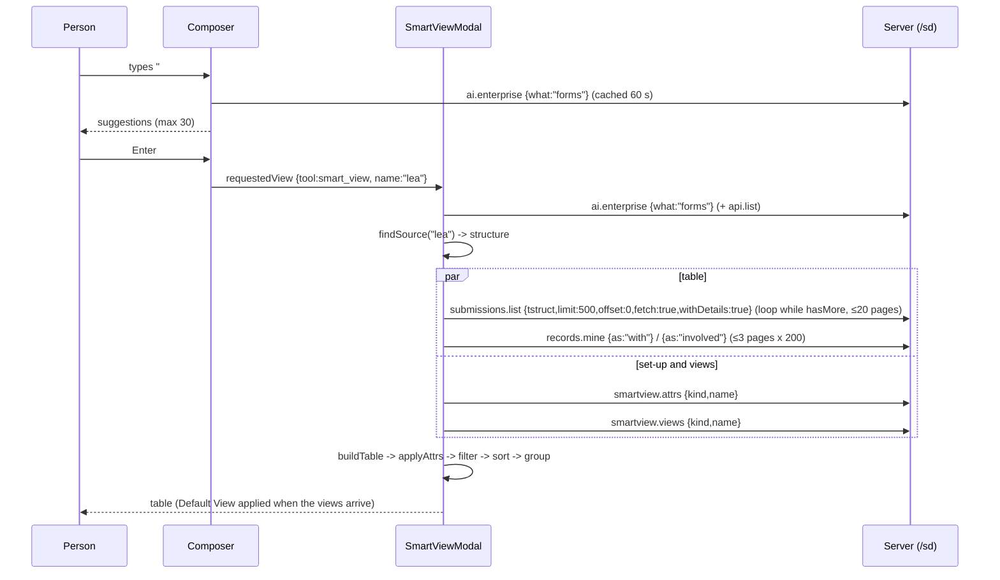
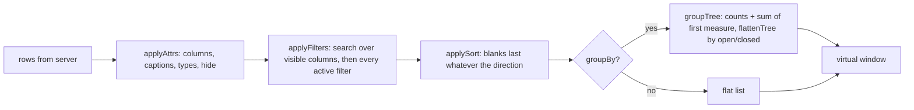
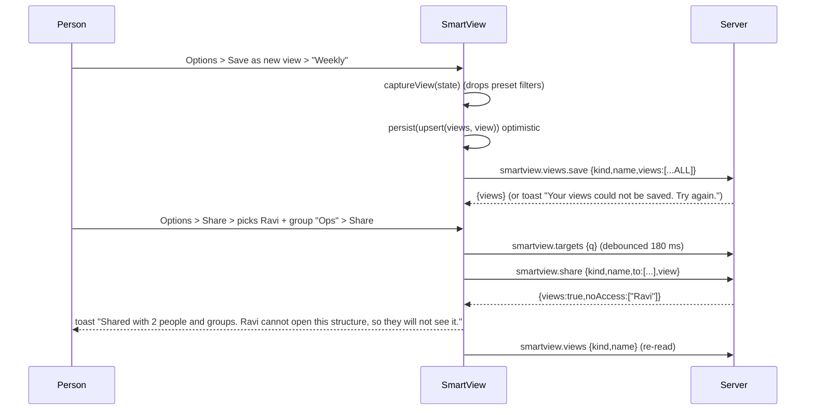

# Smart View for the mobile app: clone the web's Smart View exactly (revision 2)

**For:** the mobile team. **From:** the BE/Web side. **Status:** revision 2, answering your checklist (items 1 to 10). It is a documentation and verification task: **no application code was changed.**

| | |
|---|---|
| **Describes** | branch `dev`, `origin/dev` = `6dfeaedc` ("Status and completion rules for the mobile team (#828)"), 16 Nov 2026 |
| **Verified against** | a backend **built from that commit** (the Docker image of `connectum-backend/`, `erlang:27-alpine`, its own Redis, `CONNECTUM_DEV_OTP=1`), run on 16 Nov 2026 on a **scratch organisation** made by the capture script. The branch this document sits on differs from `origin/dev` only in docs, the three Smart View tools, one test file and one `rebar.lock` line: **nothing under `chat-app/` or `connectum-backend/src/` differs**, so the captures describe dev. The shared dev server `dev.connectum.app` was **not** used (no credentials, and test data does not go onto a shared environment), so the run is on a local build of the same commit. |
| **Examples** | every JSON example below is pasted by `tools/smartview-doc-examples.mjs` from a capture in `docs/examples/smartview/` made by `tools/smartview-capture.mjs` (107 captures, `index.json` lists them). Nothing in this revision is reconstructed or typed by hand. Re-run both to refresh; `node tools/smartview-doc-examples.mjs --check` fails when this file is out of date. |
| **Engine vectors** | `docs/examples/smartview-engine/vectors.json`: input and **output of the web's own functions** (`tools/smartview-vectors.mjs`), for type inference, filters, sort, group, aggregate, formatting and the cells of every field type. |
| **Written by** | Claude Code (the BE/Web side's assistant), checked against the code and the live run. |

## Changelog (revision 1 → revision 2)
**Corrections** (revision 1 said otherwise; each is fixed below and was verified by a run):
1. **`records.mine` paging:** revision 1 said "continue with `next`". Wrong for `with`, `involved` and `all` (and `team` with no reports): `next` is **always `null`**; continue with `offset += received` while `hasMore`. Only `raised` and `team` can answer a real `next`. 2.4.
2. **A server defect found by the run:** `records.mine {as:"raised"}` with a small `limit` **drops records** and says `hasMore:false`. 2.4.1. Use `limit: 100` or more and treat it as unreliable past 100 until fixed.
3. **No access = `not_found`**, never `forbidden`, for `submission.history`, `submission.get`, `record.actions`. Revision 1 marked this `[UNSURE]`. 2.13.
4. **Hidden fields are NOT removed by the server** from record payloads: only the source *list* (`ai.enterprise`) leaves them out. Their **values** and **captions** are sent to everyone who may read the record, and a colleague can read the form definition. This is a data-exposure question for the owner. **5.4.**
5. **Live refresh:** revision 1 said a burst of events gives one re-read per 150 ms. Wrong: the web's handler is called **once per event** in the batch, each starting a full re-read (only the newest answer lands). **4.5**, with a safe mobile strategy.
6. `canEdit` exists only on `submissions.list` rows (with `withDetails`). Received records (`records.mine`) carry none; the rule is in 2.4.2.
7. An administrator **cannot** delete someone else's record from Smart View (server refuses, verified). 4.7.
8. `#view` is **not** in the server's `/cmds` catalogue (22 commands, none is `view`): it is a web-client command; the mobile app builds the entry and the suggestions itself. E2.
9. `RECORD_ACTIONS.md` said its commands also exist as `POST /api/sd/<command>`: they do not (`not_found "No such endpoint."`, verified). **Fixed at the source** (`RECORD_ACTIONS.md`, `MOBILE_RECORDS_FULL.md`).
10. Saved views have **no revision check**: two devices overwrite each other (reproduced step by step, 2.8.1).

**Added:** real captured examples for every command and event (item 1); the cell-text table and formatting rules (item 2); the complete client-engine specification and test vectors (item 3, section 5); the hidden-field and access matrix (item 4, 5.4, 4.7); the sharing rules and the supported / NOT BUILT list (item 7, 2.9, 7.2); exact refresh rules and strategy (item 8, 4.5); UI strings and phone card behaviour (item 9, section 3); the NOT BUILT / UNSURE page and an acceptance checklist you can run (item 10, 6 and 7).

## Where each of your 10 checklist items is answered
| Item | Answer |
|---|---|
| 1 real captured examples | section 2 (every block is a capture), `docs/examples/smartview/`, 6.1 |
| 2 cell formatting | 3.8 and 3.8.1 (table copied here, plus real output), `docs/SMART_VIEW.md` is **in the repo** (it was not missing, only unsynced): publish list in 6.4 |
| 3 client engine: server option or exact algorithms | 5.1 (answer: **no server option**), 5.2 (complete rules), `vectors.json` |
| 4 hidden fields and access | 5.4 (security finding), 4.7 (matrix), 2.13 |
| 5 records paging, canEdit, events | 2.4, 2.4.1, 2.4.2, 2.11 |
| 6 command catalogue and arguments | E1, E2, E9, 2.1 |
| 7 saved views and sharing | 2.8, 2.8.1, 2.9, 7.2 |
| 8 live refresh and rate limits | 2.0, 4.5 |
| 9 UI strings and states | section 3 |
| 10 delivery | 6, 7 (NOT BUILT / UNSURE page, acceptance checklist) |

**About your "25 numbered questions" and "15 discrepancies" (sections 8 and 9 of your spec):** the attachment did not reach us (only the 10-item task text did). We therefore answered by topic, above. **Please re-send those two sections**; we will answer them in the same numbering, and 7.4 already lists every disagreement between documents that we know of.

## 0. How to read this document

**Source tags.** Every statement carries one: **`[VERIFIED: ran against dev 16 Nov 2026]`** (a capture or a vector produced by running the code; the file is named), `[code: path:line]` (paths are from `connectum/`), `[doc: file section]`, or `[UNSURE]`. `NOT BUILT` marks what the web does not have. A tag at the end of a paragraph covers the statements before it in that paragraph unless another tag follows a statement. Where a line number is not given, the function name is, and `grep` finds it in seconds.

**What was and was not verified (said plainly).**
- **Run:** the whole API surface of Smart View (107 captures: commands, refusals, events, rate limit), and the web's pure engine functions (vectors). Both were run on 16 Nov 2026 against code identical to `origin/dev`.
- **Not run:** the web **screens** (no browser session was made, so the strings and layouts in section 3 are read from the code and CSS, tagged `[code]`); anything that needs a second device or a second organisation member in a state the scratch organisation lacks (a share to a person who **cannot** open the source: the server code is read, `noAccess` was not captured); an API source (`api.run` with a real API: none is set up in a scratch organisation); a manager with direct reports (`records.mine as team` with data).
- Where `docs/SMART_VIEW.md` and the code disagree, **the code wins** and the disagreement is listed in 7.4.

**Words.** *Structure* = a form made in the builder (a "tstruct"); its answers are *records* (a record has a number, `id`). *Source* = what a Smart View opens: a structure or an API (a third and fourth kind are switched off, 1.4). *View* = a saved arrangement of the screen (search, filters, sort, grouping, columns), **not** data. *Person A, B* in captures are the synthetic people of the scratch organisation (`svcap…ann` the author, `…bob` a colleague, `…cara` an unrelated colleague, `…adm` the administrator).

---

## 1. What Smart View is

### 1.1 In plain language
Smart View turns a **structure's records** (or an **API's rows**, or a spreadsheet from the person's device, or the person's open tasks and tickets) into **one table** that the person can search, filter, sort, group, chart, total, download, and save as named *views*. Opening a row opens the record in the structure's own form (to change it) or in a read-only form (to look). A person can also add records, delete their own, see a record's history, and share a *view* with colleagues. [doc: SMART_VIEW.md "What it does"]

**Who uses it:** everyone who is signed in. It adds **no permission of its own to see or change data** — what rows and which actions a person gets is the structure's own rules, decided by the server; the screen follows what the server says. The only new permission is `smartview.configure` ("Set up Smart views"), which lets someone set the **organisation-wide default** look of a source. [doc: SMART_VIEW.md "Changing records: the structure's own rules"; code: connectum-backend/src/people/sd_perm.erl:41]

**What the user sees from start to finish (web):**
1. Types `#view` (or `#view leave`) in the chat composer. A suggestion list shows what they may open.
2. A card opens inside My Workspace/the chat (compact), with **Expand** to the full-screen dialog.
3. Full screen: a **list of sources on the left** (Overview first), the chosen source as a **table** on the right, with KPI cards and charts above it *only if the source was set up to have them*, and a **footer bar** under the table with view tabs, the filter button and tool icons.
4. The person searches/filters/sorts/groups, saves a view tab, opens a row to read or edit the record, or downloads the table.

### 1.2 Where it lives in the web app
It is a **modal/dialog**, not a page or a tab. [code: chat-app/features/connectumChat/components/ChatModals.jsx:40 (`FULLSCREEN_MODALS` contains `"smart_view"`), :440 (`<SmartViewModal …/>`)]
- **Full screen modal** `SmartViewModal` (`modal === "smart_view"`). [code: ChatModals.jsx:440]
- **Compact card** inside the chat/My Workspace: the `#view` command sets `requestedView = {view:"tool", tool:"smart_view", param:{name}}`, which renders an `InlineAiCard` containing `SmartViewModal embedded`. **Expand** ("Open in the Smart view") opens the full modal on the same source. [code: chat-app/features/connectumChat/ConnectumChatScreen.jsx:1536-1546; chatActions/routeHashCommand.js:302-306]
- Relation to others: **My Workspace** hosts the compact card; **structures** are the main data source; **records/tickets** open in the structure's own form via host callbacks (`onEditRecord`, `onViewRecord`, `onAddRecord`, `onOpenThread`) — Smart View has no form of its own; **chats**: a record whose form has `recordThread: true` has a per-record conversation button; **Studio/Admin console**: an administrator can "Set up an API" from the card, and Customize (organisation default) needs `smartview.configure`. [code: SmartViewModal.jsx:20, :174; SmartView.jsx:640-644]
- A second, separate surface is the **Inbox** (`#inbox`, `HashInboxModal.jsx`), whose **Visualize** button opens Smart View on Tasks & tickets / Approvals / Reminders. `#view` and `#inbox` are two things. [doc: SMART_VIEW.md "`#view` and `#inbox` are two things"]

### 1.3 Every entry point

| # | Entry point | Exact behaviour | Who sees it | Source |
|---|---|---|---|---|
| E1 | `#view [name]` | Composer command. Aliases **`#smartview`** and **`#list`**. Arg `name` is type `source`, optional, `rest: true` (takes the rest of the line). `requires: "none"`, `available: true`. On send: `requestedView={view:"tool", tool:"smart_view", param:{name: rest\|\|""}}`. No name → the Overview pane. A name → `findSource` (exact match on name or caption, case-insensitive; else the first source whose name or caption **contains** it); no hit → the note "Nothing is called “X” that you can open." | everyone signed in (the *suggestions* are filtered per person) | [code: chat-app/features/connectumChat/data/hashCommandsCatalog.js:206-215; chatActions/routeHashCommand.js:33, 302-306; features/smartView/smartViewSources.js (`findSource`); SmartViewModal.jsx:32-40] |
| E2 | `#view ` suggestions | Read once a minute while typing (`listSources()`, cached 60 s in `sourcesRef`); **no server `/cmdcomplete` call**. Rules: only sources with `canFetch !== false`; `#list` shows structures only; a name that **starts with** the typed letters ranks before one that only contains them; then **structures a person made before built-in ones**, then server order; max **30** items. Each item: `value`=name, `label`=caption, `hint` = "your structure" / "built-in structure" / lower-cased kind label without trailing s ("api"), `sub` = "N fields" for structures. If exactly one item remains and its `value` equals the typed text, the list is empty so **Enter runs it**. **The server knows nothing of `#view`** (1.3.1). | everyone | [code: Composer.jsx:83, 234-256, 414-437] |
| E3 | Card → **Expand** | Full modal opens on the same source with the left list **folded** (`opensFolded`: folded whenever a specific source is open; the Overview and plain list open unfolded). | everyone | [code: ConnectumChatScreen.jsx:1545; features/smartView/svLayout.js `opensFolded`; SmartViewModal.jsx:28] |
| E4 | Overview card (`ov-card`) | A card per openable structure; click opens that structure. | everyone | [code: StructureOverview.jsx:101] |
| E5 | Inbox → **Visualize** (folder or row) | Opens Smart View with `{kind, name, caption}` of `work` ("Tasks & tickets"), `approvals`, or `reminders`; with one structure picked in the Tasks & tickets "All kinds" list it opens **that structure's** own Smart View (`{structure: name}`). | everyone | [code: HashInboxModal.jsx:191; ChatModals.jsx:137; ConnectumChatScreen.jsx:1560] |
| E6 | File chip → **Open as a table** | In the file preview of a spreadsheet cell: opens that file as a table source (`kind:"file"`). | everyone | [doc: SMART_VIEW.md "Files in a cell: preview"; code: SmartView.jsx:792] |
| E7 | Hyperlink cell | A column set up as a link opens its target (a structure's single record, or another Smart View) **over** the current view (inline) or moves the window to it (non-inline; not possible in the chat card). | everyone | [code: SmartView.jsx:295-306] |
| E8 | "Open an Excel or CSV file" drop zone | Left list top (and in the compact picker): reads `.xlsx`/`.csv` **in the browser**, nothing sent until **Save**. | everyone | [code: SvOpenFile.jsx; SmartViewModal.jsx:159] |
| E9 | Deep links / URLs / push notifications | **NOT BUILT.** There is no URL, route or notification that opens Smart View; the only inputs are the `#` command and the Inbox buttons. `[UNSURE]` whether a mobile deep link is planned; none exists in the web. | — | [code: grep of `chat-app` for `smart_view` finds only the files in E1-E7] |

### 1.3.1 The `#view` command: grammar, what the server knows, what the mobile app builds itself
- **The catalogue entry** (web client, verbatim): `{name:"view", aliases:["smartview","list"], category:"lookup", summary:"Open a structure, data source or API as a table", usage:"#view [name]  (also #list [name])", args:[{name:"name", type:"source", required:false, rest:true}], available:true, requires:"none"}`. The argument type **`source`** is not one of the server's argument types (`user, group, host, msgid, emoji, url, word, enum, text`, `HASH_COMMANDS.md`): it exists only in the web client. [code: chat-app/features/connectumChat/data/hashCommandsCatalog.js:206-215]
- **The server does not know `#view`.** `/cmds` answers 22 commands and none is `view`, `smartview` or `list`; `/cmdcomplete {"input":"#view le"}` answers `kind:"none"` with no items. **So the suggestions never come from `/cmdcomplete`: the app builds them from the source list** (`ai.enterprise {what:"forms"}`, plus `api.list`, 2.2), cached 60 s. **[VERIFIED: ran against dev 16 Nov 2026, capture `101-`]**
- **Grammar.** `#view`, `#smartview` or `#list`, then optionally ONE argument that takes **the whole rest of the line**: `#view leave request` asks for the name `leave request` (no quotes; spaces belong to the name; the rest is trimmed, inner spaces are kept as typed). [code: chatActions/routeHashCommand.js:18 and :302-306]
- **On send nothing goes to the server.** `view`, `smartview` and `list` are "screen only" commands (`screenOnly`, `sendsItself`): no chat message is made, no `/sd` call; the screen opens on the result of `findSource`. [code: routeHashCommand.js:26-37]
- **Matching** (`findSource`): lower-case; first the source whose `name` or `caption` **equals** the text; else the first source, in the list's order, whose `name` or `caption` **contains** it; no hit → the note `Nothing is called “X” that you can open.` [code: smartViewSources.js `findSource`]
- **Suggestions the app builds, exactly:** candidates are the sources with `canFetch !== false` (`#list`: structures only); keep those whose `name` or `caption` **contains** the typed text (case-insensitive; empty text keeps all); order: those that **start with** the text first, then **structures a person made before built-in (`system`) ones**, then the source list's own order; at most **30**; each item `{value: name, label: caption || name, hint: "your structure" | "built-in structure" | the kind word without a trailing "s", sub: "N fields" (structures only)}`; when exactly one item remains and its `value` equals the typed text, offer none so that Enter runs it. [code: Composer.jsx:234-256]
- **Order of the picker list** (not of the suggestions): "not system first, then caption A→Z by `localeCompare`" [code: smartViewSources.js:42]; the suggestions use the source list's own order for ties (above). `[UNSURE]` whether the two orders were meant to differ; copy each where it is used.
- **No deep link, URL, push or notification opens Smart View** (E9): confirmed, the only entries are the `#` command and the Inbox buttons. [code: grep of `chat-app` for `smart_view`]

<!-- EX:101- -->
**/cmds # and /cmdcomplete #view le**: as ann (author); capture `docs/examples/smartview/101-cmds-catalogue-and-cmdcomplete-for-view.json` **[VERIFIED: ran against a backend built from dev, 16 Nov 2026]**

Capture:
```json
{
  "command": "/cmds, /cmdcomplete (chat frames, not /sd)",
  "commandNamesInCatalogue": [
    "dm",
    "groupmsg",
    "users",
    "groups",
    "inbox",
    "historyhost",
    "profile",
    "creategroup",
    "addmember",
    "leavegroup",
    "me",
    "associates",
    "find",
    "transfer",
    "scan",
    "forms",
    "options",
    "lookups",
    "form",
    "tstruct",
    "tstruct-add",
    "help"
  ],
  "viewInCatalogue": false,
  "cmd_suggestions": {
    "input": "#view le",
    "items": [],
    "kind": "none",
    "reqId": 7,
    "type": "cmd_suggestions"
  }
}
```
<!-- /EX -->

**What `#view` opens.** On the **source**, never on a saved view: it opens the source's table with `Default View` lit (the person's stored default, if they saved one, is applied once the views are read: `defaultOf(views)` → `viewState`). Nothing is pre-filtered (a `preset` filter exists only for hyperlink targets). Parameters: an API with parameters that have no default and no remembered value shows a form first. [code: SmartView.jsx:184-206]

### 1.4 What can be a source (switch)
| Kind | In the web today | Notes |
|---|---|---|
| `structure` | **ON** | the main case; includes "Your files" (structures with `fromSheet: true` the person owns) |
| `api` | **ON** | an API answering rows; `put` APIs are not offered |
| `work` | **ON, Inbox only** | Tasks & tickets; not in the left list, not reachable with `#view` |
| `approvals`, `reminders` | **ON, Inbox only** | lists built from `req.list` and `feed.list` |
| `file` | **ON, local** | spreadsheet opened from the device |
| `datasource` (Axpert), `list` (Connectum data source) | **OFF ("on hold")** | not listed, cannot be set up or hold views. One switch in two places: `SMART_VIEW_KINDS` and `?KINDS`. **Do not build them.** |

[code: features/smartView/smartViewAttrs.js:10-16; connectum-backend/src/forms/sd_smartview.erl:36; doc: SMART_VIEW.md "Where the rows come from"]

---

## 2. Data and API

### 2.0 Transport, envelope, errors, rate limits (applies to every command below)

- Commands are sent over the signed-in **WebSocket** as one text frame: `/sd <action> {json}`, with a `reqId` inside the JSON. The reply is `{"type":"sd","reqId":…,"ok":true,"data":…}` or `{"type":"sd","reqId":…,"ok":false,"error":{"code":…,"message":…}}`. [doc: CONNECTUM_API.md §2; code: tools/records-probe.mjs `openLink`/`call`]
- **Error codes seen on these commands:** `invalid`, `bad_request`, `forbidden`, `not_found`, `limit`, `rate_limited`. The message is meant to be shown to the person as written. [code: sd_smartview.erl, sd_svviews.erl, sd_svshare.erl, sd_cmds.erl:66-77]
- **Per-connection command limit: 30 commands per 10 seconds** (`CHAT_RATE_LIMIT_MAX` overrides the count; `/cmds`, `/cmdcomplete` have a bigger window of their own). When refused, the reply is the normal envelope with `error.code:"rate_limited"` and message "Too many commands -- slow down and retry." [code: connectum-backend/src/chat.hrl:13-14; http/chat_web_send.erl:393-436; core/sd_cmds.erl:66-77]
- **What the web does:** every Smart View call goes through `callRetrying`: on `rate_limited` it waits `1000 × (attempt+1)` ms and retries, **up to 4 retries**; any other refusal is the answer. Mobile must do the same or a table of many pages will stop half way. [code: smartViewSources.js:16-29]
- Other limits that affect Smart View: `api.run` 120 per 60 s per person (`rate_limited` "Too many calls; wait a minute."); `records.summary` budget 1500 ids a minute per person. [code: core/sd_cmds_forms.erl:437; doc: CONNECTUM_API.md "records.summary"]
- All data is read **as the signed-in person**: the server applies the structure's rules; the client never filters by permission.
### 2.0.1 The envelope, and the rate limit as measured
Every reply is one envelope: `{"action":"<command>","ok":true,"data":…,"type":"sd"}` or `{"action":…,"error":{"code":…,"message":…},"ok":false,"type":"sd"}`, with the `reqId` you sent. An **empty** answer is data, not an error (a structure that does not exist, or one you may not read, gives an empty page). **[VERIFIED: ran against dev 16 Nov 2026]**

<!-- EX:049- -->
**smartview.attrs: nothing set up (attrs null, not an error)**: as ann (author); capture `docs/examples/smartview/049-smartview-attrs-nothing-set-up-attrs-null-not-an-error.json` **[VERIFIED: ran against a backend built from dev, 16 Nov 2026]**

Request:
```json
{
  "kind": "structure",
  "name": "tickets"
}
```

Reply:
```json
{
  "action": "smartview.attrs",
  "data": {
    "attrs": null,
    "canConfigure": true,
    "canDefault": false,
    "mine": false
  },
  "ok": true,
  "type": "sd"
}
```
<!-- /EX -->

**Rate limit, measured:** 40 commands sent at once on one connection: **30 were answered, 10 came back `rate_limited`** with the message `Too many commands -- slow down and retry.` The limit is per connection and per 10 s window, so the **first 30 in a window pass**. **[VERIFIED: capture `102-`]**

<!-- EX:102- -->
**40 commands sent at once on one connection**: as bob (colleague); capture `docs/examples/smartview/102-rate-limit-burst-of-40.json` **[VERIFIED: ran against a backend built from dev, 16 Nov 2026]**

Request:
```json
{
  "kind": "structure",
  "name": "tickets"
}
```

Capture:
```json
{
  "command": "smartview.attrs",
  "request": {
    "kind": "structure",
    "name": "tickets"
  },
  "answered": 40,
  "ok": 30,
  "rate_limited": 10,
  "firstRefusal": {
    "action": "smartview.attrs",
    "error": {
      "code": "rate_limited",
      "message": "Too many commands -- slow down and retry."
    },
    "ok": false,
    "type": "sd"
  }
}
```
<!-- /EX -->


### 2.1 Command catalogue (what Smart View calls)

| Command | Level | Used for | Source |
|---|---|---|---|
| `ai.enterprise {what:"forms"}` | user | the list of structures a person may open, with fields and flags | [code: core/sd_cmds.erl:494-528] |
| `api.list` / `api.run {name, values, limit, refresh?}` | user | API sources | [code: core/sd_cmds_forms.erl:434-441] |
| `submissions.list {tstruct, limit, offset, fetch:true, withDetails:true}` | user | a structure's records | [code: core/sd_cmds_forms.erl:122-136; forms/sd_config.erl:1117-1145] |
| `records.mine {as: with\|raised\|involved\|team\|all, limit, offset}` | user | records that name the person; Tasks & tickets | [code: core/sd_cmds_forms.erl:364; forms/sd_actions.erl:1051-1069] |
| `records.list {tstruct, q?, from?, to?, scope?, limit?, offset?}` | user | **the only server-side search** (text over every value, date range on `ts`, `mine`/`all`); used by `#list`-style lookups, **not** by the web's Smart View (5.1.2) | [code: forms/sd_config.erl:1225-1259; core/sd_cmds_forms.erl `records.list`] |
| `submission.get {id}` | user | one record as the person may read it (a cheap single-record refresh); `not_found` when they may not | [code: core/sd_cmds_forms.erl:332] |
| `submission.history {id}` | user | one record's history panel | [code: core/sd_cmds_forms.erl:315-330] |
| `submissions.delete {id}` | user | delete one record | [code: core/sd_cmds_forms.erl:157-167] |
| `tstruct.user.get {name}` then `tstruct.get {name}` | user | a structure's full definition (for add/edit scope and Show hidden fields) | [code: smartViewSources.js:125-132] |
| `smartview.attrs {kind,name}` | user | what this person sees as the set-up of a source | [code: core/sd_cmds.erl:687-691] |
| `smartview.attrs.save {kind,name,metadata,hyperlinks,kpis,charts}` | user | the person's OWN set-up | [code: sd_cmds.erl:693-697] |
| `smartview.attrs.delete {kind,name}` | user | drop own set-up | [code: sd_cmds.erl:699-703] |
| `admin.smartview.save {…}` / `admin.smartview.delete {kind,name}` | needs `smartview.configure` (prefix rule) | the organisation default | [code: core/sd_cmds_admin.erl:818-842; people/sd_perm.erl:54] |
| `smartview.views {kind,name}` | user | own views + shared views of a source | [code: sd_cmds.erl:705-710] |
| `smartview.views.save {kind,name,views}` | user | replace the person's whole list of views | [code: sd_cmds.erl:728-732] |
| `smartview.targets {q}` | user | whom a person can share with | [code: sd_cmds.erl:716; forms/sd_svshare.erl:14-31] |
| `smartview.share {kind,name,to,view}` | user | share a view with people/groups | [code: sd_svshare.erl:36-49] |
| `smartview.shares {kind,name}` / `smartview.unshare {kind,name,type,id}` / `smartview.view.unshare {kind,name,id}` | user | see / take back | [code: sd_cmds.erl:719-726; sd_svshare.erl] |
| `admin.smartview.view.publish {kind,name,view}` / `…unpublish {kind,name,id}` | needs `smartview.configure` | views for everybody who opens a source (**no UI uses it on the web**, 7.4) | [code: sd_cmds_admin.erl:826-836] |
| `smartview.sheet.save {caption, columns, rows}` / `smartview.sheet.delete {name}` | user | save/delete a spreadsheet as the person's own structure | [code: sd_cmds.erl:711-714; forms/sd_svsheet.erl] |
| `req.list {status:"all"}`, `req.respond`, `feed.list`, `feed.read`, `broadcast.list` | user | the Inbox lists only | [code: smartViewSources.js:136-196] |
| `records.summary {ids}`, `record.actions`, `status.update`, `record.send` | user | record actions / list-row summaries (not called by the web's Smart View table; relevant to mobile, section 5.2) | [doc: CONNECTUM_API.md "The `record` summary"; RECORD_ACTIONS.md] |

### 2.2 `ai.enterprise {what:"forms"}` — the list of sources (structures)

Request: `{"what":"forms"}` (the default). `what:"people"` is administrator-only and not used by Smart View.
Response, real (the `fields` of each structure are cut to 3 for reading; the full list is in the capture). **[VERIFIED: ran against dev 16 Nov 2026]**

<!-- EX:004-:3 -->
**ai.enterprise forms: the source list (as the author)**: as ann (author); capture `docs/examples/smartview/004-ai-enterprise-forms-the-source-list-as-the-author.json` **[VERIFIED: ran against a backend built from dev, 16 Nov 2026]**

Request:
```json
{
  "what": "forms"
}
```

Reply:
```json
{
  "action": "ai.enterprise",
  "data": {
    "forms": [
      {
        "canAdd": true,
        "canFetch": true,
        "caption": "Every field",
        "fields": [
          {
            "caption": "Ref",
            "name": "ref",
            "section": null,
            "type": "autogenerate"
          },
          {
            "caption": "Title",
            "name": "title",
            "rich": false,
            "section": null,
            "type": "text"
          },
          {
            "caption": "Notes",
            "name": "notes",
            "rich": false,
            "section": null,
            "type": "text"
          }
        ],
        "fromSheet": false,
        "keyField": null,
        "name": "everyfield",
        "owner": "svcapcpw1ann",
        "recordThread": false,
        "sections": [],
        "status": {
          "field": "stage",
          "final": [
            "Done"
          ],
          "statuses": [
            "Open",
            "In progress",
            "Done"
          ]
        },
        "system": false
      },
      {
        "canAdd": true,
        "canFetch": true,
        "caption": "Requests",
        "fields": [
          {
            "caption": "Title",
            "name": "title",
            "rich": false,
            "section": null,
            "type": "text"
          },
          {
            "caption": "Stage",
            "name": "stage",
            "section": null,
            "type": "list"
          },
          {
            "caption": "Amount",
            "name": "amount",
            "section": null,
            "type": "number"
          }
        ],
        "fromSheet": false,
        "keyField": null,
        "name": "requests",
        "owner": null,
        "recordThread": false,
        "sections": [],
        "status": {
          "field": "stage",
          "final": [
            "Closed"
          ],
          "statuses": [
            "Open",
            "In progress",
            "Closed"
          ]
        },
        "system": false
      },
      {
        "canAdd": true,
        "canFetch": true,
        "caption": "Tickets",
        "fields": [
          {
            "caption": "Title",
            "name": "title",
            "rich": false,
            "section": null,
            "type": "text"
          },
          {
            "caption": "Stage",
            "name": "stage",
            "section": null,
            "type": "list"
          },
          {
            "caption": "Area",
            "name": "area",
            "section": null,
            "type": "list"
          }
        ],
        "fromSheet": false,
        "keyField": null,
        "name": "tickets",
        "owner": "svcapcpw1ann",
        "recordThread": false,
        "sections": [],
        "status": {
          "field": "stage",
          "final": [
            "Closed"
          ],
          "statuses": [
            "Open",
            "In progress",
            "Closed"
          ]
        },
        "system": false
      }
    ]
  },
  "ok": true,
  "type": "sd"
}
```

(Cut for reading, nothing else changed: `data.forms[0].fields`: first 3 of 21; `data.forms[2].fields`: first 3 of 5. The full reply is in the capture file.)
<!-- /EX -->

A structure entry has exactly these keys: `canAdd, canFetch, caption, fields, fromSheet, keyField, name, owner, recordThread, sections, status, system`. `keyField` is `null` when the structure has none. The same call for a colleague (`005-`) lists the same three structures because a person-made structure is organisation-wide unless it is `restricted` (below). A refused variant: `what:"people"` is for administrators only (`006-`: `forbidden`, "Only an administrator can list everyone in the organisation.").
- `fields[]` carries only `name, caption, type, section, rich`. **Hidden fields (`hidden: true`) are left out for everyone** (and the four fields a status keeps: `<field>_comments|_completion|_files|_hours`). [code: sd_cmds.erl:517-519]
- `system:true` = a form Connectum keeps itself (branches, employees…): listed after the person's own; **no Add and no Delete** on it. `canFetch:false` = a fetch rule this person does not meet → leave the source out of lists and suggestions. `canAdd` = may enter records ("Enter records" rule). `fromSheet:true` + `owner == me` = "Your files". [code: sd_cmds.erl:505-516; smartViewSources.js:48; 147]
- `status` is `null` for a structure with no status dropdown; `final` = statuses that end a record. [code: sd_cmds.erl:513]
- The list is **exactly the structures the person may open** (`sd_smartview:openable_structures/1` = `sd_config:visible_tstructs/1`). Ordering on the web: not-system first, then caption A→Z (`localeCompare`). [code: sd_smartview.erl:23; smartViewSources.js:42]
- Live: re-read when `tstructs_changed` or `resync` arrives. What is open is re-read **only if its definition changed** (`sameStructure`: caption, keyField, fields, sections); if it was removed the window goes to the Overview and says `Nothing is called “X” that you can open.` [code: SmartViewModal.jsx:47-72; svStructure.js `sameStructure`]
- If one of the four parts of `listSources` fails it is left out and named in `failed` (`"Structures"`, `"APIs"`…): the picker then says "<names> could not be read just now." with Try again, instead of looking empty. [code: smartViewSources.js:32-42; SmartViewCompact.jsx]

### 2.3 `submissions.list` — a structure's records

Request (what the web sends): `{"tstruct":"leave_request","limit":500,"offset":0,"fetch":true,"withDetails":true}`.

| Field | Type | Rule | Source |
|---|---|---|---|
| `tstruct` | string | narrows to one structure (case-insensitive key) | sd_config.erl:1118 |
| `limit` | int | clamped **1–500**, default 500 | sd_config.erl:1126 |
| `offset` | int | clamped **0–100000** (the `fetch` "all" path allows up to 1,000,000) | sd_config.erl:1127; sd_recfetch.erl:261 |
| `fetch` | bool | `true` = a programme pulling the structure's records: **the structure's fetch rule applies** | sd_cmds_forms.erl:123-128 |
| `withDetails` | bool | adds `files` and `labels` to each record **and `canEdit`** | sd_cmds_forms.erl:130-134 |
| `recordsOnly`, `window`, `ref` | — | exist; **not used by Smart View** | sd_config.erl:1122-1136 |

Response, real (page 1 of 2: `limit` 3 so that paging is visible; arrays cut to 2). **[VERIFIED: ran against dev 16 Nov 2026]**

<!-- EX:007-:2 -->
**submissions.list: the Smart View read (page 1 of 2, limit 3)**: as ann (author); capture `docs/examples/smartview/007-submissions-list-the-smart-view-read-page-1-of-2-limit-3.json` **[VERIFIED: ran against a backend built from dev, 16 Nov 2026]**

Request:
```json
{
  "tstruct": "tickets",
  "limit": 3,
  "offset": 0,
  "fetch": true,
  "withDetails": true
}
```

Reply:
```json
{
  "action": "submissions.list",
  "data": {
    "hasMore": true,
    "limit": 3,
    "offset": 0,
    "structures": {
      "tickets": {
        "caption": "Tickets",
        "fields": {
          "area": "Area",
          "due": "Due",
          "hours": "Hours",
          "secret": "Internal note",
          "stage": "Stage",
          "stage_comments": "Stage comments",
          "stage_completion": "Stage completion",
          "stage_files": "Stage files",
          "stage_hours": "Stage hours",
          "title": "Title"
        },
        "status": {
          "field": "stage",
          "final": [
            "Closed"
          ],
          "statuses": [
            "Open",
            "In progress"
          ]
        }
      }
    },
    "submissions": [
      {
        "branch": "HQ",
        "by": "svcapcpw1ann",
        "byName": "Ann Rao",
        "canEdit": true,
        "files": {},
        "host": null,
        "id": 39,
        "labels": {},
        "scope": "user",
        "ts": 1794833216938,
        "tstruct": "tickets",
        "values": {
          "area": "Delivery",
          "due": "2026-11-20",
          "hours": 2.5,
          "secret": "HIDDEN-VALUE-123",
          "stage": "Open",
          "title": "Printer jammed"
        }
      },
      {
        "branch": "HQ",
        "by": "svcapcpw1ann",
        "byName": "Ann Rao",
        "canEdit": true,
        "files": {},
        "host": null,
        "id": 37,
        "labels": {},
        "scope": "user",
        "ts": 1794833216651,
        "tstruct": "tickets",
        "values": {
          "area": "Billing",
          "due": "2026-11-15",
          "hours": 7.5,
          "secret": "HIDDEN-VALUE-123",
          "stage": "Open",
          "title": "Ticket 5"
        }
      }
    ],
    "total": 6
  },
  "ok": true,
  "type": "sd"
}
```

(Cut for reading, nothing else changed: `data.structures.tickets.status.statuses`: first 2 of 3; `data.submissions`: first 2 of 3. The full reply is in the capture file.)
<!-- /EX -->

What the captures show (each is a file in `docs/examples/smartview/`) **[VERIFIED]**:
- A row of a structure **without** a status flow has exactly these keys: `branch, by, byName, canEdit, files, host, id, labels, scope, ts, tstruct, values`. A row of a structure with a status flow that has been **sent** also carries `actedBy, actionSeq, assignor, holder, participants, editedTs` and, once an update gave one, `completion` (`100-`). **A row never carries a `status` field**: the builder's status is just a value in `values` (`values.stage`), and `holder`, `completion` come from the row; the approval word (`Recorded` / `Waiting for approval` …) is only on records of forms with approval. `ts` is epoch milliseconds (UTC).
- **`values` holds every saved field, hidden ones included** (`values.secret` above) and `structures.<name>.fields` names them (5.4).
- Without `withDetails` the rows have no `canEdit`, `files`, `labels` or `byName` (`009-`).
- A page past the clamp: `limit` over 500 → 500, `offset` below 0 → 0 (`013-`). A structure that does not exist → an empty page, not an error (`014-`).
- **A person who only RECEIVED a record does not get it here**: the colleague it was sent to reads an empty page (`018-`), which is why a client must also read `records.mine` (2.4). An unrelated colleague reads an empty page (`048-`).
- The administrator reads everything and gets `canEdit:false` on a record that is not theirs (`012-`).
- Every field type, one record of each kind (`010-`; how each becomes cell text is in 3.8.1):

<!-- EX:010-:1 -->
**submissions.list: every field type, one record of each kind**: as ann (author); capture `docs/examples/smartview/010-submissions-list-every-field-type-one-record-of-each-kind.json` **[VERIFIED: ran against a backend built from dev, 16 Nov 2026]**

Request:
```json
{
  "tstruct": "everyfield",
  "fetch": true,
  "withDetails": true
}
```

Reply:
```json
{
  "action": "submissions.list",
  "data": {
    "hasMore": false,
    "limit": 500,
    "offset": 0,
    "structures": {
      "everyfield": {
        "caption": "Every field",
        "fields": {
          "amount": "Amount",
          "at": "At",
          "code": "Code",
          "copy": "Copy",
          "day": "Day",
          "doc": "Documents",
          "fee": "Fee",
          "kind": "Kind",
          "mail": "Mail",
          "notes": "Notes",
          "owner": "Owner",
          "phone": "Phone",
          "qty": "Quantity",
          "ref": "Ref",
          "site": "Site",
          "stage": "Stage",
          "stage_comments": "Stage comments",
          "stage_completion": "Stage completion",
          "stage_files": "Stage files",
          "stage_hours": "Stage hours",
          "story": "Story",
          "tags": "Tags",
          "title": "Title",
          "urgent": "Urgent",
          "where": "Where"
        },
        "status": {
          "field": "stage",
          "final": [
            "Done"
          ],
          "statuses": [
            "Open"
          ]
        }
      }
    },
    "submissions": [
      {
        "branch": "HQ",
        "by": "svcapcpw1ann",
        "byName": "Ann Rao",
        "canEdit": true,
        "files": {},
        "host": null,
        "id": 53,
        "labels": {},
        "scope": "user",
        "ts": 1794833220527,
        "tstruct": "everyfield",
        "values": {
          "ref": "VIS-0002",
          "stage": "Open",
          "title": "Bare"
        }
      }
    ],
    "total": 2
  },
  "ok": true,
  "type": "sd"
}
```

(Cut for reading, nothing else changed: `data.structures.everyfield.status.statuses`: first 1 of 3; `data.submissions`: first 1 of 2. The full reply is in the capture file.)
<!-- /EX -->
- **Paging:** loop `offset += 500` while `hasMore`; the web stops after **20 pages (10,000 records)**; `total` is the server's count; if `total > records read` the table shows "Showing the first N of M rows. Filter to narrow it down." Use `hasMore` and `offset += limit` to continue (`submissions.list` fills each page up to `limit`; `records.mine` is different, 2.4). [code: smartViewSources.js:76-91; SmartView.jsx:578]
- **Sort/filter/group/search/aggregate are NOT server side** for a structure: the server returns newest first; everything else is client work on the fetched rows (section 5.1).
- `canEdit` is only present with `withDetails:true` and means: the author or whoever the data-access rules let change it, while not locked for approval, in a normal structure. `submissions.update` asks again. [code: sd_cmds_forms.erl:133; doc: SMART_VIEW.md "Changing records"]
- Whose records: the person's own; **direct reports'** (the team rule; read-only; a form with `hideFromManagers` is left out); plus, merged by the client, records that **name the person** via `records.mine` (`as:"with"` and `as:"involved"`, 3 pages of 200 each, only this structure, deduplicated by `id`, **never throws** — a failure leaves the table as it was). The merged list is re-sorted newest first (`ts` desc). [code: smartViewSources.js:99-120; doc: SMART_VIEW.md "Whose records a table holds"]
- `files` keys are the field name, or `"<section>.<row>.<field>"` for files inside a grid row. File ids are 24 hex characters (`^[a-f0-9]{24}$`); anything else is not a file. [code: svStructure.js `FILE_ID`, `fileValue`]

### 2.4 `records.mine` — records that name the person; Tasks & tickets; Team

Request `{"as":"with","limit":100,"offset":0}`. Answer: `{submissions, structures, total, hasMore, next}`; `as:"team"` adds `reports` (the number of direct reports). `limit` default 100, **clamped 1–200**; `offset` 0–1,000,000. [code: forms/sd_actions.erl:1049-1069, 1088-1102]

**The rule per value of `as` — which one is current (13 Nov records document and this document now agree; revision 1 was wrong).** Each row is a capture **[VERIFIED: ran against dev 16 Nov 2026]**:

| `as` | Who gets it | `next` | How to continue | `total` | Capture |
|---|---|---|---|---|---|
| `with` (default) | open records with the person now | **always `null`** | `offset += number received` while `hasMore` | size of the person's list (can include a waiting record that is not shown, so it can exceed what you read) | `019-` page 1 (`hasMore:true`), `020-` page 2, `021-` past the end |
| `involved` | records I was given, shared with or acted on, never ones I made | **always `null`** | `offset += number received` while `hasMore` | size of the index | `022-` |
| `raised` | records I made that are with someone else or waiting | `null` when the whole list was read, else the position to continue from | use `next` **but see 2.4.1: it can lose records** | number in **this** answer, not of the list | `023-`, `024-` |
| `team` | a manager: open records with my direct reports | a real `next` (position) | use `next`, never `offset + received` | exact when read from the start, else an upper bound | `025-` (a person with no reports: empty, `reports:0`) |
| `all` | **administrators**: every open record that has a status | **always `null`** | `offset += number received` | all | `027-`; anyone else silently gets `with` (`026-`) |
| anything else | treated as `with` | `null` | as `with` | | `029-` |

`limit` over 200 is clamped to 200 (`028-`); an empty answer is `{hasMore:false, next:null, structures:{}, submissions:[], total:0}`, never an error (`021-`).

<!-- EX:019-:1 -->
**records.mine as with: limit 2 (hasMore true, next null)**: as bob (colleague); capture `docs/examples/smartview/019-records-mine-as-with-limit-2-hasmore-true-next-null.json` **[VERIFIED: ran against a backend built from dev, 16 Nov 2026]**

Request:
```json
{
  "as": "with",
  "limit": 2,
  "offset": 0
}
```

Reply:
```json
{
  "action": "records.mine",
  "data": {
    "hasMore": true,
    "next": null,
    "structures": {
      "requests": {
        "caption": "Requests",
        "fields": {
          "amount": "Amount",
          "stage": "Stage",
          "stage_comments": "Stage comments",
          "stage_completion": "Stage completion",
          "stage_files": "Stage files",
          "stage_hours": "Stage hours",
          "title": "Title"
        },
        "status": {
          "field": "stage",
          "final": [
            "Closed"
          ],
          "statuses": [
            "Open"
          ]
        }
      }
    },
    "submissions": [
      {
        "actedBy": "svcapcpw1ann",
        "actionSeq": 1,
        "assignor": "svcapcpw1ann",
        "branch": "HQ",
        "by": "svcapcpw1ann",
        "editedTs": 1794833226479,
        "holder": "svcapcpw1bob",
        "host": null,
        "id": 47,
        "participants": [
          "svcapcpw1ann"
        ],
        "scope": "global",
        "ts": 1794833219353,
        "tstruct": "requests",
        "values": {
          "amount": 400,
          "stage": "Open",
          "title": "Request 4"
        }
      }
    ],
    "total": 4
  },
  "ok": true,
  "type": "sd"
}
```

(Cut for reading, nothing else changed: `data.structures.requests.status.statuses`: first 1 of 3; `data.submissions`: first 1 of 2; `data.submissions[0].participants`: first 1 of 2. The full reply is in the capture file.)
<!-- /EX -->

<!-- EX:020-:1 -->
**records.mine as with: the next page by offset += received**: as bob (colleague); capture `docs/examples/smartview/020-records-mine-as-with-the-next-page-by-offset-received.json` **[VERIFIED: ran against a backend built from dev, 16 Nov 2026]**

Request:
```json
{
  "as": "with",
  "limit": 2,
  "offset": 2
}
```

Reply:
```json
{
  "action": "records.mine",
  "data": {
    "hasMore": false,
    "next": null,
    "structures": {
      "requests": {
        "caption": "Requests",
        "fields": {
          "amount": "Amount",
          "stage": "Stage",
          "stage_comments": "Stage comments",
          "stage_completion": "Stage completion",
          "stage_files": "Stage files",
          "stage_hours": "Stage hours",
          "title": "Title"
        },
        "status": {
          "field": "stage",
          "final": [
            "Closed"
          ],
          "statuses": [
            "Open"
          ]
        }
      }
    },
    "submissions": [
      {
        "actedBy": "svcapcpw1ann",
        "actionSeq": 1,
        "assignor": "svcapcpw1ann",
        "branch": "HQ",
        "by": "svcapcpw1ann",
        "editedTs": 1794833225889,
        "holder": "svcapcpw1bob",
        "host": null,
        "id": 43,
        "participants": [
          "svcapcpw1ann"
        ],
        "scope": "global",
        "ts": 1794833218790,
        "tstruct": "requests",
        "values": {
          "amount": 200,
          "stage": "Open",
          "title": "Request 2"
        }
      }
    ],
    "total": 4
  },
  "ok": true,
  "type": "sd"
}
```

(Cut for reading, nothing else changed: `data.structures.requests.status.statuses`: first 1 of 3; `data.submissions`: first 1 of 2; `data.submissions[0].participants`: first 1 of 2. The full reply is in the capture file.)
<!-- /EX -->

<!-- EX:023-:1 -->
**records.mine as raised: limit 2 (a real next)**: as ann (author); capture `docs/examples/smartview/023-records-mine-as-raised-limit-2-a-real-next.json` **[VERIFIED: ran against a backend built from dev, 16 Nov 2026]**

Request:
```json
{
  "as": "raised",
  "limit": 2,
  "offset": 0
}
```

Reply:
```json
{
  "action": "records.mine",
  "data": {
    "hasMore": false,
    "next": null,
    "structures": {
      "requests": {
        "caption": "Requests",
        "fields": {
          "amount": "Amount",
          "stage": "Stage",
          "stage_comments": "Stage comments",
          "stage_completion": "Stage completion",
          "stage_files": "Stage files",
          "stage_hours": "Stage hours",
          "title": "Title"
        },
        "status": {
          "field": "stage",
          "final": [
            "Closed"
          ],
          "statuses": [
            "Open"
          ]
        }
      }
    },
    "submissions": [
      {
        "actedBy": "svcapcpw1ann",
        "actionSeq": 1,
        "assignor": "svcapcpw1ann",
        "branch": "HQ",
        "by": "svcapcpw1ann",
        "editedTs": 1794833226479,
        "holder": "svcapcpw1bob",
        "host": null,
        "id": 47,
        "participants": [
          "svcapcpw1ann"
        ],
        "scope": "global",
        "ts": 1794833219353,
        "tstruct": "requests",
        "values": {
          "amount": 400,
          "stage": "Open",
          "title": "Request 4"
        }
      }
    ],
    "total": 2
  },
  "ok": true,
  "type": "sd"
}
```

(Cut for reading, nothing else changed: `data.structures.requests.status.statuses`: first 1 of 3; `data.submissions`: first 1 of 2; `data.submissions[0].participants`: first 1 of 2. The full reply is in the capture file.)
<!-- /EX -->

**The shape of a `records.mine` row** is **not** the shape of a `submissions.list` row: `actedBy, actionSeq, assignor, branch, by, editedTs, holder, host, id, participants, scope, ts, tstruct, values` (+ `completion`, `hours` once an update gave them; `team` rows also `team:{members, via}`). It has **no `byName`, `canEdit`, `files` or `labels`** (an `all` row for an administrator has only `branch, by, host, id, scope, ts, tstruct, values`: no `holder`). To show a name for `by` or `holder` look the username up in what you already have; to show file names or option labels of a received record the row has none (`[UNSURE]` whether they will be added; ask). **[VERIFIED: `019-`, `027-`]**

**Tasks & tickets (`kind:"work"`)** = union, deduplicated by record id, of `with`, `raised`, `all` (page 100 each, one page) plus `loadVisibleOpen`: for up to **30** non-system structures that have a `status`, `submissions.list {tstruct, fetch:true, limit:200}` in batches of 4, keeping records whose tone is not `done`. It is re-read on events matching `/^(task_|ticket_|submissions?_|resync)/`. Columns: **No., Title, Form, Status, Progress, With, Raised by, Raised**. `Title` = the record's first short text answer (≤120 chars, not the status or its companions) else `"<form> #<id>"`. [code: smartViewSources.js:243-268; workItems.js:20-46, 72; svWork.js]

### 2.4.1 A server defect found by this revision: `records.mine {as:"raised"}` loses records
With `limit: 2` the author, who raised four records that are with someone else, got **two rows, `hasMore:false`, `next:null`**: the other two can never be reached by paging (`023-`). With `limit: 10` she got all four (`024-`). Cause, read from the code: `raised_scan` reads a chunk of up to 200 entries, keeps at most `limit` records, and then moves its position past the **whole chunk**, so the records after the first `limit` kept ones in that chunk are skipped [code: forms/sd_actions.erl:1244-1258]. **Effect for you:** until it is fixed, always ask `as:"raised"` with `limit: 200` (the biggest allowed): a chunk is at most 200 entries, so with `limit` 200 nothing in it can be dropped. It is **not** fixed here (documentation task; no application code was changed); it is listed as a known defect in 7.2 for the BE owner. The web's Smart View does not use `raised` for a structure's table (only the Tasks & tickets list reads it once with `limit 100`), so the web has the same exposure above 100 records.

### 2.4.2 Can the person edit or delete a record received through `records.mine`? (the `canEdit` question)
**The rule (verified):** a person who **received** a record (`with` / `involved`) may **not** edit or delete it with `submissions.update` / `submissions.delete`: the server answers `forbidden` "You can only edit your own submission." / "You can only delete your own submission, or any record of a structure you created." (`039-`, `040-`). What they may do with it is the **workflow**: `record.actions {id}` says which of `send` and `status` ("Update status") are enabled right now (`030-`), then `record.send` / `record.status`. The author may still edit a record that is with someone else (`041-`). An **administrator** may not delete someone else's record either (`044-`).
**So:** `canEdit` exists **only** on `submissions.list` rows with `withDetails:true`; **there is none on `records.mine` rows**. For a received record the client's rule is *"not editable, not deletable; offer only what `record.actions.items` enables"*. `canDelete` does not exist anywhere. **Requested, NOT BUILT:** `canEdit`/`canDelete` (or `actions`) on `records.mine` rows and on `submissions.list` rows (the web's own Delete rule, "author or structure owner", is computed in the client by `deletePlan` [code: svDelete.js:11-22]; mobile needs the same rule or the server's flag).

<!-- EX:030-:1 -->
**record.actions: the holder's menu**: as bob (colleague); capture `docs/examples/smartview/030-record-actions-the-holder-s-menu.json` **[VERIFIED: ran against a backend built from dev, 16 Nov 2026]**

Request:
```json
{
  "id": 41
}
```

Reply:
```json
{
  "action": "record.actions",
  "data": {
    "assignor": "svcapcpw1ann",
    "claimants": [],
    "commentsRequired": false,
    "completion": null,
    "completionRequired": false,
    "files": [],
    "filesRequired": false,
    "final": [
      "Closed"
    ],
    "finalStatuses": [
      "Closed"
    ],
    "hasRules": false,
    "holder": "svcapcpw1bob",
    "hours": null,
    "hoursRequired": false,
    "initiator": "svcapcpw1ann",
    "isAdmin": false,
    "items": [
      {
        "enabled": true,
        "id": "send",
        "label": "Send"
      }
    ],
    "lastUpdate": null,
    "minCompletion": 0,
    "status": "Open",
    "statuses": [
      "Open"
    ]
  },
  "ok": true,
  "type": "sd"
}
```

(Cut for reading, nothing else changed: `data.items`: first 1 of 2; `data.statuses`: first 1 of 3. The full reply is in the capture file.)
<!-- /EX -->

<!-- EX:039- -->
**submissions.update: the holder of a received record, who is not its author**: as bob (colleague); capture `docs/examples/smartview/039-submissions-update-the-holder-of-a-received-record-who-is-no.json` **[VERIFIED: ran against a backend built from dev, 16 Nov 2026]**

Request:
```json
{
  "id": 45,
  "values": {
    "title": "changed by bob"
  }
}
```

Reply (refused):
```json
{
  "action": "submissions.update",
  "error": {
    "code": "forbidden",
    "message": "You can only edit your own submission."
  },
  "ok": false,
  "type": "sd"
}
```
<!-- /EX -->

### 2.5 `submission.history {id}`

Request `{"id":41}`. Response `{events:[{op, ts, by, to?, fromStatus?, toStatus?, completion?, reason?, remarks?, files?, approvers?}], names:{username:name}, files:{id:{id,name,size,mime}}, caption, fields:{field:caption}, …}` — **oldest first**; the web reverses it. Whoever may open the record may read it. [code: sd_cmds_forms.erl:315-330; smartViewSources.js:237-240; svHistory.js `historyRows`]
Rendering words (`eventWord`): `created→Created, edited→Changed, deleted→Deleted, sent→Sent, status→Status updated, approved→Approved, declined→Declined, returned→Returned, submitted→Submitted, printed→Printed, posted→Posted, handed→Handed on, notified→Notified, resubmitted→Sent again`; any other `op` is capitalised with `_`/`-` turned into spaces. Percent is rounded and clamped 0–100. Note = `reason · remarks`. [code: svHistory.js:5-21]
Live: the open panel re-reads on events matching `/^(task_|ticket_|record_|submission|resync)/`.
**Real captures [VERIFIED: ran against dev 16 Nov 2026]:** the history of a record that was created, sent on and had its status updated (`033-`); the same call refused for a person who may not open the record, `not_found` "No such submission." (`034-`), likewise `submission.get` (`035-`) and a record that does not exist (`036-`: the two cases are **indistinguishable on purpose**). Notes: an event's `completion` is a **string** in the history (`"30"` for a percent of 30; the web rounds and clamps it 0–100); `record` is the record's number and `structure` its structure's name.

<!-- EX:033-:3 -->
**submission.history: events oldest first**: as ann (author); capture `docs/examples/smartview/033-submission-history-events-oldest-first.json` **[VERIFIED: ran against a backend built from dev, 16 Nov 2026]**

Request:
```json
{
  "id": 41
}
```

Reply:
```json
{
  "action": "submission.history",
  "data": {
    "caption": "Requests",
    "events": [
      {
        "by": "svcapcpw1ann",
        "caption": "Requests",
        "id": 42,
        "op": "created",
        "record": 41,
        "structure": "requests",
        "ts": 1794833218514
      },
      {
        "asAdmin": false,
        "by": "svcapcpw1ann",
        "caption": "Requests",
        "claimed": false,
        "files": [],
        "fromHolder": "svcapcpw1ann",
        "id": 55,
        "op": "sent",
        "record": 41,
        "status": "Open",
        "structure": "requests",
        "to": [
          "svcapcpw1bob"
        ],
        "ts": 1794833224889,
        "value": "",
        "via": "user"
      },
      {
        "asAdmin": false,
        "by": "svcapcpw1bob",
        "caption": "Requests",
        "claimed": false,
        "completion": "30",
        "files": [],
        "final": false,
        "fromStatus": "Open",
        "id": 59,
        "op": "status",
        "record": 41,
        "remarks": "started",
        "structure": "requests",
        "toStatus": "In progress",
        "ts": 1794833231114
      }
    ],
    "fields": {
      "amount": "Amount",
      "stage": "Stage",
      "stage_comments": "Stage comments",
      "stage_completion": "Stage completion",
      "stage_files": "Stage files",
      "stage_hours": "Stage hours",
      "title": "Title"
    },
    "files": {},
    "names": {
      "svcapcpw1ann": "Ann Rao",
      "svcapcpw1bob": "Bob Iyer"
    },
    "sections": {},
    "status": "record"
  },
  "ok": true,
  "type": "sd"
}
```
<!-- /EX -->


### 2.6 `api.list` / `api.run` — API sources

`api.list` → `{apis:[{name, caption, type: list|get|put, cacheSec, params:[{name, default}], columns, description}]}`; `put` APIs are never offered. `api.run {name, values:{param:value}, limit:500, refresh?:true}` → `{columns, rows, total, truncated, refreshedAt, cached, origin, store, cacheSec, expiresAt, via}`. The server **cuts at 500 rows** and the screen says so. Timeout on the web: 60 s. Column kinds are inferred client-side from up to 200 values (section 5.1). [code: smartViewSources.js:42-46, 270-280; doc: SMART_VIEW.md "An API"]
**Captured [VERIFIED: ran against dev 16 Nov 2026]:** `api.list` with no API set up answers `{apis:[]}` (`093-`); `api.run` of an API that does not exist answers `not_found` (`094-`). **A real `api.run` answer with rows was NOT captured** (a scratch organisation has no API, and the sample API of `tools/ui-audit/smartview-fields.e2e.mjs` needs `CONNECTUM_API_ALLOW_PRIVATE=1`): the shape above is `[code]` + `[doc]` only, `[UNSURE]` until captured. If your first phase is structures only (recommended), you do not need it.

<!-- EX:093- -->
**api.list: no API set up**: as ann (author); capture `docs/examples/smartview/093-api-list-no-api-set-up.json` **[VERIFIED: ran against a backend built from dev, 16 Nov 2026]**

Request:
```json
{}
```

Reply:
```json
{
  "action": "api.list",
  "data": {
    "apis": []
  },
  "ok": true,
  "type": "sd"
}
```
<!-- /EX -->

<!-- EX:094- -->
**api.run: an API that does not exist**: as ann (author); capture `docs/examples/smartview/094-api-run-an-api-that-does-not-exist.json` **[VERIFIED: ran against a backend built from dev, 16 Nov 2026]**

Request:
```json
{
  "name": "nothing_here",
  "values": {},
  "limit": 500
}
```

Reply (refused):
```json
{
  "action": "api.run",
  "error": {
    "code": "not_found",
    "message": "No such API."
  },
  "ok": false,
  "type": "sd"
}
```
<!-- /EX -->


### 2.7 Set-up ("Smart view attributes"): `smartview.attrs*`

**Meaning.** A source can be *set up* so its Smart View shows chosen **columns, links, KPI cards and charts**. A source nobody set up is a **plain table: no KPI cards, no charts**. (Only the Inbox lists compute their own cards.) [doc: SMART_VIEW.md "Smart view attributes"]
**Two layers.** (1) the **organisation's** set-up (`sd:svattrs`, key `"<kind>:<name>"` lower-case), written only with `smartview.configure` via `admin.smartview.save`; (2) the **person's own** set-up (`sd:svattrs:mine`, key `"<username>|<kind>:<name>"`), private — **nobody else, an administrator included, can read it**. A person sees **their own if they made one, else the organisation's**. [code: sd_smartview.erl:1-20, 84-90]

`smartview.attrs {kind,name}` → real answers **[VERIFIED: ran against dev 16 Nov 2026]**. Nothing set up (`attrs:null`, **not an error**), the person's own set-up (`mine:true`), another person never sees it, a person with none of their own gets the organisation's (`mine:false`):

<!-- EX:049- -->
**smartview.attrs: nothing set up (attrs null, not an error)**: as ann (author); capture `docs/examples/smartview/049-smartview-attrs-nothing-set-up-attrs-null-not-an-error.json` **[VERIFIED: ran against a backend built from dev, 16 Nov 2026]**

Request:
```json
{
  "kind": "structure",
  "name": "tickets"
}
```

Reply:
```json
{
  "action": "smartview.attrs",
  "data": {
    "attrs": null,
    "canConfigure": true,
    "canDefault": false,
    "mine": false
  },
  "ok": true,
  "type": "sd"
}
```
<!-- /EX -->

<!-- EX:051- -->
**smartview.attrs: after saving (mine true)**: as ann (author); capture `docs/examples/smartview/051-smartview-attrs-after-saving-mine-true.json` **[VERIFIED: ran against a backend built from dev, 16 Nov 2026]**

Request:
```json
{
  "kind": "structure",
  "name": "tickets"
}
```

Reply:
```json
{
  "action": "smartview.attrs",
  "data": {
    "attrs": {
      "charts": [
        {
          "agg": "count",
          "caption": "Tickets by stage",
          "chart": "donut",
          "column": "",
          "groupBy": "stage"
        }
      ],
      "hyperlinks": [],
      "kind": "structure",
      "kpis": [
        {
          "agg": "count",
          "caption": "Tickets",
          "column": ""
        },
        {
          "agg": "sum",
          "caption": "Total hours",
          "column": "hours"
        }
      ],
      "metadata": [
        {
          "caption": "Title",
          "field": "title",
          "filter": true,
          "hide": false,
          "key": true,
          "sourceField": "",
          "sourceForm": "",
          "type": "Character"
        },
        {
          "caption": "Stage",
          "field": "stage",
          "filter": true,
          "hide": false,
          "key": false,
          "sourceField": "",
          "sourceForm": "",
          "type": "Character"
        },
        {
          "caption": "Hours",
          "field": "hours",
          "filter": true,
          "hide": false,
          "key": false,
          "sourceField": "",
          "sourceForm": "",
          "type": "Numeric"
        },
        {
          "caption": "Due",
          "field": "due",
          "filter": true,
          "hide": false,
          "key": false,
          "sourceField": "",
          "sourceForm": "",
          "type": "Date"
        }
      ],
      "name": "tickets",
      "updatedBy": "svcapcpw1ann",
      "updatedTs": 1794833237353
    },
    "canConfigure": true,
    "canDefault": false,
    "mine": true
  },
  "ok": true,
  "type": "sd"
}
```
<!-- /EX -->

<!-- EX:056- -->
**smartview.attrs: a person with none of their own gets the organisation's**: as bob (colleague); capture `docs/examples/smartview/056-smartview-attrs-a-person-with-none-of-their-own-gets-the-org.json` **[VERIFIED: ran against a backend built from dev, 16 Nov 2026]**

Request:
```json
{
  "kind": "structure",
  "name": "tickets"
}
```

Reply:
```json
{
  "action": "smartview.attrs",
  "data": {
    "attrs": {
      "charts": [],
      "createdTs": 1794833238817,
      "hyperlinks": [],
      "kind": "structure",
      "kpis": [
        {
          "agg": "count",
          "caption": "Tickets",
          "column": ""
        }
      ],
      "metadata": [
        {
          "caption": "Title",
          "field": "title",
          "filter": true,
          "hide": false,
          "key": true,
          "sourceField": "",
          "sourceForm": "",
          "type": "Character"
        },
        {
          "caption": "Stage",
          "field": "stage",
          "filter": true,
          "hide": false,
          "key": false,
          "sourceField": "",
          "sourceForm": "",
          "type": "Character"
        },
        {
          "caption": "Hours",
          "field": "hours",
          "filter": true,
          "hide": false,
          "key": false,
          "sourceField": "",
          "sourceForm": "",
          "type": "Numeric"
        },
        {
          "caption": "Due",
          "field": "due",
          "filter": true,
          "hide": false,
          "key": false,
          "sourceField": "",
          "sourceForm": "",
          "type": "Date"
        }
      ],
      "name": "tickets",
      "updatedBy": "svcapcpw1adm",
      "updatedTs": 1794833238817
    },
    "canConfigure": true,
    "canDefault": false,
    "mine": false
  },
  "ok": true,
  "type": "sd"
}
```
<!-- /EX -->

Refusals (also captured): an unknown column in a card is `invalid` with the line number (`053-`); `admin.smartview.save` without `smartview.configure` is `forbidden` (`054-`); the organisation default is saved by `admin.smartview.save` (`055-`); `smartview.attrs.delete` answers `{deleted:true}` (`057-`); another person reads `attrs:null` for your own set-up (`052-`); a source the person cannot open or that does not exist also answers `attrs:null` (`092-`).

<!-- EX:053- -->
**smartview.attrs.save: a refused set-up (unknown column)**: as ann (author); capture `docs/examples/smartview/053-smartview-attrs-save-a-refused-set-up-unknown-column.json` **[VERIFIED: ran against a backend built from dev, 16 Nov 2026]**

Request:
```json
{
  "kind": "structure",
  "name": "tickets",
  "metadata": [
    {
      "field": "title",
      "caption": "Title",
      "type": "Character",
      "hide": false,
      "key": true,
      "filter": true,
      "sourceForm": "",
      "sourceField": ""
    },
    {
      "field": "stage",
      "caption": "Stage",
      "type": "Character",
      "hide": false,
      "key": false,
      "filter": true,
      "sourceForm": "",
      "sourceField": ""
    },
    {
      "field": "hours",
      "caption": "Hours",
      "type": "Numeric",
      "hide": false,
      "key": false,
      "filter": true,
      "sourceForm": "",
      "sourceField": ""
    },
    {
      "field": "due",
      "caption": "Due",
      "type": "Date",
      "hide": false,
      "key": false,
      "filter": true,
      "sourceForm": "",
      "sourceField": ""
    }
  ],
  "hyperlinks": [],
  "kpis": [
    {
      "caption": "x",
      "agg": "sum",
      "column": "nope"
    }
  ],
  "charts": [
    {
      "caption": "Tickets by stage",
      "chart": "donut",
      "groupBy": "stage",
      "agg": "count",
      "column": ""
    }
  ]
}
```

Reply (refused):
```json
{
  "action": "smartview.attrs.save",
  "error": {
    "code": "invalid",
    "message": "KPIs, line 1: \"nope\" is not in the metadata. Add it there first."
  },
  "ok": false,
  "type": "sd"
}
```
<!-- /EX -->
`attrs` is `null` when nothing is set up (**not an error**). `canConfigure` is always `true` (everyone customizes their own); `canDefault` = holds `smartview.configure`; `mine` = what is returned is the person's own. [code: sd_cmds.erl:687-691]

**Schema and every allowed value** [code: sd_smartview.erl:36-46, 111-239]:
- `kind`: for the organisation set-up `structure` | `api`. For a person's own: `structure` | `api` | `file` | `work`.
- `name`: trimmed, 1–120 chars, no control characters; keys are case-insensitive.
- `metadata[]` (max **200**; a field named **once**, case-insensitive; "Metadata: "x" is listed twice."): `field` (1–80), `caption` (1–120), `type` ∈ **`Character | Numeric | Date | Boolean | File`**, booleans `hide`, `key`, `filter`, `sourceForm` (≤120, optional), `sourceField` (≤80, optional).
- `hyperlinks[]` (max **50**): `field` (1–80, must be in metadata), `type` ∈ **`tstruct | smartview`** (UI labels "Load structure" / "Load from API"), `target` (1–120), `mappings[]` (max **10**; `{from: a metadata field of this view, to: the target's field}`), `inline` bool.
- `kpis[]` (max **30**): `caption` (1–80), `agg` ∈ **`sum | avg | min | max | count`**, `column` (≤80; **required unless `agg:"count"`**).
- `charts[]` (max **30**): `caption` (1–80), `chart` ∈ **`line | bar | stacked-bar | column | stacked-column | stacked-percentage-column | area | pie | semi-donut | donut | stacked-group-column | scatter-plot | funnel`** (13), `groupBy` (1–80, in metadata), `agg` as above, `column` as above.
- Every column named in hyperlinks/kpis/charts must be a `field` in `metadata`: error `Charts, line 2: "x" is not in the metadata. Add it there first.` Errors use the pattern `<List>, line <n>: <message>` with code `invalid`.
- Unknown columns at display time are **skipped, never an error** (a changed source never breaks the view).

**Web UI today ("Customize View").** Only the **Cards** and **Charts** tabs are on; **Columns** and **Links** editors exist but are commented out of `TABS`. What was saved for columns/links earlier **still applies**. With Columns off, the metadata is filled from the source's own columns when a card or chart is saved. Footer: `Reset` (only if the person has their own), checkbox **"For everyone"** (only with `smartview.configure`, never for `file`/`work`), `Cancel`, `Save` ("Saving…"). Toasts: `Saved`, `Saved as the default for everyone`. [code: SvConfigure.jsx:19-24, 45, 77, 87, 165-176]

### 2.8 Saved views: `smartview.views`, `smartview.views.save`

**Where stored.** Redis, never the device: `sd:svviews` hash, key `"<username>|<kind>:<source>"` lower-case → `{views:[…]}`; `sd:svshared` hash, key `"<kind>:<source>"` → `{views:[…]}`. They follow the person to any device. [code: sd_svviews.erl:1-6]
**Which source kinds may hold views:** `structure`, `api`, `approvals`, `reminders`, `file`, `work`. [code: sd_smartview.erl:70]

`smartview.views {kind,name}` → `{mine:[view], shared:[view], canPublish}` (`canPublish` = holds `smartview.configure`). **Real answers [VERIFIED: ran against dev 16 Nov 2026]:** first, what the server made by itself when the structure was created (`058-`: `Everything open`, `Open by status`, `By Area`, `Newest first`), then after the person saved their own list (`060-`):

<!-- EX:058-:2 -->
**smartview.views: the views the server made when the structure was created**: as ann (author); capture `docs/examples/smartview/058-smartview-views-the-views-the-server-made-when-the-structure.json` **[VERIFIED: ran against a backend built from dev, 16 Nov 2026]**

Request:
```json
{
  "kind": "structure",
  "name": "tickets"
}
```

Reply:
```json
{
  "action": "smartview.views",
  "data": {
    "canPublish": false,
    "mine": [
      {
        "charts": true,
        "filters": [
          {
            "col": "stage",
            "op": "not",
            "value": "Closed"
          }
        ],
        "groupBy": [],
        "hidden": [],
        "id": "auto-open",
        "kpis": true,
        "name": "Everything open",
        "order": [],
        "search": "",
        "sort": null,
        "widths": {}
      },
      {
        "charts": true,
        "filters": [
          {
            "col": "stage",
            "op": "not",
            "value": "Closed"
          }
        ],
        "groupBy": [
          "stage"
        ],
        "hidden": [],
        "id": "auto-by-status",
        "kpis": true,
        "name": "Open by status",
        "order": [],
        "search": "",
        "sort": null,
        "widths": {}
      }
    ],
    "shared": []
  },
  "ok": true,
  "type": "sd"
}
```

(Cut for reading, nothing else changed: `data.mine`: first 2 of 4. The full reply is in the capture file.)
<!-- /EX -->

<!-- EX:060- -->
**smartview.views: after saving**: as ann (author); capture `docs/examples/smartview/060-smartview-views-after-saving.json` **[VERIFIED: ran against a backend built from dev, 16 Nov 2026]**

Request:
```json
{
  "kind": "structure",
  "name": "tickets"
}
```

Reply:
```json
{
  "action": "smartview.views",
  "data": {
    "canPublish": false,
    "mine": [
      {
        "charts": true,
        "filters": [],
        "groupBy": [],
        "hidden": [],
        "id": "__default",
        "kpis": true,
        "name": "Default View",
        "order": [],
        "search": "",
        "sort": {
          "col": "due",
          "dir": "desc"
        },
        "widths": {}
      },
      {
        "charts": true,
        "filters": [
          {
            "col": "stage",
            "op": "not",
            "value": "Closed"
          }
        ],
        "groupBy": [
          "stage"
        ],
        "hidden": [
          "hours"
        ],
        "id": "v1",
        "kpis": true,
        "name": "Open by stage",
        "order": [],
        "search": "",
        "sort": {
          "col": "due",
          "dir": "asc"
        },
        "widths": {
          "title": 320
        }
      }
    ],
    "shared": []
  },
  "ok": true,
  "type": "sd"
}
```
<!-- /EX -->
**The view schema** — the server keeps **only these keys**, each bounded [code: sd_svviews.erl `clean_view`, `id`, `names`, `filters`, `sort`, `widths`]:
| Key | Type / rule |
|---|---|
| `id` | `^[A-Za-z0-9_-]{1,40}$`. `"__default"` = the person's Default View (no tab of its own). Web makes new ids `String(Date.now())`; shared ones are `"s<ms>"`. |
| `name` | trimmed, 1–40 chars, no control characters |
| `search` | ≤200 chars (bad → `""`) |
| `filters` | ≤**30** objects, each ≤2000 bytes as JSON (anything else dropped). Each is `{col, op, value, preset?}` — the server does **not** validate `op`; the web's ops are in 5.1. `preset:true` ones (brought by a hyperlink) are **never stored** (`captureView` drops them). |
| `sort` | `{col, dir:"asc"\|"desc"}` or `null` |
| `groupBy` | ≤**5** column keys (web may store several; the first is the outer group). Older views stored a single string — read both. |
| `hidden` | ≤300 column keys left out |
| `order` | ≤300 column keys (shown order) |
| `widths` | map key→px, **48–1200** on the server (the web clamps 64–800), ≤300 entries |
| `kpis`, `charts` | booleans, default `true` ("whether the cards/charts show") |
| (shared only) `by`, `to`, `mine` | `by` = who shared; `to` = audience (never sent to viewers); `mine` = computed per reader |
A view over **16,384 bytes** → `invalid` "That view is too big to keep." Max **20** named views per person per source **plus** the Default View. [code: sd_svviews.erl:14-17, 241-290]

`smartview.views.save {kind,name,views:[…]}` **replaces the person's whole list** (send everything, not a delta). Returns `{views}`. Duplicates: one id once, one name once (case-insensitive; **the later one wins**). Errors: `invalid` "At most 20 views." / "views must be a list." / "A view needs an id (letters, digits, - and _, up to 40)." / "A view needs a name of 1 to 40 characters." / "Which data source? kind and name are required." [code: sd_svviews.erl:229-260]
**Web behaviour:** state is updated optimistically (`persist`), then saved; a failed save toasts `Your views could not be saved. Try again.` (no rollback). Name taken by Default View → `That name is taken by the Default View. Choose another.` Empty name → `Give the view a name.` The first time a source opens, views kept by an **older web version** in `localStorage` are uploaded and the local copy removed. [code: SmartView.jsx:452-467; smartViewSources.js:305-317] **Mobile has no old local views: ignore this migration.**
**Auto-made views.** When a person **creates** a structure with `tstruct.user.save` (`sd_cmds_forms.erl:234`; **not** for administrator-made structures), `sd_svviews:seed` fills their views *only if they have none*: status field → **"Everything open"** (`id auto-open`, filter status ≠ each final) and **"Open by status"** (`auto-by-status`, same + group by status); first single-choice list field → **"By <caption>"** (`auto-by-choice`); first date field → **"Newest first"** (`auto-newest`, sort desc). Never raises. [code: sd_svviews.erl:96-139]

### 2.8.1 Replacing the whole list: two devices overwrite each other (reproduced)
**There is no revision, no version check and no per-view command**: `smartview.views.save` replaces the person's whole list and answers `{views}`; there is no `stale` error. Reproduced with one person and two stale copies of the same list **[VERIFIED: ran against dev 16 Nov 2026]**:
1. Device 1 reads the list (3 entries) and saves it plus the view `From phone` (`061-`): the server keeps 4.
2. Device 2, which read the **same list before step 1**, saves its copy plus `From tablet` (`062-`): the server answers success and keeps `Default View`, `Open by stage`, `From tablet`.
3. The phone's view is **gone** (`063-`). No error, no warning.

<!-- EX:063- -->
**two devices, step 3: what is left (the phone's view is gone)**: as ann (author); capture `docs/examples/smartview/063-two-devices-step-3-what-is-left-the-phone-s-view-is-gone.json` **[VERIFIED: ran against a backend built from dev, 16 Nov 2026]**

Request:
```json
{
  "kind": "structure",
  "name": "tickets"
}
```

Reply:
```json
{
  "action": "smartview.views",
  "data": {
    "canPublish": false,
    "mine": [
      {
        "charts": true,
        "filters": [],
        "groupBy": [],
        "hidden": [],
        "id": "__default",
        "kpis": true,
        "name": "Default View",
        "order": [],
        "search": "",
        "sort": {
          "col": "due",
          "dir": "desc"
        },
        "widths": {}
      },
      {
        "charts": true,
        "filters": [
          {
            "col": "stage",
            "op": "not",
            "value": "Closed"
          }
        ],
        "groupBy": [
          "stage"
        ],
        "hidden": [
          "hours"
        ],
        "id": "v1",
        "kpis": true,
        "name": "Open by stage",
        "order": [],
        "search": "",
        "sort": {
          "col": "due",
          "dir": "asc"
        },
        "widths": {
          "title": 320
        }
      },
      {
        "charts": true,
        "filters": [],
        "groupBy": [],
        "hidden": [],
        "id": "t1",
        "kpis": true,
        "name": "From tablet",
        "order": [],
        "search": "",
        "sort": null,
        "widths": {}
      }
    ],
    "shared": []
  },
  "ok": true,
  "type": "sd"
}
```
<!-- /EX -->

Other refusals: 21 views → `invalid` "At most 20 views." (`064-`); a view with no name → `invalid` (`065-`).
**Safest client behaviour until the server has a revision:** (a) read `smartview.views` **immediately before every save** and merge by `id` (keep every view you did not change, take the server's copy of the ones you did not touch); (b) never send a list that you read more than a few seconds ago; (c) make ids unique per device (the web uses `String(Date.now())`, which two devices can only clash on within the same millisecond; use a UUID-like id of at most 40 characters from `[A-Za-z0-9_-]`); (d) there is **no event** when views change, so re-read when the screen opens and when the app comes to the foreground; (e) on a save, treat the answer's `views` as the truth and redraw from it. **Requested, NOT BUILT:** a `rev` number on `smartview.views` that `smartview.views.save` must echo, with a `stale` error (as `record.status` already has `stale`) so a client can merge instead of overwrite. `[UNSURE]` whether it is planned: BE owner's decision.

### 2.9 Sharing: `smartview.targets`, `smartview.share`, `smartview.shares`, `smartview.unshare`, `smartview.view.unshare`

- **Meaning:** a person shares the **arrangement** (a view) of a structure or API with chosen people/groups; it appears to them as a tab. **It gives no record**: they see only what the structure lets them. There are no Read/Add checkboxes. [code: sd_svshare.erl:1-8; SvShare.jsx:5-8]
- `smartview.targets {q}` → `{people:[{type:"user",id,name,detail}], groups:[{type:"group",id,name,detail:"N members"}]}`: people = the colleagues the person may talk to (`users.colleagues`, limit **8**); groups = groups they are in (never `general`), max **6**, filtered by `q`. Web debounces **180 ms** after typing (0 ms on open); newest answer wins. [code: sd_svshare.erl:14-31; SvShare.jsx:31-37]
- `smartview.share {kind,name,to:[{type:"user"|"group",id}],view:{…}}` → `{views:true, noAccess:["Display Name",…]}`. Rules: the sharer must be able to open the source themselves (`sd_smartview:may_open`: a structure only if it is in `openable_structures`; else `forbidden` "You can only share what you can open yourself."); `to` 1–**50** else `invalid` "Choose at least one person or group." / "Share with at most 50 people or groups at a time."; each user must exist and not be the sharer; each group must be one the sharer is in, else `invalid` "Someone you chose cannot be shared with (a person who is not in the organisation, yourself, or a group you are not in)."; **the Default View cannot be shared** (`invalid` "The Default View cannot be shared; save it as a view with a name first."); max **20** shared views per source (`limit` "There are already 20 shared views. Remove one first."). Sharing the same name again from the same person **adds** the new audience. `noAccess` names recipients (a group counts for up to 200 members) who cannot open the source; **the share is kept** and appears if access is granted later. [code: sd_svshare.erl:36-98; sd_svviews.erl:43-70]
- Visibility rule when reading (`shared_for`): a shared view is returned to a reader only if they **can open the source** (else the list is `[]` — silently, **not** `not_found`), and they are the sharer, **or** the view has no audience (published for everyone), **or** they are named, **or** in a named group. The reader is never told who else it was shared with. [code: sd_svviews.erl:66-92]
- `smartview.shares {kind,name}` → `{shares:[{type,id,name,canOpen?}]}` (what *this person* shared; `canOpen:false` for a person who now cannot open the source → the dialog says `Cannot open this <structure|API>`). `smartview.unshare {kind,name,type,id}` removes one person/group from the person's shared views (a view left with nobody goes) → `{unshared:true}`. `smartview.view.unshare {kind,name,id}` → `{shared:[…]}`; `not_found` "No such shared view of yours." if it is not theirs. [code: sd_cmds.erl:719-726; sd_svshare.erl:101-117; sd_svviews.erl:118-134]
- **Published views** (`admin.smartview.view.publish`): a holder of `smartview.configure` copies a view to everybody (no audience). **The web has no button that calls it** (`publishView` is exported and unused); `shared[]` published this way is still returned and shown as tabs. [code: smartViewSources.js:331-332 unused by any component; sd_svviews.erl `publish/4`] → treat as **NOT BUILT in the UI; server-ready**.

### 2.9.1 Sharing: the real answers, the rules, and what is supported
**Captured [VERIFIED: ran against dev 16 Nov 2026]**, as the author (Ann) sharing a view with a colleague (Bob):

<!-- EX:067- -->
**smartview.targets: whom a person can share with**: as ann (author); capture `docs/examples/smartview/067-smartview-targets-whom-a-person-can-share-with.json` **[VERIFIED: ran against a backend built from dev, 16 Nov 2026]**

Request:
```json
{
  "q": "bo"
}
```

Reply:
```json
{
  "action": "smartview.targets",
  "data": {
    "groups": [],
    "people": [
      {
        "detail": "Analyst",
        "id": "svcapcpw1bob",
        "name": "Bob Iyer",
        "type": "user"
      }
    ]
  },
  "ok": true,
  "type": "sd"
}
```
<!-- /EX -->

<!-- EX:068- -->
**smartview.share: share a view with a colleague**: as ann (author); capture `docs/examples/smartview/068-smartview-share-share-a-view-with-a-colleague.json` **[VERIFIED: ran against a backend built from dev, 16 Nov 2026]**

Request:
```json
{
  "kind": "structure",
  "name": "tickets",
  "to": [
    {
      "type": "user",
      "id": "svcapcpw1bob"
    }
  ],
  "view": {
    "id": "v1",
    "name": "Open by stage",
    "search": "",
    "filters": [
      {
        "col": "stage",
        "op": "not",
        "value": "Closed"
      }
    ],
    "sort": null,
    "groupBy": [
      "stage"
    ],
    "hidden": [],
    "order": [],
    "widths": {},
    "kpis": true,
    "charts": true
  }
}
```

Reply:
```json
{
  "action": "smartview.share",
  "data": {
    "noAccess": [],
    "views": true
  },
  "ok": true,
  "type": "sd"
}
```
<!-- /EX -->

<!-- EX:069- -->
**smartview.views: the colleague sees the shared view**: as bob (colleague); capture `docs/examples/smartview/069-smartview-views-the-colleague-sees-the-shared-view.json` **[VERIFIED: ran against a backend built from dev, 16 Nov 2026]**

Request:
```json
{
  "kind": "structure",
  "name": "tickets"
}
```

Reply:
```json
{
  "action": "smartview.views",
  "data": {
    "canPublish": false,
    "mine": [],
    "shared": [
      {
        "by": "svcapcpw1ann",
        "charts": true,
        "filters": [
          {
            "col": "stage",
            "op": "not",
            "value": "Closed"
          }
        ],
        "groupBy": [
          "stage"
        ],
        "hidden": [],
        "id": "s1794833243150",
        "kpis": true,
        "mine": false,
        "name": "Open by stage",
        "order": [],
        "search": "",
        "sort": null,
        "widths": {}
      }
    ]
  },
  "ok": true,
  "type": "sd"
}
```
<!-- /EX -->

- **Who can share, to whom:** anyone who can **open the source themselves** (a colleague who cannot gets `forbidden` "You can only share what you can open yourself.", `089-`; the same text for a source that does not exist, `077-`). To people and groups they may talk to; not to themselves (`075-`: `invalid`), not nobody (`076-`: `invalid` "Choose at least one person or group."); the **Default View cannot be shared** (`074-`: `invalid`, "The Default View cannot be shared; save it as a view with a name first.").
- **What the recipient sees:** the view as a tab with `by` (the sharer's username), `mine:false` and a **new id** (`s<ms>`); **read-only** (the web has no "Update" on it, only "Save as my own view"); **it gives no record**: they see only what the structure lets them (`069-`).
- **A share is a copy.** When the owner removes the view from her own list (`070-`) the recipient **still has it** (`071-`). It goes away only when the owner unshares (`081-` `smartview.unshare` takes one person back, a view left with nobody goes) or `smartview.view.unshare`. Deleting the **structure** deletes its shared views [doc: SMART_VIEW.md].
- **A recipient who cannot open the source:** the share is **kept**, the sharer is told `noAccess:["Bob Iyer"]` (`087-`), the recipient's `smartview.views` is `{mine:[], shared:[]}` with **no error** (`088-`), and the sharer's list says `canOpen:false` (`090-`); it appears if access is granted later. `ai.enterprise` does not list a `restricted` structure for them (`086-`) and `submissions.list` answers an empty page (`091-`).
- **Revoke:** `smartview.unshare {kind,name,type,id}` → `{unshared:true}` (`081-`); `smartview.view.unshare {kind,name,id}` for a view that is not the caller's → `not_found` "No such shared view of yours." (`082-`).
- **Publish to everyone** (`admin.smartview.view.publish`): works on the server and reaches an unrelated colleague (`079-`, `080-`); refused without `smartview.configure` (`078-`); taken back with `unpublish` (`083-`). **The web has no button for it**: server-ready, **NOT BUILT in any UI**; do not build a screen for it unless asked.

<!-- EX:087- -->
**smartview.share: to a person who cannot open the source (noAccess lists them; the share is kept)**: as ann (author); capture `docs/examples/smartview/087-smartview-share-to-a-person-who-cannot-open-the-source-noacc.json` **[VERIFIED: ran against a backend built from dev, 16 Nov 2026]**

Request:
```json
{
  "kind": "structure",
  "name": "private_t",
  "to": [
    {
      "type": "user",
      "id": "svcapcpw1bob"
    }
  ],
  "view": {
    "id": "pv",
    "name": "Private view",
    "search": "",
    "filters": [],
    "sort": null,
    "groupBy": [],
    "hidden": [],
    "order": [],
    "widths": {},
    "kpis": true,
    "charts": true
  }
}
```

Reply:
```json
{
  "action": "smartview.share",
  "data": {
    "noAccess": [
      "Bob Iyer"
    ],
    "views": true
  },
  "ok": true,
  "type": "sd"
}
```
<!-- /EX -->

<!-- EX:090- -->
**smartview.shares: the share to a person who cannot open it says canOpen false**: as ann (author); capture `docs/examples/smartview/090-smartview-shares-the-share-to-a-person-who-cannot-open-it-sa.json` **[VERIFIED: ran against a backend built from dev, 16 Nov 2026]**

Request:
```json
{
  "kind": "structure",
  "name": "private_t"
}
```

Reply:
```json
{
  "action": "smartview.shares",
  "data": {
    "shares": [
      {
        "canOpen": false,
        "id": "svcapcpw1bob",
        "name": "Bob Iyer",
        "type": "user"
      }
    ]
  },
  "ok": true,
  "type": "sd"
}
```
<!-- /EX -->

<!-- EX:079-:1 -->
**admin.smartview.view.publish: a view for everybody who opens the source**: as admin; capture `docs/examples/smartview/079-admin-smartview-view-publish-a-view-for-everybody-who-opens-.json` **[VERIFIED: ran against a backend built from dev, 16 Nov 2026]**

Request:
```json
{
  "kind": "structure",
  "name": "tickets",
  "view": {
    "id": "v9",
    "name": "For all",
    "search": "",
    "filters": [],
    "sort": null,
    "groupBy": [],
    "hidden": [],
    "order": [],
    "widths": {},
    "kpis": true,
    "charts": true
  }
}
```

Reply:
```json
{
  "action": "admin.smartview.view.publish",
  "data": {
    "shared": [
      {
        "by": "svcapcpw1adm",
        "charts": true,
        "filters": [],
        "groupBy": [],
        "hidden": [],
        "id": "s1794833246328",
        "kpis": true,
        "name": "For all",
        "order": [],
        "search": "",
        "sort": null,
        "widths": {}
      }
    ]
  },
  "ok": true,
  "type": "sd"
}
```

(Cut for reading, nothing else changed: `data.shared`: first 1 of 2. The full reply is in the capture file.)
<!-- /EX -->

**Supported / NOT BUILT, so nobody builds dead features:**
| Thing | Status |
|---|---|
| Source kind `structure` | **built**, the main case (including "Your files": structures with `fromSheet:true` the person owns) |
| Source kind `api` | built on the server and in the web; **a real `api.run` answer was not captured** (`[UNSURE]` shape) |
| Source kinds `work`, `approvals`, `reminders` (Inbox lists) | built in the web **for the Inbox only** (not listed, not reachable with `#view`); their views are stored on the server under that kind |
| Source kind `file` (a spreadsheet opened from the device) | built in the web (read in the browser; `smartview.sheet.save` keeps it, `097-`, `098-`); phase 2 or later |
| Axpert data sources (`datasource`), Connectum data sources (`list`) | **NOT BUILT: switched off** ("on hold"): not listed, cannot be set up or hold views |
| "Publish to everyone" button | **NOT BUILT** (server command exists) |
| Read / Add checkboxes when sharing | **NOT BUILT** (a share gives no data permission) |
| Deep link, URL, push for Smart View | **NOT BUILT** |
| Server-side filter / sort / group / aggregate | **NOT BUILT** (5.1) |
| Per-view command, revision / stale error on views | **NOT BUILT** (2.8.1) |
| `canEdit` / `canDelete` on `records.mine` rows | **NOT BUILT** (2.4.2) |
| Batch `record.actions` | **NOT BUILT** (single only; `records.summary` is the batch read) |
| Columns and Links editors in Customize | built but **switched off** in the web (what was saved still applies) |

### 2.10 `smartview.sheet.save` / `smartview.sheet.delete` (spreadsheet → the person's own structure)

`smartview.sheet.save {caption, columns:[{name, type:"text"|"number"|"date"}], rows:[[value,…]]}` → `{name, caption, added, failed}`. Limits: **60 columns, 2,000 rows**; each row is saved by the structure's own call, so a row it refuses counts in `failed`. The structure is named `sheet_<file as identifier>` (a number added while taken), owned by the person, `fromSheet:true`. Web timeout 120 s. `smartview.sheet.delete {name}` → `{deleted, rows}` removes rows (including rows others added), the structure, grants, **everybody's views and set-up** and its record history; only for the person's own saved file. [code: sd_svsheet.erl:1-16, 45-66; smartViewSources.js:319-324] The **client reads the file** (`.xlsx`/`.csv`, comma/semicolon/tab, BOM ok, first sheet, first non-empty row = header, **≤20 MB, ≤50,000 rows**; empty header → "Column N", repeats numbered, an empty column dropped; number/date only when all values read so; phone numbers and leading-zero codes stay text). [doc: SMART_VIEW.md "Open your own Excel or CSV file"; code: svFileSource.js]

**Captured [VERIFIED: ran against dev 16 Nov 2026]:** `097-` saves a spreadsheet as a structure of the person's own (`{name, caption, added, failed}`; here 2 rows, `sheet_cap_sheet`); `098-` deletes it (`{deleted:true, rows:2}`). The web reads the `.xlsx`/`.csv` **in the browser**: a mobile app that wants this feature must parse the file itself (phase 3 or later).

<!-- EX:097- -->
**smartview.sheet.save: a spreadsheet saved as a structure**: as ann (author); capture `docs/examples/smartview/097-smartview-sheet-save-a-spreadsheet-saved-as-a-structure.json` **[VERIFIED: ran against a backend built from dev, 16 Nov 2026]**

Request:
```json
{
  "caption": "Cap sheet",
  "columns": [
    {
      "name": "Item",
      "type": "text"
    },
    {
      "name": "Qty",
      "type": "number"
    }
  ],
  "rows": [
    [
      "Pen",
      3
    ],
    [
      "Ink",
      5
    ]
  ]
}
```

Reply:
```json
{
  "action": "smartview.sheet.save",
  "data": {
    "added": 2,
    "caption": "Cap sheet",
    "failed": 0,
    "name": "sheet_cap_sheet"
  },
  "ok": true,
  "type": "sd"
}
```
<!-- /EX -->

### 2.11 Live events that update an open view

| Event (`sd_event`) | Payload (relevant) | Who gets it | What the web does |
|---|---|---|---|
| `submissions_changed` | `id, tstruct, action (created/updated/deleted/Taken/renamed/approved/rejected/…), by, record?` | submitter, host, admins, holders, previous holder, actor | structure table: **quiet re-read** (`run(values,false,true)`) |
| `submission_approved`, `submission_rejected` | `tstruct?` | the approver/people told | same |
| `ticket_assigned` | `id, tstruct, action (Send/Update status/Reassigned), by, record` | the person it is now with | same; Inbox lists re-read |
| `tstructs_changed` | `scope, name, action, by` | everyone connected | re-read the source list; see 2.2 |
| `task_assigned`, `task_updated`, `submission_notice` | — | the person | Tasks & tickets / Approvals re-read |
| *(reconnect)* `status_change: connected` → the client synthesises **`resync`** | — | — | **re-read everything** (events sent while offline are lost) |

- The client gathers the events that arrive within ~150 ms and then calls the screen's handler **once for every event in that batch** (`batch.forEach`), **not once per window** [code: useLiveChanges.js:32-37]. Each call that passes the check below starts a full quiet re-read, so **N events in one window start N overlapping re-reads, of which only the newest answer is kept** (`runSeq`) (4.5.1). A structure's table reacts when `recordsChanged`: event is `resync`, or one of `submissions_changed / submission_approved / submission_rejected / ticket_assigned` whose `tstruct` is absent or equals this structure (case-insensitive). [code: chat-app/features/connectumChat/utils/useLiveChanges.js:6-45; svStructure.js `recordsChanged`; SmartView.jsx:207-212]
- **`data.record` IS on the events today (current; the older "planned" wording in other documents is stale).** `submissions_changed` and `ticket_assigned` carry `data.record = {by, claimants, completion, final, holder, status, ts}` **for a person who may read the record**; a record you may not read gives no event at all, and an event with no `record` means "unknown, ask", never "no status". It was added on **16 Nov 2026 in `dev`** (#822 `a3e39f5d`); it is **not** in `main` and **not** in any tagged release (latest tag `v0.1.0`, `main` last merged #758) `[doc: CONNECTUM_API.md "The record summary"; code: forms/sd_recsummary.erl]`. **The web's own Smart View ignores it** (it re-reads the whole table, 4.5), so mobile can do better. **[VERIFIED: captures `017-`, `031-`, `103-`]**
- **The events the captures show** (what a person receives, by event):
  - `submissions_changed {action, by, id, tstruct, record?}`: `action` is `created`, `Send`, `Status update`, `updated`, `deleted` (no `record` on `deleted`), `Taken`, `approved`, `rejected`… Only people who may read the record get it: after Ann created a record, **only Ann** received it (`103-`); after she sent it, Ann and Bob did (`017-`).
  - `ticket_assigned {action:"Send", by, id, tstruct, record}` goes to the new holder only (`017-`, Bob).
  - `tstructs_changed {action:"created"|"saved"|"deleted", by, name, scope:"user"|"admin"}` goes to **everyone connected** (`104-`: Ann and Bob).
  - Others that arrived next to them and are **not** Smart View's: `options_changed {action, by, id}`, `feed_item {counts, notification}`.
  - The `status_change: connected` the web turns into `resync` is the client's own, not a server event.

<!-- EX:017-:1 -->
**record.send: send a record to a colleague**: as ann (author); capture `docs/examples/smartview/017-record-send-send-a-record-to-a-colleague.json` **[VERIFIED: ran against a backend built from dev, 16 Nov 2026]**

Request:
```json
{
  "id": 41,
  "via": "user",
  "person": "svcapcpw1bob"
}
```

Reply:
```json
{
  "action": "record.send",
  "data": {
    "assignor": "svcapcpw1ann",
    "completion": null,
    "files": [],
    "holder": "svcapcpw1bob",
    "id": 41,
    "status": "Open"
  },
  "ok": true,
  "type": "sd"
}
```
<!-- /EX -->

<!-- EX:031-:1 -->
**record.status: the holder updates the status**: as bob (colleague); capture `docs/examples/smartview/031-record-status-the-holder-updates-the-status.json` **[VERIFIED: ran against a backend built from dev, 16 Nov 2026]**

Request:
```json
{
  "id": 41,
  "status": "In progress",
  "comments": "started",
  "percent": 30
}
```

Reply:
```json
{
  "action": "record.status",
  "data": {
    "completion": 30,
    "files": [],
    "final": false,
    "holder": "svcapcpw1bob",
    "hours": null,
    "id": 41,
    "status": "In progress"
  },
  "ok": true,
  "type": "sd"
}
```
<!-- /EX -->

<!-- EX:103-:1 -->
**events after a record is created**: as (events pushed to each person's WebSocket); capture `docs/examples/smartview/103-events-after-a-record-is-created.json` **[VERIFIED: ran against a backend built from dev, 16 Nov 2026]**

Events pushed to each person's WebSocket:
```json
{
  "ann (author)": [
    {
      "data": {
        "action": "created",
        "by": "svcapcpw1ann",
        "id": 72,
        "record": {
          "by": "svcapcpw1ann",
          "claimants": [],
          "completion": null,
          "final": false,
          "holder": "svcapcpw1ann",
          "status": "Open",
          "ts": 1794833275334
        },
        "tstruct": "tickets"
      },
      "event": "submissions_changed",
      "type": "sd_event"
    }
  ],
  "bob (colleague)": [],
  "cara (unrelated colleague)": []
}
```
<!-- /EX -->

<!-- EX:104- -->
**events after a structure is created (tstructs_changed)**: as (events pushed to each person's WebSocket); capture `docs/examples/smartview/104-events-after-a-structure-is-created-tstructs-changed.json` **[VERIFIED: ran against a backend built from dev, 16 Nov 2026]**

Events pushed to each person's WebSocket:
```json
{
  "ann (author)": [
    {
      "data": {
        "action": "created",
        "by": "svcapcpw1ann",
        "name": "evprobecpw1",
        "scope": "user"
      },
      "event": "tstructs_changed",
      "type": "sd_event"
    }
  ],
  "bob (colleague)": [
    {
      "data": {
        "action": "created",
        "by": "svcapcpw1ann",
        "name": "evprobecpw1",
        "scope": "user"
      },
      "event": "tstructs_changed",
      "type": "sd_event"
    }
  ]
}
```
<!-- /EX -->
- A 30-second timer re-renders the "updated N min ago" text only; it reads nothing. [code: SmartView.jsx:207]

### 2.12 Other commands the table calls
- `submissions.delete {id}` → `{deleted:true}`. Rule: the **author of the record or the owner of the structure**; the server asks again and refuses in its own words (a record waiting for approval or approved, for one). The web calls it **once per record, 350 ms apart, at most 200 per go**. [code: sd_cmds_forms.erl:157-167; svDelete.js:8, SmartView.jsx:344-359]
- `tstruct.user.get {name}` → `{tstruct}` (scope `"user"`); else `tstruct.get {name}` (scope `"admin"`); neither → throws "This form is not available to you." The definition's `scope` tells the host which form to open. [code: smartViewSources.js:125-132]
- Add a record: `withDefinition` (above) then `onAddRecord(source, scope)`; **Add shows only when `canAdd` and the host supplied `onAddRecord`**. [code: SmartView.jsx:219-220, 317-324]

**Captured [VERIFIED: ran against dev 16 Nov 2026]:** delete by a non-author, non-owner → `forbidden` "You can only delete your own submission, or any record of a structure you created." (`095-`); delete by the author → `{deleted:true}` (`096-`) and the event `submissions_changed {action:"deleted"}`; an **administrator** deleting someone else's record → the same `forbidden` (`044-`); edit by a holder who is not the author → `forbidden` "You can only edit your own submission." (`039-`); the form definition for Add/Show hidden fields: `tstruct.user.get` answers for a person-made structure (`046-`), and for an administrator-made structure it answers `not_found` while `tstruct.get` answers (`042-`, `043-`) — **so the two-step read the web does (`tstruct.user.get`, then `tstruct.get`) works for both kinds; for a person-made structure `tstruct.get` is `not_found` (`047-`) and for an unknown name `tstruct.user.get` is `not_found` (`099-`)**.

<!-- EX:095- -->
**submissions.delete: not the author or the structure's owner**: as bob (colleague); capture `docs/examples/smartview/095-submissions-delete-not-the-author-or-the-structure-s-owner.json` **[VERIFIED: ran against a backend built from dev, 16 Nov 2026]**

Request:
```json
{
  "id": 43
}
```

Reply (refused):
```json
{
  "action": "submissions.delete",
  "error": {
    "code": "forbidden",
    "message": "You can only delete your own submission, or any record of a structure you created."
  },
  "ok": false,
  "type": "sd"
}
```
<!-- /EX -->

<!-- EX:043-:1 -->
**tstruct.get: an administrator-made form, asked by an ordinary person**: as bob (colleague); capture `docs/examples/smartview/043-tstruct-get-an-administrator-made-form-asked-by-an-ordinary-.json` **[VERIFIED: ran against a backend built from dev, 16 Nov 2026]**

Request:
```json
{
  "name": "requests"
}
```

Reply:
```json
{
  "action": "tstruct.get",
  "data": {
    "rev": "c02317d37f354e4d",
    "tstruct": {
      "caption": "Requests",
      "description": "",
      "fields": [
        {
          "caption": "Title",
          "condition": null,
          "multiline": false,
          "name": "title",
          "required": true,
          "rich": false,
          "section": null,
          "type": "text"
        }
      ],
      "name": "requests",
      "saveToDb": true,
      "sections": [],
      "sendEnabled": true
    }
  },
  "ok": true,
  "type": "sd"
}
```

(Cut for reading, nothing else changed: `data.tstruct.fields`: first 1 of 7. The full reply is in the capture file.)
<!-- /EX -->

### 2.13 Scoping and visibility
- One signed-in **session belongs to one organisation (enterprise)**; every command above works inside it and every key is namespaced `e:<enterpriseid>:…`. A person in several organisations enters one at a time (MULTI_ENTERPRISE.md); **switching organisations = a new session = discard all Smart View state and re-read**. Smart View itself has no organisation selector. [doc: MULTI_ENTERPRISE.md; code: tests/lib/harness.mjs `ek`]
- **No access:** a structure the person may not open is simply **not in `ai.enterprise`**; one they may open but whose fetch rule they do not meet comes with `canFetch:false` (the web leaves it out of lists and suggestions). A view shared to a person who cannot open the source is **not returned** (empty `shared`, no error). `submission.history`, `submission.get` and `record.actions` on a record the person may not open answer **`not_found`** ("No such submission." / "No such record."), **never `forbidden`**, the same as for a record that does not exist, so the server never says that a record exists (`032-`, `034-`, `035-`, `036-`) **[VERIFIED: ran against dev 16 Nov 2026]**; the 13 Nov records document says the same. `records.summary` for records the person may not read leaves them out and counts them in `omitted` (`038-`). Smart View adds no permission of its own (confirmed: 4.7). `smartview.attrs` of an unknown/unopenable source returns `attrs:null` (**not** an error). [code: sd_svviews.erl:66-74; sd_cmds.erl:687; connectum_smartview_test.mjs "Reading"]
- **Hidden fields:** see **5.4** (the server sends the values and definitions to every reader; only the source list leaves them out) and 7.4 item 1.

### 2.14 Limits table

| Thing | Limit | When hit, the web | Source |
|---|---|---|---|
| Rows read per structure | 500/page × **20 pages = 10,000** | note "Showing the first N of M rows. Filter to narrow it down." | smartViewSources.js:76-91 |
| API rows | server cuts at **500** | note + `truncated` | smartViewSources.js:270; doc |
| `records.mine` merge | 3 pages × 200 per kind (`with`, `involved`) = 600 each | silent | smartViewSources.js:99 |
| Tasks & tickets | 30 structures, 4 at a time, 200 each | silent | smartViewSources.js:251-268 |
| Columns shown | none fixed; metadata ≤200; view `hidden`/`order` ≤300; widths ≤300 | — | sd_smartview.erl:43; sd_svviews.erl |
| Filters per view | **30**, each ≤2000 B | extra dropped by the server | sd_svviews.erl `filters/1` |
| Group levels in a view | **5** | extra dropped | sd_svviews.erl `names(…,5)` |
| Named views | **20** + Default; shared **20**/source | "At most 20 views." / "There are already 20 shared views…" | sd_svviews.erl |
| One stored view | 16,384 bytes | "That view is too big to keep." | sd_svviews.erl:15 |
| Search text in a view | 200 chars | cleared to `""` | sd_svviews.erl |
| KPI cards / charts per source | 30 each; metadata 200; links 50; mappings 10 | `<List>, line n: …` or "… can have at most N lines." | sd_smartview.erl:43-46 |
| Chart groups | **40** biggest (date charts: in date order) | card says when more were left out (`more`) | smartViewEngine.js:6; smartViewAttrs.js `definedChart` |
| Delete in one go | **200**, 350 ms apart | rest stay ticked | svDelete.js:8 |
| Share targets | 50 per call; targets list 8 people + 6 groups | message | sd_svshare.erl |
| File cells | 20 files per cell; inline image ≤2,000,000 chars | extra ignored | doc: SMART_VIEW.md "Files inside the rows" |
| Spreadsheet open | 20 MB, 50,000 rows; **save** 2,000 rows / 60 columns | plain-words refusal / counted `failed` | doc; sd_svsheet.erl:14-15 |
| Column type inference | first **200** values | — | smartViewEngine.js:55-79 |
| Download report | PDF ≤20 table pages, PPTX ≤6 slides, 12 rows/page | toast "The table shows the first N rows; Excel has all of them." | SmartView.jsx:434-446 |
| Command rate | 30 / 10 s per connection | auto retry ×4 | chat.hrl:13-14 |
| History panels open | 4 at once (opening a 5th closes the oldest) | — | SmartView.jsx:55 |
| Caching | `#view` suggestion list 60 s; API answers per the API's `cacheSec`; `refresh:true` bypasses | Refresh icon = `run(values, true)` | Composer.jsx:419; SmartView.jsx:730 |
| Timeouts | 30 s lists/records; 60 s API and big isource; 15 s views/attrs/share; 120 s sheet save/delete | error text + **Try again** | smartViewSources.js |

---

## 3. The exact user interface of the web

> The web's own look is the **design pack** (`docs/THEME.md`, `docs/UI_DESIGN.md`, `docs/LIQUID_GLASS_STYLE_GUIDE.md`): **one light theme**, no dark mode, tokens only. The mobile team's design pack is what the web already uses (commit `932b54e1`). Icons are **Material Icons** (names given below).
>
> **Screenshots:** none are included (no browser session was run). Each state is described exactly instead; `tools/ui-audit/smartview-fields.e2e.mjs` takes pictures of the main states (`SHOTS=<folder>`) if you want them. `[UNSURE]` = could not be confirmed without rendering.

### 3.1 Screen inventory (every screen the web has for it)
1. **Composer** `#view` suggestion menu (E2).
2. **Compact card** in the chat: source picker, then one table (`SmartViewCompact`).
3. **Full-screen modal**: header + left list + main pane.
4. **Overview** pane (`StructureOverview`).
5. **Table screen** (`SmartView`): title bar, KPI strip, notes, charts, table (or one record card), footer.
6. **Parameters form** (API with parameters).
7. **Dialogs** (`SvDialog`): Select Fields (Columns), Group By, Save as new view / Save as my own view / Save this file (`NameDialog`), Share, Customize View, Filters panel (inline popover), chart "make it big", file preview, an opened link.
8. **Record history panel** under a row.
9. **Confirm dialogs** (`confirmDialog`): delete records, remove view, stop sharing, delete file.
10. **Empty / error / loading** states of the above.

### 3.2 Composer suggestion menu — see E2. Item = `label` (caption), `hint`, `sub`. Escape/Enter per the command menu (shared with other `#` commands). Typing `#view ` opens it; the whole name typed → no menu, Enter runs.

### 3.3 Full-screen modal (`SmartViewModal`)
- **Header** `connectum-modal-header`: left a button, then a title block, right a **×** close (`aria-label="Close"`).
  - Left button: when a source is open **directly** (no list): `arrow_back` "Back to the list". When the list layout is shown: the **menu toggle** (`menu_open` / `menu`) with `aria-label` **"Hide the list of sources" / "Show the list of sources"**, `title` "Hide the list" / "Show the list of structures and APIs", `aria-expanded`. Otherwise the TStruct badge icon.
  - Title `<h3>`: the open source's `caption`, or **"Smart view"**. Subtitle: the kind in singular ("Structure", "Api"…), or **"Your structures and data as KPI cards, charts and tables"**.
- **Body**, three states: loading → centred spinner (`autorenew`, class `sv-spin`) + **"Looking for what you can open…"**; the list layout; or the table when a source is chosen directly.
- **List layout** (`sv-inbox`): a **left list** (`<nav aria-label="What to look at">`) + a drag **resizer** + the **main pane**. Width remembered in `localStorage connectum.sv.navw` (200–520 px; drag, **←/→ 16 px**, Home/Escape/double-click = reset); the resizer is hidden ≤760 px.
  - Left list top→bottom: **"Open an Excel or CSV file"** drop zone (icon `upload_file`; "Reading…" while busy (`hourglass_top`); compact variant has no sub-line; errors: "That file is bigger than 20 MB." etc.), a **Find** search (`search` icon, placeholder/aria **"Find"**), an optional note `Nothing is called “X” that you can open.`, then groups:
    - **Overview** item (`space_dashboard`) — only when not searching.
    - Groups by kind with a small caps title and a count: **"Work"**, **"Your files"**, **"Structures"**, **"Data sources"**, **"APIs"**, **"Connectum data sources"** (`KIND_LABEL`; empty groups hidden). A structure made from a saved file is listed under **Your files**, not Structures. Item = icon (TStruct icon for structures; `api`, `table_view`…) + caption, `title` = caption, the active item highlighted (`aria-current`). **Your files** items have a **delete icon** (`delete_outline`, "Delete the file X", visible on hover/focus).
    - If there are no APIs: the **APIs** group shows `0` and **"None set up yet."**; `sources.length === 0` → **"Nothing else you can open as a table yet."**; search with no hit → **"Nothing matches."**
  - On ≤760 px the list is a **row above the table** (max height 34vh) and folds the same way.
- **Main pane:** the Overview, or a table (`SmartView`, keyed by `kind:name:preset` so a new source starts clean), or a spinner.
- **Escape / focus:** dialogs trap Tab, Escape closes the top one, focus returns to the opener. [code: SvDialog.jsx]

### 3.4 Compact card (`SmartViewCompact`)
- Picker: the Open-file drop zone, search **"Find a structure or API to view"**, chips **All / Structures / APIs** (only when more than two shown; with counts), then sections **"Your files"**, **"Your structures"**, **"Built-in structures"**, **"APIs"** (always shown, even empty), data sources, lists. Row = icon, caption, hint (`"N fields"`, or `"one record"` for a Get API), `chevron_right`.
- Empty APIs: **"No APIs are set up yet."** + (administrator) button **"Set up an API"** / (others) **"An administrator can add one."**
- Nothing at all: icon `dynamic_form`, **"There is nothing you can open as a table yet."** (or **"Nothing matches."** when searching) + **Try again** (`refresh`).
- Failed part: **"<Structures and APIs> could not be read just now."** + retry link.
- Open source: a bar with **"All sources"** back button (`arrow_back`), then the table. **Expand** = "Open in the Smart view".
[code: SmartViewCompact.jsx]

### 3.5 Overview (`StructureOverview`)
One **KPI totals band** (icons, big number, label; `fitClass` shrinks long numbers), then **a card per structure** (`ov-card`, `aria-label="<caption>: open as a table"`): records, the **last seven days** as a seven-bar sparkline (`aria-label="Records in the last seven days: a, b, c…"`, today's bar highlighted), how they stand (pending/approved/rejected/recorded) and when the last arrived. The count is `submissions.list {limit:1}` for the first **40** structures; per-card stats are `structureStats` (500 newest). Empty: **"There are no structures you can open yet."**, search miss **"No structure matches."** `[UNSURE]` exact totals wording — see `StructureOverview.jsx:76-79`.

### 3.6 Table screen — layout, top to bottom (`SmartView.jsx:566-800`)
1. **Title bar** `sv-titlebar`: `<h3>` caption and `<em>` **"N row(s) · updated <ago>"** (`1 row`; `ago`: `<45 s` "just now", `<1 h` "N min ago", else "N h ago"; refreshed on a 30 s tick).
2. **KPI strip** (`sv-kpis`, `aria-label="Summary"`) — shown only if `kpis !== false` **and** there are cards. A card = rounded square **icon**, **label**, big **value** (count-up animation 650 ms, none under `prefers-reduced-motion`), `title` = hint. Tone classes `tone-brand | green | waiting | red`.
3. **Notes** (`sv-note`, icon `info`): preset note, source notes, truncation note.
4. **Charts**: for a set-up source, the **chart row** (cards in a sideways-scrolling row, arrows at the edges, ←/→ keys, swipe, "Make the chart X big" `open_in_full` → dialog); for the Inbox lists only, **two auto chart cards** with a "by" column drop-down, a **Compare** menu (rows and/or number columns; **Total / Average / Smallest / Largest**), and **Split by**.
5. **Table card** `sv-tablecard`: the table, a **single-record card**, or an **empty state**.
6. **Footer bar** `sv-foot` (view tabs · filter · spacer · "N selected  Clear" · tools).
7. Dialogs over everything.

**Table (wide).** Header row (role `row`): a **select-all checkbox** (indeterminate when some), then one sortable header per shown column (`aria-sort`). Header button: key icon (`vpn_key`, "Key") for a key column, the caption, and an arrow icon (`arrow_upward` / `arrow_downward` / `unfold_more`). **Click = sort: none → up → down → none.** A header has a **resize grip** on its right edge (`role=separator`, "Resize the <caption> column", **drag**, **←/→ = ±16 px**, double-click = own width back; 16 px wide on touch). **Drag a header onto another to move the column; Alt+←/→ on a focused header** moves it one step. Hover title: "Click to sort. Drag to move, or Alt + arrow keys."
Rows: `ROW_H = 48`, a checkbox cell, then cells. **Virtualised** (section 4.5). A row is **openable** (cursor + click) if the server allows (`canEdit` → edit form; else a view-only form for structures and Tasks & tickets); clicks on buttons, links, inputs, labels and file chips do **not** open the row.
Cells by type (alignment and width classes `is-number|date|bool|text|file`; default widths **number 110, date 210, bool 100, text 220**, grow factors 0.55/0.8/0.5/1; checkbox column 44):
- blank → a dash `–` (`aria-label="empty"`)
- text longer than 24 chars gets a `title` with the full value
- **number** right aligned; **No.** (`#`) is a button "Open record N" when openable
- **Status** pill (`sv-pill is-good|warn|bad|plain`); **Progress** a bar with `role="progressbar"` and `NN%`
- **file** chips (`FileChips`), **link** cells (button `sv-linkcell`, `title="Open <target>"`)
- A form with `recordThread`: a `forum` button next to the number ("Open the conversation of record N").
- A structure with a status, and Tasks & tickets: a **history button** (`history` / `expand_less`, "Show/Hide the history of record N") in the **first column**.

**Group rows** (`sv-group`, a button, height 48, indent `14 + depth × 22` px): `expand_more`/`chevron_right`, **bold group label**, **count**, and the **sum** of the first number column that is a "measure" (formatted, ≤2 decimals). Empty values group as **`(empty)`**. Tap toggles; state is per group path and **not saved in a view**.

**Phone (≤600 px, `CARD_QUERY`): the web already switches the table to cards.** `data-cards`: the header row is hidden; each record is a **card with two columns of label/value** (label = `data-label`, uppercase small), row height **168**; the **first six columns** of the person's layout are drawn (cells ≥8th hidden), so the **Columns picker chooses and orders them**; a **checkbox** at the card's left (44 px); a **sort bar** is shown above (`select-all`, a **Sort by** select with "Sort: as it comes", and a direction button "Sorted high to low: change to low to high" / "…low to high: change to high to low"). Column resize/drag are irrelevant on cards. [code: SmartView.jsx:48-52, 649-660; smartView.css:673-706]

**Single-record card** (`sv-record`): used when exactly one row remains, no search/filter beyond a hyperlink's preset, no grouping, ≥3 columns, and (for a structure) a preset filter exists — i.e. a **Get API, a one-row result or a link's target**. A definition list of label → value (status pill/files/link/text/dash), then `RecordActionsBar` (structures only) and, for `recordThread`, **"Open this record's conversation"** (`forum`). A plain structure table with one row stays a table. [code: SmartView.jsx:558, 631-645]

**Empty states** (`sv-empty`, icon + sentence + action):
| Situation | Icon | Text | Action |
|---|---|---|---|
| search/filters hide everything | `search_off` | **"Nothing matches. Try fewer conditions."** | link **"Clear search and filters"** |
| really empty | `table_rows` | **"There is nothing here yet."** | **"Add a record"** (primary) if `canAdd` |
**Loading:** centred spinner + **"Loading <caption>…"**. **Error:** `error_outline` + the message + **Try again**. **Offline/partial:** no special offline UI — a failed quiet refresh keeps what is shown (`[UNSURE]` no explicit offline banner exists; reconnect → `resync` → re-read).

**Parameters form** (an API with parameters and no default/remembered values): `<h4>` caption, text "<description or 'Fill these in to run it.'>" (+ " Fill in what to filter by, or leave a box empty to see everything it returns." for APIs), one labelled input per parameter (first autofocus), primary button **"Show the data"**. Last values are remembered per person+source in `localStorage` (`connectum.sv.params.<enterprise>.<user>.<kind>.<name>`); after a first run the form is skipped (**Options → Parameters** brings it back). [code: SmartView.jsx:543-555, 188-191; smartViewSources.js:295-298]

### 3.6.1 Footer bar (`sv-foot`)
- **View tabs** (`role=tablist`, "Views", sideways scroll row): **"Default View"** first, then the person's views (newest first), then **shared** views with a `group` icon ("Shared with everybody who opens this"), then a **`+`** button (`add`, "Create a view from what is on screen" → name dialog). Selecting a tab applies its state (`apply`: replaces search/filters/sort/group/hidden/order/widths/kpis/charts; `closed` groups reset).
- **Filter bar** button: **"Click here to Filter Data"** (`filter_alt`; reads **"Filters"** when some apply), disabled when no column is filterable; chips of the applied conditions (each chip has a remove ×, "Remove the filter …").
- **"N selected"** + **Clear** link when rows are ticked.
- **Tools** (icon buttons with `title`/`aria-label`):
  - **Save to my files** (`save`) — only for `kind:"file"`.
  - **Refresh** (`refresh`; "Get the latest data (last updated <ago>)") — clears the selection and re-reads with `refresh:true`.
  - **Delete selected** (`delete_outline`, danger) — structures that are not `system`; disabled until ticked rows the person may delete exist; title "Tick records to delete them" / "Delete the N selected record(s)" / "Deleting i of n".
  - **Add a record** (`add`, "Add a record") — `canAdd` and host `onAddRecord`.
  - **Download** (`download`, menu, opens upwards; disabled with no rows).
  - **Search** (`search`/`close`): toggles an input (placeholder **"Search <caption lower-case>"**, `aria-label="Search"`); blur with empty text collapses it; the icon becomes `close` ("Clear the search") when text exists.
  - **Options** (`more_vert`).

**Download menu:** header "Only the N selected row(s)" when ticked; **Excel** (`.xlsx · real numbers and dates, filters on`), **CSV** (`.csv · plain text, opens anywhere`), **Google Sheets** (copies a TSV to the clipboard and opens `sheets.new`; over 4,000,000 characters or no clipboard → downloads Excel and opens Drive); heading **"Report with the cards, chart and list"**: **PDF** (`.pdf · the summary page, then the table`), **PowerPoint** (`.pptx · one slide per page, ready to present`), **Image** (`.png · the summary page as one picture`). Toasts: `"N rows downloaded as CSV"`, `"… as Excel"`, `"Report downloaded as a PDF."` (+ " The table shows the first N rows; Excel has all of them."), `"The report could not be made."`. Download takes the **ticked rows if any, else all rows after search/filters, in the order shown, visible columns only**. [code: SmartView.jsx:391-449, 738-758]

**Options menu** (`more_vert`; each item an icon + label; conditional ones in this order): **Columns** (`view_column`) · **Reset column layout** (`restart_alt`, only when moved/resized) · **Group** / **Group (n)** (`segment`) · **Save view** (on Default View) / **Update current view** (on a tab; hidden on a shared view) (`bookmark`) · **Save as new view** / **Save as my own view** (shared) (`bookmark_add`) · **Remove view** (`delete_outline`; own tab only) · **Share** (`person_add`; structures and APIs) · **Delete file** (`delete_outline`; only "Your files") · **Stop sharing this view** (`group_remove`; a shared view the person shared) · **Hide KPI** / **Show KPI** / **No KPI** (`view_agenda`; disabled when no cards) · **Hide charts** / **Show charts** / **No charts** (`insights`; disabled when none) · **Parameters** (`tune`; only sources with parameters) · **Customize** (`settings`; configurable sources). The menu closes on click-away and Escape; an upward menu is never taller than the space above its button.

### 3.6.2 Dialogs — exact content
- **Select Fields** (`SvFieldPicker mode="columns"`): searchable grid of fields (caption + name), **Select all**, **Reset** (to what the view started with), Apply; **at least one stays** ticked ("Keep at least one field."). A switch **"Show hidden fields"** with hint **"Fields the form keeps off its screen. Off unless you turn it on."** (structures that are not `system`; any person who can open it, dev #810). Turning it on reads the form's definition once and re-reads the table with the hidden fields as extra ticked columns; "This form has no hidden fields." / "The form could not be read." as toasts. Off until the person turns it on; lasts while the view is open; fields a status keeps are never added.
- **Group By** (`mode="group"`): same grid; **Clear, Cancel, Apply**; the first ticked is the outer group.
- **Save as new view / Save as my own view / Save this file** (`NameDialog`): one text input (`maxLength` 40; 80 for a file), `Cancel`, `Save`; errors `Give the view a name.` / `Give the file a name.` / the Default-View-name message; `note` for a file: "It is kept in your files, opens with #view and can be shared." Toasts: `View "X" saved`, `Default View saved`, `View updated`, `View "X" removed`, and for a file `Saved N rows to your files.` or `Saved N rows; M could not be saved.`.
- **Remove view** confirm: **title** `Remove the view "X"?`, **message** "Its filters, grouping and columns are forgotten. The data is not touched.", button **Remove view** (danger).
- **Stop sharing** confirm: `Stop sharing "X" with everybody?` / "Nobody you shared it with will see it any more. Views that people saved from it are theirs and stay." / **Stop sharing**; toast `"X" is not shared any more`; error "It could not be taken down.".
- **Delete records** confirm: title **"Delete this record?"** or **"Delete N records?"**; message **"This record of <caption> will be deleted for good. This cannot be undone."** (plural: "These N records of …"), plus " N ticked record(s) is/are not yours to delete and will stay."; button **Delete** (danger). Result toast: `Record deleted`, `N records deleted`, or `N deleted, M could not be deleted: <first reason>`. Then the selection clears and the table re-reads quietly. [code: svDelete.js:23-33]
- **Delete file** confirm: `Delete "X"?` / "The file, its rows, and the views and settings saved with it are removed for good. People it was shared with lose it too." / **Delete file**; toasts `"X" was deleted` / "It could not be deleted.". [code: SmartViewModal.jsx:77-86]
- **Share** (`SvShare`): title **"Share"**, subtitle the source caption; label **"Share with"**; a combobox input (placeholder **"Type a name or a group"**, then **"Add more"**) with chips for chosen people/groups (`person`/`groups` icons, remove ×, Backspace removes the last), a suggestion listbox (↑/↓/Enter/Escape; row = icon, **name**, detail, and "Group"), "Nobody matches “q”."; hint **"They see this view as a tab. What they can open, add or change is decided by their own access to this <structure|API>."**; **"Shared with"** list (each with a "Stop sharing with X" `person_remove` button; a person who cannot open it shows **"Cannot open this <noun>"**, else "Shared view"); footer **Close** / **Share** ("Sharing…"). Toasts: `Shared with <name | N people and groups>` plus ` <name> cannot open this <noun>, so they will not see it.` / ` N of them cannot open …`; errors "Choose at least one person or group." / "It could not be shared." / "It could not be taken back.". It shares **the view that is currently lit** (name; Default View → the source caption) as captured now (`captureView`). [code: SvShare.jsx]
- **Customize View** (`SvConfigure`, width 920, tabs **Cards** and **Charts**): see 2.7. Each line is a card with a few settings; **Remove line** (`delete_outline`). Empty text: "No cards yet." / "No charts yet." The screen validates before saving with the same sentences as the server (`problemWith`: `Charts, line 2: choose what to group by.` etc.).
- **Filters panel** (`SvFilterBar`): a popover `role=dialog aria-label="Filters"` with **one line per filterable column** (label + control), a footer **"Filters"** title, **Clear**, **Apply**, and a collapse icon (`expand_more`, "Close the filters"). Escape or a click outside closes **without applying**. Controls by `controlFor` (5.1): **choice** (multi-select drop-down, placeholder "Any", up to 60 distinct values, or up to 500 if the column takes its values from another form), **text** (a condition drop-down **Starts with / Contains / Is** + input, `maxLength` 200), **number** (From/To), **date** (a **period** drop-down **Custom, Today, Yesterday, This week, Last 7 days, This month, Last month, This year** + From/To date inputs), **yes/no** (Any / Yes / No). Chips read e.g. `Customer: ACME, BETA` (first two then `+N`), `Net: from 500`, `Status is Open`.
- **Chart "make it big"** dialog; **file preview** dialog (5.1 / doc "Files inside the rows"); **opened link** dialog (width 1100) holding another Smart View.

### 3.6.3 The phone card: which columns, in what order, and what is "the detail"
**Which columns are on a card (≤600 px):** the **first six columns of the person's layout** are drawn (`.sv-td:nth-child(n+8)` is hidden: child 1 is the tick box, children 2 to 7 are columns 1 to 6) as `LABEL` (11 px, bold, upper case, from the column caption) over the value, two cards-columns wide, 168 px per card. The layout is the column order of the table, then the view's `hidden` and `order`. [code: smartView.css:675-686; SmartView.jsx:49-50]
**The default column order of a structure** (so the default card) is, from `svStructure.js:127-134` and confirmed by the real output in 3.8.1:
- a structure **with a status** (the common ticket case): `[key field]`, **No.**, **By**, **Submitted**, **Approval**, **the status field**, **With** — that is six — then *Progress* and the structure's own fields. **So Progress and every field of the structure are NOT on the default card**; the person (or a saved view) must choose them in Columns.
- a structure **without** a status: `[key field]`, **No.**, **By**, **Submitted**, **Status** (the approval word), then the first one or two own fields.
**What is on the card besides columns:** a tick box (44 px, left), the history button in the first column for a status structure, the "open the conversation" button next to the number when the form has `recordThread`, status pills and a progress bar in their cells; a **sort bar** above the cards (select-all, a "Sort by" select with "Sort: as it comes", a direction button).
**There is no separate detail screen in Smart View.** Tapping a card opens **the record in the structure's own form**: editable if `canEdit`, otherwise the same form read-only titled "View …" with only **Close** (host callbacks `onEditRecord` / `onViewRecord`). Every field that the card does not show is in that form. The only "detail" the Smart View draws itself is the **single-record card** (a Get API, a one-row result, a link's target: a label/value list, then the record actions bar) and the **history panel** under a row.
**Recommendation for mobile (not the web's behaviour):** show more than six on a card or add a detail sheet, because the web's six-column rule hides the structure's own fields by default. Keep the **same column order and the same Columns picker** so a saved view means the same thing on both.

### 3.7 Cards, charts and colours — how they are derived

**KPI cards for a set-up source** (`definedCards`): per definition `{caption, agg, column}`; value = `aggregate(rows after search+filters, column, agg)`; counting needs no column; tone cycles `brand → green → waiting`; icon `functions|avg_pace|arrow_downward|arrow_upward|tag` for sum/avg/min/max/count; decimals shown unless `count`. A definition whose column is missing is **skipped**. [code: smartViewAttrs.js:100-117]
**Auto cards (Inbox lists only)** (`kpiCards`): **Rows** (hint `of N` when filtered, bar = share) · **Groups** (when grouped) · one card for each of the **top 3 `Status` values** (icon/tone from the word: `declin|reject|cancel|fail` → `cancel`/red; `wait|pending|open|review` → `schedule`/waiting; else `check_circle`/green; hint "N% of the rows") · up to **2 "total" cards** (`<Label>, total`, hint `avg X`) · **Top <column>** (the first chartable column that is not Status). [code: smartViewEngine.js:356-372]
**Charts** (`definedChart`): group rows by `groupBy`, aggregate per group, **date columns in date order else biggest first, at most 40 groups**, `subtitle` = `SUM Net by Channel` (agg word upper-case + measure label + "by" + group label); the chart type is the definition's. The web draws with its own flat SVG components (no library), tooltip on every mark. Auto charts (`compareChart`): type is **line** when the group column is a date with ≥3 groups, **donut** when one series of "Rows" has ≤6 groups, else **bar**; `split` keeps the **6** biggest values and an **"Other"** series. [code: smartViewEngine.js:313-340; smartViewAttrs.js:123-140]
**Colours (derived, not typed):** the status pill is `statusClass`: **a final status → `good` (green), a status the structure defines → `plain`, a record waiting for approval → `warn` (amber)** (`toneOf` is the same parser the record cards use). For an un-defined `Status` text column (Inbox lists): declined/rejected/failed/cancelled → `bad` (red); waiting/pending/review/open → `warn`; approved/recorded/done/complete/active/paid/success/progress → `good`; else `plain`. **Approval** column words: `Recorded` (no flag), `Waiting for approval` (pending), `Declined` (rejected), `Approved`. **Overdue rules: none exist in Smart View** (no due-date logic; `[UNSURE]` whether planned). Chart palette tokens are `--chart-*` in `smartView.css`; the contrast of every colour is measured by `tools/ui-audit/contrast-check.mjs`; **colours are theme tokens, never literals** — take them from the design pack (`docs/THEME.md`), not from this document. [code: svStatus.js:12-21; SmartView.jsx:41-42, 525-526]

### 3.8 Formatting rules (`formatCell`)
- **Numbers:** `toLocaleString(undefined, {maximumFractionDigits: 2})` (device locale). A value written with other symbols (`45%`, `$1,200`) **stays as written**. IDs, years, codes, phones are not summed (5.1).
- **Dates:** `day 2-digit, month short, year numeric` (e.g. `12 Nov 2026`); with a time in the value → also `hour:minute`. **Time zone = the device's.** Server `ts` fields are epoch ms; the structure table converts `ts` to an ISO string (`toISOString`, UTC) which the client then formats in local time. Slot (booking) shows date and time; **`time` fields are text**. [code: smartViewEngine.js:376-400; svStructure.js `structureTable`]
- **Booleans:** `Yes` / `No`. **Files:** names joined (CSV/Excel carry the links, not the names). **Nested JSON from an API:** a short line (`a, b`, `a: 1 · b: 1 field`, `2 items`); never `undefined`/`null`/`[object Object]`.
- **Per-field-type cell text for structures:** see the table in `docs/SMART_VIEW.md` ("A structure made in the builder") — `text/email/url/mobile/fill/barcode/autogenerate` as saved; **rich text** → words only (script/style dropped, entities read; **never drawn as markup**); `number/wholenumber` → number; `date/slot` → date; `toggle` → yes/no; `selection/list/status/people` → the **label** (a person's name, not the user name) else what was saved; `location` → address (else `lat, lng`); `payment` → `INR 500 · UPI · Paid` / `Pay later`; **grid section** → one column, rows on one line `1. Pallet, 4, photo.png; 2. Crate, 8`. [code: svStructure.js:20-110]
- **Column order for structures:** key field first (marked), then **No., By, Submitted, Status** (labelled **Approval** when the structure has its own status), then — for a structure with a status — the **status field, With, Progress**, then the remaining fields. `Status` values: `Recorded` / `Waiting for approval` / `Declined` / `Approved`. **With** = `claimants` joined, else `holder`, else `by`. [code: svStructure.js:117-149]
- **RTL / locale:** all strings above are the web's English copy; there is **no RTL handling and no translation layer** in Smart View `[UNSURE]` — mobile may want to wrap cell text with `dir="auto"` equivalents.

### 3.8.1 How every field type becomes cell text (the table that lived in `docs/SMART_VIEW.md`, with the real output)
`docs/SMART_VIEW.md` **is in the repository** (it was only not synced to you; 6.4 lists the files to fetch). Its table, verified against `svStructure.js` and against a real run, with the column type each field gets and the empty case. The **input is a real record** captured from the backend (`010-`); the **output is the web's own `structureTable` + `formatCell`** (vectors, `structureCellsDisplayed`).

| Field type (`type`) | Cell text (what `textValue` makes) | Column type | Empty / null / invalid | Example in → out (real) |
|---|---|---|---|---|
| `text`, multi-line `text`, `email`, `url`, `mobile`, `fill`, `barcode`, `autogenerate` | the saved text, untouched (a new line stays a new line; an e-mail or URL is **plain text, not a link**) | text | blank → dash | `"line one\nline two"` → same; `+919886012345` → same; autogenerate `VIS-0001` |
| `text` with `rich: true` | the **words only**: `<br>`, `</p>`, `</div>`, `</li>`, `</h1-6>`, `</tr>` → a space; every other tag dropped; a `<script>` or `<style>` block dropped (an unclosed one takes the rest); entities read (`&amp; &lt; &gt; &quot; &apos; &nbsp; &#65; &#x42;`, an unknown `&x;` stays); runs of white space → one space; trimmed. **Never drawn as markup.** | text | blank → dash | `<p>Hello <b>world</b> &amp; <i>friends</i><script>alert(1)</script></p>` → `Hello world & friends` |
| `number`, `wholenumber` | a number (`toLocaleString(undefined, {maximumFractionDigits: 2})`, device locale, **at most 2 decimals, thousands separators**); text written with symbols stays as written (`45%`, `$1,200`); text that is not a number stays | number (right aligned; summed only by "measure" rules, 5.1) | blank → dash | `1234.5` → `1,234.5` |
| `date` | `dd MMM yyyy` in the device's locale (`12 Nov 2026`); if the saved text has a time (`T` or space then `hh:mm`) → `12 Nov 2026, 09:30`; **a date-only text is local midnight, never shifted**; a text with `Z` or an offset is converted to the device's zone; not a date → shown as written | date | blank → dash | `"2026-11-12"` → `12 Nov 2026` |
| `slot` (a booked time) | the same as a date, with the booked time (`"2026-11-20 10:30"`) | date | blank → dash | `2026-11-20 10:30` → `20 Nov 2026, 10:30` |
| `time` | the saved text (`09:45`): **a time of day is not a date** | text | blank → dash | `09:45` → `09:45` |
| `toggle` | `Yes` / `No`: the saved text `Yes`/`No` (also `true`/`1`/`false`/`0`) | bool (a yes/no filter) | blank → dash (never "No") | `"Yes"` → `Yes` |
| `selection`, `list` (one), a status dropdown | the **label** the record carries (`labels[field]`), else the saved value | text | blank → dash | `"Contract"` → `Contract` |
| `list` with several choices | the labels (or values) **joined with `, `** | text | blank → dash | `["red","blue"]` → `red, blue` |
| a list of people (`source: users`) | the **person's name** from `labels[field]`, not the user name; else the saved user name | text | blank → dash | `svcap…bob` → `Bob Iyer` |
| `location` | the street address (trimmed); else `lat, lng` as saved; else nothing | text | no address and no coordinates → dash | `{address:"MG Road", lat:12.9, lng:77.5}` → `MG Road` |
| `payment` | `<currency> <amount> · <method> · <Paid|Pay later>`; the amount is `String(Number(amount))` (**no thousands separator, no locale formatting**); a status other than `paid`/`pending` adds nothing; nothing at all if there is no amount and no method | text | → dash | `{amount:500,currency:"INR",method:"UPI",status:"paid"}` → `INR 500 · UPI · Paid` |
| `file` | **file chips**: only values that are 24-hex Connectum file ids are kept; the chip name is `files[field][i].name`, else `File`; `+N` for more; a preview opens (3.8 and 4.8) | file | no ids → dash | `[<id>]` → chip `Everything.pdf` |
| a **grid section** (rows) | **one column** for the whole section: `1. a, b; 2. c, d` (the row's file names stand for its files, joined by ` / `; empty cells skipped) | text | no rows → dash | `1. Pallet, 4, photo.png; 2. Crate, 8` |
| the record's own columns | **No.** = `id` (number); **By** = `byName` else `by`; **Submitted** = `ts` (epoch ms) → local date-time (`16 Nov 2026, 17:44`); **Approval/Status** = `Waiting for approval` / `Declined` / `Approved` / else `Recorded`; **With** = `claimants` joined by `, ` else `holder` else `by` (**a user name, not a display name**); **Progress** = `completion` as an integer clamped 0–100, else empty | number / date / text | — | see below |

**Rules that apply to every cell (all `[VERIFIED]` by the vectors):**
- **Nothing is rounded except numbers**: two decimals at most, only on display; the stored value and CSV/Excel are untouched. A number with 10+ digits, a leading zero (`007`), or in a column named like a phone/pin/account/id is **text** (5.1).
- **Time zone and locale are the device's** for every date and number (`toLocaleString(undefined, …)`); the vectors below were made in `Asia/Calcutta`, locale `en-GB`, so the sample month/order is en-GB. A mobile app must use the device's locale the same way; do not hard-code a format.
- **Truncation:** the data is never cut; the web ellipsises by width and puts the full text in a tooltip (`title`) when it is longer than 24 characters. On a phone show the full text on tap.
- **A null, an empty string, `undefined` or an invalid value never shows as `null`, `undefined` or `[object Object]`**: blank → the dash `–`; an object a field should not hold is shown as a short JSON line (`a: 1 · b: 2 fields`); an invalid date or number is shown as it was written.
- **Links and images in cells:** `url` and `email` are text. Only **file chips** and columns declared as **hyperlinks** in Customize are clickable. A file is drawn inline only for `https`, same-site paths, small inline pictures and Connectum files whose **first bytes** are PNG/JPEG/GIF/WebP/PDF; SVG and plain `http` never (3.8 above).

The real output for the record "Everything" (all field types filled) and the column types the engine assigns to every column of that structure:

<!-- VEC:structureCellsDisplayed.1 -->
`vectors.json` → `structureCellsDisplayed.1` **[VERIFIED: the web's own functions, run 2026-11-16, time zone Asia/Calcutta, locale en-GB]**

```json
{
  "No.": "51",
  "By": "Ann Rao",
  "Submitted": "16 Nov 2026, 18:17",
  "Approval": "Recorded",
  "Stage": "Open",
  "With": "svcapcpw1ann",
  "Progress": "",
  "Ref": "VIS-0001",
  "Title": "Everything",
  "Notes": "line one\nline two",
  "Story": "Hello world & friends",
  "Quantity": "7",
  "Amount": "1,234.5",
  "Day": "12 Nov 2026",
  "At": "09:45",
  "Mail": "a@b.co",
  "Site": "https://example.com/x",
  "Phone": "+919886012345",
  "Where": "MG Road",
  "Kind": "Contract",
  "Tags": "red, blue",
  "Owner": "Bob Iyer",
  "Urgent": "Yes",
  "Code": "8901234567890",
  "Copy": "",
  "Fee": "INR 500 · UPI · Paid",
  "Documents": "Everything.pdf"
}
```
<!-- /VEC -->

<!-- VEC:structureColumnTypes -->
`vectors.json` → `structureColumnTypes` **[VERIFIED: the web's own functions, run 2026-11-16, time zone Asia/Calcutta, locale en-GB]**

```json
{
  "#": "number",
  "By": "text",
  "On": "date",
  "Status": "text",
  "stage": "text",
  "With": "text",
  "#progress": "number",
  "ref": "text",
  "title": "text",
  "notes": "text",
  "story": "text",
  "qty": "number",
  "amount": "number",
  "day": "date",
  "at": "text",
  "mail": "text",
  "site": "text",
  "phone": "text",
  "where": "text",
  "kind": "text",
  "tags": "text",
  "owner": "text",
  "urgent": "bool",
  "code": "text",
  "copy": "text",
  "fee": "text",
  "doc": "file"
}
```
<!-- /VEC -->

The record "Bare" (only the required field): every empty cell is the empty string, which the screen draws as the dash:

<!-- VEC:structureCellsDisplayed.0 -->
`vectors.json` → `structureCellsDisplayed.0` **[VERIFIED: the web's own functions, run 2026-11-16, time zone Asia/Calcutta, locale en-GB]**

```json
{
  "No.": "53",
  "By": "Ann Rao",
  "Submitted": "16 Nov 2026, 18:17",
  "Approval": "Recorded",
  "Stage": "Open",
  "With": "svcapcpw1ann",
  "Progress": "",
  "Ref": "VIS-0002",
  "Title": "Bare",
  "Notes": "",
  "Story": "",
  "Quantity": "",
  "Amount": "",
  "Day": "",
  "At": "",
  "Mail": "",
  "Site": "",
  "Phone": "",
  "Where": "",
  "Kind": "",
  "Tags": "",
  "Owner": "",
  "Urgent": "",
  "Code": "",
  "Copy": "",
  "Fee": "",
  "Documents": ""
}
```
<!-- /VEC -->

Number, date, bool and JSON formatting, input → output, from the same run:

<!-- VEC:formatCell -->
`vectors.json` → `formatCell` **[VERIFIED: the web's own functions, run 2026-11-16, time zone Asia/Calcutta, locale en-GB]**

```json
[
  {
    "fn": "formatCell",
    "input": {
      "value": 1234.5,
      "type": "number"
    },
    "output": "1,234.5"
  },
  {
    "fn": "formatCell",
    "input": {
      "value": "1234.567",
      "type": "number"
    },
    "output": "1,234.57"
  },
  {
    "fn": "formatCell",
    "input": {
      "value": "1,200.50",
      "type": "number"
    },
    "output": "1,200.5"
  },
  {
    "fn": "formatCell",
    "input": {
      "value": "45%",
      "type": "number"
    },
    "output": "45%"
  },
  {
    "fn": "formatCell",
    "input": {
      "value": "$1,200",
      "type": "number"
    },
    "output": "$1,200"
  },
  {
    "fn": "formatCell",
    "input": {
      "value": "abc",
      "type": "number"
    },
    "output": "abc"
  },
  {
    "fn": "formatCell",
    "input": {
      "value": 0,
      "type": "number"
    },
    "output": "0"
  },
  {
    "fn": "formatCell",
    "input": {
      "value": -3.14159,
      "type": "number"
    },
    "output": "-3.14"
  },
  {
    "fn": "formatCell",
    "input": {
      "value": null,
      "type": "number"
    },
    "output": ""
  },
  {
    "fn": "formatCell",
    "input": {
      "value": "2026-11-12",
      "type": "date"
    },
    "output": "12 Nov 2026"
  },
  {
    "fn": "formatCell",
    "input": {
      "value": "2026-11-12 09:30",
      "type": "date"
    },
    "output": "12 Nov 2026, 09:30"
  },
  {
    "fn": "formatCell",
    "input": {
      "value": "2026-11-12T09:30:00Z",
      "type": "date"
    },
    "output": "12 Nov 2026, 15:00"
  },
  {
    "fn": "formatCell",
    "input": {
      "value": "12/11/2026",
      "type": "date"
    },
    "output": "12 Nov 2026"
  },
  {
    "fn": "formatCell",
    "input": {
      "value": 1794831150455,
      "type": "date"
    },
    "output": "16 Nov 2026"
  },
  {
    "fn": "formatCell",
    "input": {
      "value": "not a date",
      "type": "date"
    },
    "output": "not a date"
  },
  {
    "fn": "formatCell",
    "input": {
      "value": true,
      "type": "bool"
    },
    "output": "Yes"
  },
  {
    "fn": "formatCell",
    "input": {
      "value": "no",
      "type": "bool"
    },
    "output": "No"
  },
  {
    "fn": "formatCell",
    "input": {
      "value": "1",
      "type": "bool"
    },
    "output": "Yes"
  },
  {
    "fn": "formatCell",
    "input": {
      "value": "x",
      "type": "bool"
    },
    "output": "No"
  },
  {
    "fn": "formatCell",
    "input": {
      "value": [
        "a",
        "b"
      ],
      "type": "list"
    },
    "output": "a, b"
  },
  {
    "fn": "formatCell",
    "input": {
      "value": "{\"a\":1}",
      "type": "json"
    },
    "output": "a: 1"
  },
  {
    "fn": "formatCell",
    "input": {
      "value": "{not json",
      "type": "text"
    },
    "output": "{not json"
  },
  {
    "fn": "formatCell",
    "input": {
      "value": {
        "a": 1,
        "b": [
          1,
          2
        ]
      },
      "type": "json"
    },
    "output": "a: 1 · b: 1, 2"
  },
  {
    "fn": "formatCell",
    "input": {
      "value": "",
      "type": "text"
    },
    "output": ""
  },
  {
    "fn": "formatCell",
    "input": {
      "value": null,
      "type": "text"
    },
    "output": ""
  },
  {
    "fn": "formatCell",
    "input": {
      "value": 0,
      "type": "text"
    },
    "output": "0"
  },
  {
    "fn": "formatCell",
    "input": {
      "value": false,
      "type": "text"
    },
    "output": "false"
  }
]
```
<!-- /VEC -->

### 3.9 Component tree and files (map one-to-one)

```
ConnectumChatScreen / ChatModals
 └─ SmartViewModal.jsx                 full screen: sources list, Overview, folding, live source list, delete-file
     ├─ SvOpenFile.jsx                 drop zone; svFileSource.js (pure read of .xlsx/.csv)
     ├─ StructureOverview.jsx (+overview.css, CountUp.jsx)
     └─ SmartView.jsx                  THE screen (state: useReducer `reduce`: search, filters, sort, groupBy, hidden, order, widths, closed, charts, kpis, chart* )
         ├─ SvInsights.jsx (KpiStrip, ChartRow) → SvChart.jsx, svChartGeometry.js
         ├─ SvFilterBar.jsx            panel; svFilters.js (controlFor, rangeFor, draftFor, conditionFrom, applyDrafts, chipText)
         ├─ SvFieldPicker.jsx          Columns / Group dialogs → SvDialog.jsx
         ├─ SvConfigure.jsx            Customize View; smartViewAttrs.js (pure)
         ├─ SvShare.jsx                Share dialog
         ├─ SvHistory.jsx              record history; svHistory.js (pure)
         ├─ SvFiles.jsx, svFiles.js, SvOpenFile…  file chips + preview
         ├─ (host) RecordActions.jsx → RecordActionsBar   (single-record card)
         └─ pure logic: smartViewEngine.js, svStructure.js, svStatus.js, svViews.js, svLayout.js, svDelete.js, svWork.js, workItems.js, svCells.js, svFile*.js
 SmartViewCompact.jsx                  the card in the chat
 smartViewSources.js                   every server call (ask / callRetrying) + remembered parameters
 HashInboxModal.jsx / BroadcastSent.jsx / broadcasts.js   the Inbox (separate product surface)
 reportCanvas.js, reportFiles.js       PDF / PPTX / PNG report (no library; fflate for .pptx)
Hooks: useLiveChanges (connectumChat/utils), usePagePinned.js, useSyncExternalStore(watchCards)
CSS: smartView.css (742 lines), svDefined.css, svEdit.css, hashInbox.css, overview.css, ../aiFormat/aiFormat.css
```
Tests that pin the behaviour (use them as the spec): `tests/frontend/smartView*.test.mjs` (engine, attrs, filters, layout, structure, status, delete, files, origin, report, api values, hidden option) and `connectum-backend/test/connectum_smartview_test.mjs` (set-up, views, share, sheet).

### 3.10 Responsive behaviour already in the web, and touch alternatives

| Web today | Touch alternative for mobile |
|---|---|
| ≤600 px: **rows become cards** (first 6 columns), sort bar replaces column headers | adopt as-is; the Columns picker is how a person picks the 6 |
| ≤760 px: list of sources becomes a row above the table, resizer hidden | a source picker screen, then the table |
| `@media (hover: none)` grips become 16 px wide | column resize is a **nice-to-have**; not needed on cards |
| **Hover-only:** row **delete icon in the Your-files list** (on hover/focus); **tooltips** (`title` on every icon and truncated cell) | long-press the file / row; show the full text in the card or a bottom sheet |
| **Drag a header to reorder columns; Alt+arrows** | order columns in the Select Fields dialog (the web stores the same `order`) |
| **Resize grip** | not needed |
| **Right-click / context menu:** none exists in Smart View | — |
| **Click on a row** opens the record | tap; **long-press** to start multi-select (the web uses checkboxes) |
| Options menu opens **upwards** from the footer | a bottom sheet |
| Chart row: arrows + keyboard + swipe, "make big" | native horizontal scroll + tap to enlarge |
| Download (Excel/CSV/Sheets/PDF/PPTX/Image) | share sheet for CSV/Excel; PDF/PPTX/PNG report is **nice-to-have** |

**Essential on a phone (my recommendation):** source list + `#view` entry; table-as-cards with infinite paging; search; sort; the Columns picker; filter panel; grouping with counts; saved views as tabs (own + shared); open record (edit / read-only); live refresh; pull-to-refresh; status pills + progress; file chips + preview; delete own records with confirm; Add record. **Nice to have:** Customize (cards/charts set-up), charts, KPI cards (only when a source is set up), Share, history panel, downloads/report, spreadsheet open & save, column resize/reorder by drag, Overview sparklines, hyperlinks between sources.

---

## 4. Behaviour details

### 4.1 Open from `#`, load data

Notes: attrs are read **with** the data (`Promise.all`), and a failed attrs read leaves a plain table (never stops the data); views are read separately and the Default View is applied **once** when they arrive (`defaultApplied`). **Only the newest load may land** (`runSeq`): a slow older answer is dropped. [code: SmartView.jsx:161-206]

### 4.2 Filter / sort / group (all on the client)

Each step is memoised and runs once per change, not per scroll. [code: SmartView.jsx:222-257]

### 4.3 Save a view / share a view

A **shared** view is read-only for its readers: no "Update current view"; **"Save as my own view"** copies it (`copyShared` = `saveAsNew`). The sharer can **Stop sharing this view**. [code: SmartView.jsx:451-491]

### 4.4 Open a record, act on it, live update
```mermaid
sequenceDiagram
  participant U as Person
  participant V as SmartView
  participant H as Host screen
  participant S as Server
  U->>V: taps a row (not a button/link/checkbox)
  alt record.canEdit
    V->>H: onEditRecord(record) (Smart View closes; the structure's own form opens, filled)
  else may read
    V->>H: onViewRecord(record) (same form, titled "View …", every field locked, only Close)
  end
  Note over S,V: someone changes a record
  S-->>V: sd_event submissions_changed {tstruct,id,action,record?}
  V->>V: coalesce 150 ms; recordsChanged(change, name)?
  V->>S: submissions.list ... (quiet: no spinner, scroll stays)
  S-->>V: page
  V->>V: only if still the newest load: replace rows
```
**Record actions from inside the view:** Smart View has **no Send / Update status buttons in the table**; those live in the structure's own screens and in `RecordActionsBar`, which is drawn **only on the single-record card** of a structure that is not `system`. Allowed actions follow `record.actions` / `RECORD_ACTIONS.md`. **Edit** = open the form (needs `canEdit`); **Delete** = checkbox + bin (author or structure owner); **Add** = `+`. [code: SmartView.jsx:312-324, 639]

### 4.5 Real-time, performance and what mobile must copy
- **Quiet refresh:** `run(values,false,true)`: no spinner, table stays, scroll stays, **a failure leaves what is shown**. Changes arriving while the person scrolls or has the Filters panel open do **not** move anything except the rows list (filters/selection/open panels are separate state). Selection is by row index `__i` of the **current answer**; `Refresh` clears it. `[UNSURE]` a quiet refresh while rows are ticked keeps the ticks by `__i`, which can point at a different record if rows moved — the web accepts this; mobile should key by record `id` (`#`) instead.
- **Reconnect** → `resync` → re-read the table, the source list, the open history panels.
- **Virtualisation:** only rows in view are drawn: `OVERSCAN = 24` rows above/below, big jumps (>8 rows) drawn immediately; binary search over per-item offsets (rows 48, groups 48, cards 168, a history panel 96–288 px + 12 padding). 2,000 rows keep about 30 in the DOM.
- **Memoisation:** filter, sort, group are each recomputed once per change. **Charts: no library.**
- **Rate limits:** page reads one after another (never parallel floods); `callRetrying`; delete 350 ms apart; sources count (`submissions.list {limit:1}`) for at most 40 structures in the Overview; `records.summary` ≤50 ids and 1500 ids/min.
- **Do not** re-read on a timer; the only timer is the "updated … ago" text.

### 4.5.1 Exact refresh rules of the web, what they cost, and a safe strategy for mobile (item 8)
**What the web does, exactly** [code: SmartView.jsx:207-212; smartViewSources.js:76-120; useLiveChanges.js]:
| Trigger | What the web does |
|---|---|
| `submissions_changed`, `submission_approved`, `submission_rejected`, `ticket_assigned` whose `tstruct` is missing or equals this structure (case-insensitive) | `run(values, false, true)`: a **quiet full re-read**, once **per event** (no debounce beyond the 150 ms batch, no cancelling of reads in flight) |
| reconnect (`status_change: connected`) → `resync` | the same full re-read; also the source list and the open history panels |
| `tstructs_changed` / `resync` | the **source list** is re-read; the open structure is re-read **only if its definition changed** (`sameStructure`) |
| a timer | none; only the "updated … ago" text re-renders every 30 s |
**A "full re-read" is:** `submissions.list {tstruct, limit:500, offset:i×500, fetch:true, withDetails:true}` one page after another until `hasMore` is false or **20 pages (10,000 records)**; then `records.mine {as:"with"}` and `{as:"involved"}` in parallel with each other, each **at most 3 pages of 200**, merged by `id` into the list (records already there are not replaced) and re-sorted by `ts` newest first; and `smartview.attrs` once, alongside the first page. The views are **not** re-read. The answer **replaces** the whole row list (no diff); the selection is kept by row index (`__i`), which can point at another record after a re-read: key it by record id on mobile.
**What it costs:** at most **20 + 6 + 1 = 27 commands** for a structure of 10,000 records and typically **4** (1 page + 2 `records.mine` + 1 `attrs`) for a structure under 500. The connection allows **30 commands per 10 seconds** (2.0.1): one full re-read of a big table uses 27 of them, so two in a row, or a re-read **per event** during a burst, hit `rate_limited` at once; the web survives only because every call retries after 1, 2, 3, 4 s. **Do not copy this.**

**Recommended mobile strategy (a recommendation, built from commands that exist and are verified; the sequence itself was not run on a device):**
1. **Collect, then act:** gather live events for **500–1000 ms** (a trailing debounce), coalesce them **by record id**, and have **at most one refresh in flight**; a new batch while one runs is queued as one more.
2. **Patch, do not re-read, whenever the event can say it.** `submissions_changed` with `data.record` and an `id` you already hold → update that row's status value, holder, claimants, completion and `final` **in place** from `data.record` (the Status column is `values[statusField]`; **With** is `claimants` else `holder`; **Progress** is `completion`) — no command at all. `action:"deleted"` → remove the row by id. `action:"updated"` (a field was edited; the event has no values) → `submission.get {id}` (one command) and replace that row. A **new** id (`created`, `Send`) → read **page 1 only** (`submissions.list limit 50 offset 0`) and merge by id, newest on top. An event **without** `record` means "unknown": do the `submission.get`.
3. **Full re-read only** on `resync` (reconnect or the app returning to the foreground after a long time), on `tstructs_changed` for **this** structure's name, or on a pull-to-refresh; trailing debounce 1 s.
4. **Screenful refresh without rows:** `records.summary {ids:[≤50]}` returns `{id, tstruct, record}` for the rows on screen (budget 1500 ids a minute per person): use it when the app comes to the foreground.
5. **Budget:** keep Smart View under **20 of the 30 commands per 10 s**; queue the rest; on `rate_limited` wait 1, 2, 3, 4 s and retry, exactly as the web.
6. **First load:** read page 1 (`limit 200` is plenty for a phone) and show it; continue the remaining pages while the person scrolls, or at once if they sort, filter, group or search (those need the full set because the engine is on the client, 5.1). Say "Showing the first N of M rows" when `total` exceeds what you read.
**Is there a delta or batch option?** `records.summary` (batch **status** read, ≤50 ids) **exists** (dev, 16 Nov 2026, #822). **NOT BUILT:** a "changed since" read on `submissions.list`, a batch `record.actions`, and a batch `submission.get`. Whether any is planned and its release is **`[UNSURE]`**: a decision for the BE owner (7.3).

### 4.6 Error and retry, offline
| Failure | Web behaviour |
|---|---|
| table load fails (first load) | `error_outline` + the server message (default "It could not be loaded.") + **Try again** (`run(values)`) |
| quiet refresh fails | silent; old rows stay |
| `rate_limited` | auto retry up to 4× with 1 s, 2 s, 3 s, 4 s |
| views read fails | toast "Your saved views could not be read just now."; list empty |
| views save fails | toast "Your views could not be saved. Try again." (optimistic state is **not** rolled back) |
| attrs read fails | plain table; opening Customize re-reads first, else toast "Your set-up could not be read just now. Try again." |
| source list part fails | named in the picker with retry; a **partial list never removes** an open source (the live handler ignores a list with `failed`) |
| a record's form unavailable | toast "This form is not available to you." |
| link target not openable | toast "<target> is not available to you." / "This cell is empty, so there is nothing to open." / "It could not be opened. Try again." |
| offline | no offline cache or banner; nothing is stored on the device except column parameters and the list width `[UNSURE]` — see 7.2 (IndexedDB cache spec) |

### 4.7 Permissions matrix
Roles: **Owner of the view** (the person who saved/shared it), **Viewer of a shared view**, **Editor** (holds `smartview.configure`), **Form owner** (creator of the structure), **Admin**, **No access**.

| Operation | Owner of view | Viewer (shared) | `smartview.configure` holder | Form owner | Admin | No access to the structure |
|---|---|---|---|---|---|---|
| See the source and its rows | by the structure's rules | same | same | yes | yes | not listed; no rows |
| Change search/filters/sort/group/columns **temporarily** | yes | yes | yes | yes | yes | — |
| Save / update / remove **own** view (≤20 + Default) | yes | n/a (own copy) | yes | yes | yes | — |
| Edit a **shared** view | **no** (share again) | **no** — "Save as my own view" | server-side `publish` only | — | — | — |
| Share a view (≤50 people/groups) | **yes, if they can open the source** | — | yes | yes | yes | `forbidden` "You can only share what you can open yourself." |
| Stop sharing | yes (own shares) | no | — | — | — | — |
| Customize **own** look (Cards, Charts) | yes | yes | yes | yes | yes | — |
| Set the **organisation default** look | no | no | **yes** ("For everyone") | no | yes (`admin` role includes it) | — |
| Publish a view to everybody | no | no | **yes (no web UI)** | no | yes | — |
| Open a record to **edit** | author / data-access rules when `canEdit` | per record | same | per rules | per rules | — |
| Open a record **read-only** | any record shown | same | same | same | same | — |
| **Delete** a record | author | — | — | **owner of the structure** | **no — the server refuses another person's record: `forbidden` "You can only delete your own submission, or any record of a structure you created." [VERIFIED: ran against dev 16 Nov 2026, `044-`]** | — |
| Add a record | needs `canAdd` ("Enter records") | same | same | same | same | — |
| Show hidden fields | any person who can open the table (dev #810) | same | same | same | same | — |
| Delete / save own spreadsheet file | yes | no | — | — | — | — |

Sources: [code: sd_svshare.erl:36-41; sd_perm.erl:41, 54; sd_cmds.erl:687-691; svDelete.js:11-22; SmartView.jsx:219-220, 313-315, 456, 482, 773-782]. A manager sees direct reports' records **read only**, never delete (`deletePlan` keeps them).

### 4.8 Edge cases
- **Empty data:** "There is nothing here yet." + Add (if `canAdd`). A structure whose rows are all filtered: "Nothing matches. Try fewer conditions."
- **Deleted fields/forms:** a view that names a **column that no longer exists** simply has no effect (`filter`/`sort`/`group` look up the column; `groupKeys` is intersected with `listed`); a set-up line naming a missing column is skipped; a deleted/renamed structure → the window leaves the table, says `Nothing is called “X” that you can open.` and returns to the Overview; deleting a structure or API also deletes its set-up and shared views and **everyone's** saved views of it. [code: SmartView.jsx:231; sd_smartview.erl:143-150; SmartViewModal.jsx:47-72]
- **Renamed structure:** the **name** (not the caption) is the key of everything; a caption change re-reads the table (`sameStructure`).
- **Very long values:** truncated by width; `title` shows the full text over 24 characters; mobile cards: show full text on tap.
- **Files/images in cells:** chips with real names and `+N`; the preview (Previous/Next, ←/→, Escape): pictures and PDFs are drawn; other files offer **Open in a new tab** / **Download**; only `https`, same-site paths, small inline pictures and Connectum files are drawn inline; **plain `http` and SVG are never drawn inline**; a Connectum file is fetched with the person's session and its **type is sniffed from the first bytes** (PNG/JPEG/GIF/WebP/PDF), because the server sends every file as a download with no type. Spreadsheet previews read the first **200 rows**; text previews the first **200 KB**, always as plain text. [doc: SMART_VIEW.md "Files in a cell: preview"; code: svFiles.js]
- **Many groups:** nothing virtualises the *number of groups* separately — groups are rows in the same window. Sum shows only for the first `isMeasure` column.
- **Time zones:** server `ts` epoch ms; dates shown in the **device** zone; date-only strings compare by local day (`setHours(0,0,0,0)`); the filter presets use the **local** day, Monday–Sunday for "This week".
- **Locale:** `toLocaleString(undefined, …)` — the device locale.
- **Very large result sets:** capped at 10,000 rows (structures) / 500 (API); say so; the person narrows with filters (client-side only — **server-side filtering does not exist**, see 5.1).
- **Hostile text:** all cell text is drawn as **text**; rich text is stripped (`plainFromHtml` in one pass, a never-closed `<script>` takes the rest); `javascript:` / `data:` pages / `blob:` / `file:` / `//host` links are never files. [code: svStructure.js:57-80; doc]
- **Hostile/odd numbers:** `ID_LIKE` column names and 10+ digit values are text; leading-zero strings (`"007"`) are text; `"1,200.50"`, `"45%"`, `"$1,200"` are numbers.

---

## 5. What mobile must know

### 5.1 What runs on the server and what on the client (the honest answer)

**The server does NOT filter, sort, group, search, aggregate or compute Smart View columns.** It returns rows (a structure's records newest first; an API's rows as the API answers) and stores definitions and views. **Every Smart View behaviour below is client logic** in `smartViewEngine.js` and friends. Since you must not copy the web's *form/engine* logic into the app: **there is no server endpoint that computes Smart View aggregates, grouping or filtering.** `[UNSURE]` whether one is planned — it would be a new API; ask the BE owner. What *is* server-side: who may see which rows, `canEdit`/`canAdd`, labels and file names (`withDetails`), the hidden-field omission, status/final/completion, view and set-up storage and validation, sharing and `noAccess`, the team rule, the API's own cut at 500 rows.

### 5.1.0 The answer to item 3 ("server options or exact algorithms")
**There is no server-side option for filter, sort, group, aggregate, type inference or KPI/chart data**, and no command that takes them. `submissions.list` takes only `tstruct, limit, offset, fetch, withDetails, recordsOnly, window, ref` (everything else is ignored) [code: forms/sd_config.erl:1117-1145]. Whether a server command for them will exist is **`[UNSURE]`** (a new API: the BE owner's decision, 7.3). So the app must reproduce them: **the complete specification is 5.1 (the table), 5.1.1 (the details the run showed) and the test vectors** (`docs/examples/smartview-engine/vectors.json`, 5.1.3). The rule "the mobile app must not copy the web's form/engine logic" is about **form logic** (validation, conditions, dependencies: `FORM_LOGIC_FOR_MOBILE.md`); Smart View's engine is **display logic over rows the server already authorised**: it adds no permission and no business rule, which is why it can be reproduced from this document.
**A partial server option does exist — `records.list` (5.1.2):** a server-side text search and date range, with different rules from the web's Smart View; do not mix the two.

The exact client algorithms to reproduce (pure functions, with tests):

| Concern | Rule | Source |
|---|---|---|
| **Column type inference** (API/Inbox/files; structures declare it) | look at up to **200** filled values. `ID_LIKE` name (`phone|mobile|tel|telephone|fax|contact|zip|pin ?code|pin|postal|aadhaar|aadhar|account|iban|ifsc|swift|ssn|barcode|isbn`) → text. `isFileColumn` (every filled value is a file) → `file`. Else count: lists, objects, booleans (`true/false` real or text), numbers, dates. All lists → `list`; lists+objects → `json`; all bool → `bool`; all numbers → `number`; all dates → `date`; else `text`. A **number** is a JS number or text matching `^[-+]?\s*[$€£¥₹]?\s*\d[\d,]*(\.\d+)?\s*%?$` — **not** a leading-zero string (`/^0\d/`) and **not** 10+ digits; a **date** is ISO (`yyyy-mm-dd[ Thh:mm[:ss[.f]][Z\|±hh:mm]]`), `d/m/yyyy` or `d-m-yyyy` (day first!), or epoch ms `> 1e11` | smartViewEngine.js:13, 30-79 |
| **Table build** | columns are names or `{key,label,type,isKey}`; rows are objects or arrays; plain values become `{Value: v}`; no columns → the keys of the first 200 rows (arrays → `Column N`); each row gets `__i` = its index | smartViewEngine.js:83-100 |
| **Search** | case-insensitive `includes` over the **visible** columns only (a hidden column must not find rows) of `plain(value)` (lists `a, b`; objects as a short JSON line) | smartViewEngine.js:164-173 |
| **Filter operators** | text: `contains, equals, not, starts, empty, filled`; number: `eq, ne, gt, gte, lt, lte, between, empty, filled`; date: `on, after, before, between, empty, filled` (day granularity; `"today"` allowed as a value); bool: `true, false`; list/json/file use the text ops; **`in`** (any of a list, case-insensitive). A condition counts only when active (`filterActive`: has `col`+`op`; value present unless the op needs none; `in` needs ≥1; `between` needs one end). Inactive = ignored, not "match nothing". `between` is inclusive. All active conditions are **AND**ed | smartViewEngine.js:103-160 |
| **Sort** | none → asc → desc → none on header tap; **blanks last whatever the direction**; numbers numerically, dates by time, text by `localeCompare(…, {numeric:true})` on the lower-cased `plain` value; ties keep original order (`__i`) | smartViewEngine.js:176-198; SmartView.jsx:84-90 |
| **Group** | by up to N keys, in order of appearance; blank → `(empty)`; each group: count and the sum of the **first measure column**; `closed[path]` toggles (path = concatenated keys) | smartViewEngine.js:216-250 |
| **Measure** (summable) | `type==="number"` and neither key nor label matches `^#$\|\b(year\|id\|no\|number\|code\|pin\|zip\|phone\|mobile\|age\|rank\|sr)\b\.?` (case-insensitive) | smartViewEngine.js:201-202 |
| **Aggregate** | `__rows` → row count; `count` → filled cells; `sum/avg/min/max` over numeric values (non-numbers ignored; none → 0) | smartViewEngine.js:295-307 |
| **Chartable column** | not list/json/file; number only if asked; not nested JSON; **>1 and < rows distinct values, ≤40** | smartViewEngine.js:264-273 |
| **Defined cards/charts** | section 3.7 | smartViewAttrs.js |
| **Status tone / pill** | `toneOf({status, final})` — the same parser as the record cards (`connectumChat/utils/recordActions.js`) | svStatus.js |
| **Computed fields / conditional formatting / formulas** | **none in Smart View** (the only "computed" things are the cards/charts above and `Title` for Tasks & tickets) | — |
| **CSV** | BOM ``, header = captions, `\r\n`, cells quoted when they contain `" , \n \r`; a file cell holds the **URLs**; rows = what is on screen (filtered, sorted, visible columns; ticked rows only if any) | smartViewEngine.js:395-409 |

### 5.1.1 Details of the exact rules that the run showed (read with the table above)
- **Number parsing (`num`)**: a JS number (finite) or text matching `^[-+]?\s*[$€£¥₹]?\s*\d[\d,]*(\.\d+)?\s*%?$` after trimming; the value is the text with `, $ € £ ¥ ₹ % + ` and spaces removed. So `1,200.50` = 1200.5, `45%` = 45 (**the percent sign is dropped, not divided**), `$1,200` = 1200. `.5` is **not** a number (it needs a digit before the point).
- **Dates (`toTime`)**: a number above `1e11` is epoch ms; ISO `yyyy-mm-dd` optionally followed by `T` or one space and `hh:mm[:ss[.fff]]` and optionally `Z` or `±hh:mm` / `±hhmm`; a date-only ISO is parsed as **local midnight**; `d/m/yyyy` or `d-m-yyyy` is **day first** (`1/2/2026` is 1 Feb); anything else (`9:30` with a one-digit hour, `yesterday`, a text number) is not a date. An impossible date (`2026-13-45`) is not a date.
- **Type inference** looks at up to **200** non-blank values; the column name is checked **first** for identifier words (`phone|mobile|tel|telephone|fax|contact|zip|pin ?code|pin|postal|aadhaar|aadhar|account|iban|ifsc|swift|ssn|barcode|isbn` with word boundaries on `tel`, `fax`, `pin`, case-insensitive, **matched anywhere in the label or key**: a column called "Contact count" is text). Booleans are real booleans or the **text `true`/`false` only** (`yes`/`no` text is text). A leading-zero text and a text of ten or more digits are not numbers. Empty column → text. A column that mixes kinds → text. A structure's own columns are **declared** (`columnType`): number/wholenumber → number, date/slot → date, toggle → bool, file → file; everything else is inferred.
- **Search** is a case-insensitive substring over the text form (`plain`, lower-cased) of **each visible column's raw value** (a date is its stored text, e.g. `2026-11-12` finds it; a list is `a, b`; an object is its short line; a file is its names/links). **Accents are not folded** (`emile` does not find `Émile`); spaces at the ends of the typed text are trimmed; a hidden column is not searched.
- **Sort**: `none → asc → desc → none`; **blank values last in both directions**; a number column by numeric value, a date column by time, **everything else by the lower-cased text with `localeCompare(…, undefined, {numeric: true})`** — so `Item 2 < Item 9 < Item 10`, and the order of accents and case depends on the **device's locale and ICU**: use the platform's locale-aware numeric comparison and do not hand-roll it. **Ties keep the original order (`__i`) in both directions** (a descending sort does **not** reverse ties). A bool column sorts as the lower-cased stored text (`0 < 1 < false < no < true < yes`).
- **Filters**: see the table; an inactive condition (no column or op; an empty value; an empty `in`; `between` with both ends empty) is **ignored**, not "match nothing"; conditions are ANDed; the search is ANDed with them. A number op on a non-number cell, or a blank cell, **does not match** (so `ne` excludes blanks). Date ops compare **local days**; `after`/`before` are strict; `between` is inclusive on both ends and either end may be empty; the value `"today"` means now. `true` accepts `true|yes|1`, `false` accepts `false|no|0`. `in` compares lower-cased text with any entry.
- **Group**: keys in the order given; a group key is the **stored value as text** (`String(value)`, **not** the formatted one: a date column groups by its stored text, so `2026-11-12` and `12/11/2026` are two groups), a blank is `(empty)`; **groups keep the order of first appearance in the already sorted/filtered rows** (they are not sorted by key); each group carries its row count and the sum of the **first measure column** (`num() ?? 0`; blanks add 0). The path of a nested group is the keys joined with the control character U+001F (`A␟true`), used only to remember which groups are closed; closed state is **not** saved in a view.
- **Measure** (the only column a group total uses): a number column whose key **and** label do not contain, as whole words, `year|id|no|number|code|pin|zip|phone|mobile|age|rank|sr` (or are exactly `#`); `Pincode` (one word) **is** a measure, `Pin code` is not — a quirk to copy, not to fix.
- **Aggregate**: `__rows` = row count; `count` = non-blank cells; `sum/avg/min/max` over the cells that read as numbers, ignoring others; **an empty set gives `0` for all five** (not null). `avg` is a plain float division (no rounding in the engine; the cards print with `maximumFractionDigits: 2`).
- **Defined KPI cards / charts** (the set-up): over the rows **after** search and filters; tone cycles `brand, green, waiting`; icons `functions|avg_pace|arrow_downward|arrow_upward|tag`; a card or chart that names a missing column is skipped; chart groups are **sorted biggest first (date columns in date order)** and cut to 40 (`more` says how many were cut).
- **Limits** (2.14): 10,000 records read, 500 API rows, filters 30 / views 20 / group levels 5 per view, 40 chart groups, 200 values for inference, 30 suggestions.
- **Not in the engine:** formulas, conditional formatting, computed fields, overdue rules, RTL or translation.

### 5.1.2 The one server-side search that exists: `records.list`
`records.list {tstruct, q?, from?, to?, scope?, limit?, offset?}` → `{records, total, offset, limit, hasMore}`: `q` is a case-insensitive text found in **any value** (and the record reference); `from`/`to` are epoch ms on the record's `ts`; `scope` is `mine` or `all` (default `all`: everything the person may see); `limit` is clamped to **1–100** (default 20); it looks at the **newest 1000** records the person may see at most; it applies the structure's fetch rule (`forbidden` when the person does not meet it); rows have the **`records.mine` shape without holder** (`branch, by, host, id, scope, ts, tstruct, values`) — no `canEdit`, `files` or `labels`. **[VERIFIED: ran against dev 16 Nov 2026]**
It is **not** what the web's Smart View search does (that one searches the visible columns' text and every filter on the client), so results will differ. Use it only for a "find a record" box, not to replace Smart View's search.

<!-- EX:105-:1 -->
**records.list: server-side text search over every value (q), newest first**: as ann (author); capture `docs/examples/smartview/105-records-list-server-side-text-search-over-every-value-q-newe.json` **[VERIFIED: ran against a backend built from dev, 16 Nov 2026]**

Request:
```json
{
  "tstruct": "tickets",
  "q": "ticket 3",
  "limit": 5
}
```

Reply:
```json
{
  "action": "records.list",
  "data": {
    "hasMore": false,
    "limit": 5,
    "offset": 0,
    "records": [
      {
        "branch": "HQ",
        "by": "svcapcpw1ann",
        "host": null,
        "id": 33,
        "scope": "user",
        "ts": 1794833216063,
        "tstruct": "tickets",
        "values": {
          "area": "Billing",
          "due": "2026-11-13",
          "hours": 4.5,
          "secret": "HIDDEN-VALUE-123",
          "stage": "Open",
          "title": "Ticket 3"
        }
      }
    ],
    "total": 1
  },
  "ok": true,
  "type": "sd"
}
```
<!-- /EX -->

### 5.1.3 Test vectors (input rows and the expected output), all produced by the web's own code
`docs/examples/smartview-engine/vectors.json` holds, for each rule above, the input and the output of the web's function **[VERIFIED: ran 16 Nov 2026]**: `toTime` (17 inputs), `inferType` (25 columns), `plain`, `plainFromHtml`, `filters` (34 cases, every operator, on the 8-row `table`), `sort` (9), `group` (4), `aggregate` and `aggregateEmpty`, `isMeasure` (14), `summarise`, `formatCell` (27), `datePresets` (for a fixed "now"), `chips`, `filterControl`, `captureView`, `definedCards`, `definedChart`, and `structureCells` (the real records of 3.8.1). **Dates and numbers depend on the zone and locale, which the file records in `environment`** (`Asia/Calcutta`, `en-GB`); a client in another zone must expect the same instants but its own text. **Acceptance:** your implementation passes when it gives the same `outputRowIndexes` / `output` for each `input`. A few cases, as the file has them:

<!-- VEC:filters:6 -->
`vectors.json` → `filters` **[VERIFIED: the web's own functions, run 2026-11-16, time zone Asia/Calcutta, locale en-GB]**

```json
[
  {
    "fn": "applyFilters",
    "label": "search: case-insensitive contains",
    "input": {
      "search": "ALPHA"
    },
    "outputRowIndexes": [
      0,
      3
    ]
  },
  {
    "fn": "applyFilters",
    "label": "search: accents are NOT folded (é differs from e)",
    "input": {
      "search": "emile"
    },
    "outputRowIndexes": []
  },
  {
    "fn": "applyFilters",
    "label": "search: matches the same column text the person sees (a date is its stored text)",
    "input": {
      "search": "2026-11-12"
    },
    "outputRowIndexes": [
      1,
      4
    ]
  },
  {
    "fn": "applyFilters",
    "label": "search: spaces trimmed",
    "input": {
      "search": "  beta  "
    },
    "outputRowIndexes": [
      1
    ]
  },
  {
    "fn": "applyFilters",
    "label": "search only in chosen columns",
    "input": {
      "search": "a",
      "searchIn": [
        {
          "key": "kind",
          "label": "Kind",
          "type": "text"
        }
      ]
    },
    "outputRowIndexes": [
      0,
      2,
      5,
      7
    ]
  },
  {
    "fn": "applyFilters",
    "label": "text contains",
    "input": {
      "filters": [
        {
          "col": "name",
          "op": "contains",
          "value": "mil"
        }
      ]
    },
    "outputRowIndexes": [
      2,
      4
    ]
  }
]
```

(Cut for reading: `(top)`: first 6 of 34.)
<!-- /VEC -->

<!-- VEC:sort:4 -->
`vectors.json` → `sort` **[VERIFIED: the web's own functions, run 2026-11-16, time zone Asia/Calcutta, locale en-GB]**

```json
[
  {
    "fn": "applySort",
    "label": "text asc: case-insensitive, numeric-aware ('Item 2' < 'Item 9' < 'Item 10'), blanks last",
    "input": {
      "col": "name",
      "dir": "asc"
    },
    "outputRowIndexes": [
      0,
      3,
      1,
      2
    ]
  },
  {
    "fn": "applySort",
    "label": "text desc: blanks still last",
    "input": {
      "col": "name",
      "dir": "desc"
    },
    "outputRowIndexes": [
      5,
      6,
      7,
      2
    ]
  },
  {
    "fn": "applySort",
    "label": "number asc: '1,200' and '45%' read as numbers, blank last, ties keep original order",
    "input": {
      "col": "qty",
      "dir": "asc"
    },
    "outputRowIndexes": [
      7,
      1,
      5,
      6
    ]
  },
  {
    "fn": "applySort",
    "label": "number desc: ties STILL keep original order (not reversed)",
    "input": {
      "col": "qty",
      "dir": "desc"
    },
    "outputRowIndexes": [
      2,
      4,
      0,
      5
    ]
  }
]
```

(Cut for reading: `(top)`: first 4 of 9; `[0].outputRowIndexes`: first 4 of 8; `[1].outputRowIndexes`: first 4 of 8; `[2].outputRowIndexes`: first 4 of 8; `[3].outputRowIndexes`: first 4 of 8.)
<!-- /VEC -->

<!-- VEC:inferType:8 -->
`vectors.json` → `inferType` **[VERIFIED: the web's own functions, run 2026-11-16, time zone Asia/Calcutta, locale en-GB]**

```json
[
  {
    "fn": "inferType",
    "label": "numbers as numbers",
    "input": {
      "values": [
        1,
        2.5,
        3
      ],
      "name": "Amount"
    },
    "output": "number"
  },
  {
    "fn": "inferType",
    "label": "numbers as text",
    "input": {
      "values": [
        "1,200.50",
        "$1,200",
        "45%",
        "-3"
      ],
      "name": "Amount"
    },
    "output": "number"
  },
  {
    "fn": "inferType",
    "label": "leading zero is a code",
    "input": {
      "values": [
        "007",
        "010"
      ],
      "name": "Amount"
    },
    "output": "text"
  },
  {
    "fn": "inferType",
    "label": "ten digits is not an amount",
    "input": {
      "values": [
        "9886012345",
        "9886012346"
      ],
      "name": "Amount"
    },
    "output": "text"
  },
  {
    "fn": "inferType",
    "label": "nine digits is a number",
    "input": {
      "values": [
        "988601234"
      ],
      "name": "Amount"
    },
    "output": "number"
  },
  {
    "fn": "inferType",
    "label": "a phone column by name",
    "input": {
      "values": [
        1,
        2,
        3
      ],
      "name": "Phone"
    },
    "output": "text"
  },
  {
    "fn": "inferType",
    "label": "name words: pin code, account",
    "input": {
      "values": [
        1,
        2
      ],
      "name": "Account no"
    },
    "output": "text"
  },
  {
    "fn": "inferType",
    "label": "the word 'contact' anywhere in the name",
    "input": {
      "values": [
        1,
        2
      ],
      "name": "Contact count"
    },
    "output": "text"
  }
]
```

(Cut for reading: `(top)`: first 8 of 25.)
<!-- /VEC -->

<!-- VEC:aggregateEmpty -->
`vectors.json` → `aggregateEmpty` **[VERIFIED: the web's own functions, run 2026-11-16, time zone Asia/Calcutta, locale en-GB]**

```json
[
  {
    "fn": "aggregate",
    "label": "empty set",
    "input": {
      "rows": [],
      "key": "qty",
      "agg": "sum"
    },
    "output": 0
  },
  {
    "fn": "aggregate",
    "label": "empty set",
    "input": {
      "rows": [],
      "key": "qty",
      "agg": "avg"
    },
    "output": 0
  },
  {
    "fn": "aggregate",
    "label": "empty set",
    "input": {
      "rows": [],
      "key": "qty",
      "agg": "min"
    },
    "output": 0
  },
  {
    "fn": "aggregate",
    "label": "empty set",
    "input": {
      "rows": [],
      "key": "qty",
      "agg": "max"
    },
    "output": 0
  },
  {
    "fn": "aggregate",
    "label": "empty set",
    "input": {
      "rows": [],
      "key": "qty",
      "agg": "count"
    },
    "output": 0
  }
]
```
<!-- /VEC -->

<!-- VEC:datePresets -->
`vectors.json` → `datePresets` **[VERIFIED: the web's own functions, run 2026-11-16, time zone Asia/Calcutta, locale en-GB]**

```json
{
  "fn": "rangeFor",
  "nowLocal": "2026-11-18 15:00 (Wednesday)",
  "output": {
    "custom": {
      "from": "",
      "to": ""
    },
    "today": {
      "from": "2026-11-18",
      "to": "2026-11-18"
    },
    "yesterday": {
      "from": "2026-11-17",
      "to": "2026-11-17"
    },
    "week": {
      "from": "2026-11-16",
      "to": "2026-11-22"
    },
    "7days": {
      "from": "2026-11-12",
      "to": "2026-11-18"
    },
    "month": {
      "from": "2026-11-01",
      "to": "2026-11-30"
    },
    "lastmonth": {
      "from": "2026-10-01",
      "to": "2026-10-31"
    },
    "year": {
      "from": "2026-01-01",
      "to": "2026-12-31"
    }
  }
}
```
<!-- /VEC -->

**Form/engine logic you must NOT copy** (the mobile app already has `docs/FORM_LOGIC_FOR_MOBILE.md`): Smart View never evaluates form rules; opening/adding/editing a record always goes through the structure's own form, which the host owns.

### 5.2 API changes since commit `0e64c035` and planned ones that touch Smart View
`git log 0e64c035..HEAD` has **56 commits**. Those that touch Smart View: `#783` (the Smart View lands), `#784` (seeing a structure does not need Enter records: affects `ai.enterprise` / `openable_structures`), `#793` (the design pack on the web), `#795` (**team records in `submissions.list`**, `records.mine {as:"team"}`, `hideFromManagers`), `#796` (Smart View: add is one button; Excel *upload* into a form removed), `#804` (hidden fields not in the Smart View), `#809` (Smart View tweaks), `#810` (**Show hidden fields for everyone**), and the record-summary feature in `docs/CONNECTUM_API.md` ("The `record` summary").
Already built and relevant to a phone:
- **`data.record` on `submissions_changed` and `ticket_assigned`** (`{status, holder, claimants, completion, final, ts, by}`), only for people who may read the record; a missing `record` means "unknown, ask", never "no status". Lets a list row update **without a re-read**. **[VERIFIED: ran against dev 16 Nov 2026, `017-`, `031-`, `103-`]** It is in `dev` since **16 Nov 2026 (#822)**; it is **not** in `main` and **not** in any release yet (latest tag `v0.1.0`); a release date is a decision of the owner (`[UNSURE]`). [doc: CONNECTUM_API.md "The `record` summary"]
- **`records.summary {ids:[≤50]}`** — one call for a screenful of rows; entries only for readable records; `omitted` counts the rest; budget 1500 ids/min. [same]
- **Batch `record.actions`:** `NOT BUILT` `[UNSURE]` — there is a single `record.actions` (RECORD_ACTIONS.md); I found no batch form in `sd_cmds.erl` (`record.actions` and `records.summary` are separate commands, `sd_cmds.erl:180`). Ask the BE owner if "planned" means something not in the repo.
- Planned-and-moving: see 5.3.

### 5.3 What changed recently or may move (do not build on it)
1. **Hidden fields:** the rule changed twice in 3 days (#804 → #810). Treat "Show hidden fields" as unstable; see 7.4 item 1.
2. **Customize tabs:** Columns and Links editors are commented out (`SvConfigure.jsx:19-24`) and "come back by putting two lines back"; what was saved still applies.
3. **Source kinds `datasource` and `list`** are on hold pending approval; a single switch re-enables them.
4. **Published (everyone) views:** server-ready, no web UI; may get one.
5. **`smartview.history`** is mentioned in a comment of `svHistory.js` — the real call is `submission.history`; ignore the comment.
6. **Inbox Broadcast** uses `localStorage.connectum_broadcast_source` (`dummy` default → sample news; `live` → real). Not Smart View proper. [doc: SMART_VIEW.md]
7. **Excel open/save** (`smartview.sheet.*`) — present; the "remove the Excel upload" commit (#796) removed the form upload, not this. Confirm with the owner before building.
8. **Team tab** exists in Inbox → My submissions, not in Smart View.
9. **`records.mine`/`team`** reads in steps of `next`; page sizes may change.

---

### 5.4 Hidden fields and access: what the server sends to whom (item 4, a security finding for the owner)
**The question:** are hidden fields removed by the SERVER, or only hidden by the web UI? **Answer, verified: the server removes them from exactly one thing — the source list (`ai.enterprise {what:"forms"}`) — and sends them everywhere else.** **[VERIFIED: ran against dev 16 Nov 2026]**

| What | Hidden field in it? | Who receives it | Capture |
|---|---|---|---|
| `ai.enterprise {what:"forms"}` `fields[]` (what a Smart View draws columns from) | **left out** (the field and the four a status keeps: `<f>_comments`, `_completion`, `_files`, `_hours`) | everyone | `004-`, `005-` |
| `submissions.list` `rows[].values` | **the value is sent** (`values.secret = "HIDDEN-VALUE-123"`) | every person who may read the record (the author, the administrator, managers by the team rule, holders…) | `007-`, `012-` |
| `submissions.list` `structures.<name>.fields` | **the caption is sent** (`secret: "Internal note"`, `stage_comments`, `stage_completion`, `stage_files`, `stage_hours`) | the same | `007-`, `009-` |
| `tstruct.user.get {name}` (the full definition) | **sent, with its `default` value** (`hidden:true, default:"HIDDEN-VALUE-123"`) | **any colleague who can open the form** (here Bob, who had no record of it) | `046-` |
| `records.mine`, `records.list` rows `values` | not checked with a hidden field in this run; by the code there is **no filtering of values by `hidden` anywhere in the list paths** | the same | `[code]` (the only occurrences of `hidden` in `sd_config.erl` are the builder's own and `hidden_from_managers`) |

**So the server does not treat `hidden` as an access rule.** A hidden field is "not shown on the entry form and not offered as a Smart View column"; its **value is part of the record and goes to everyone who may read the record**, and its **definition and default value go to everyone who may open the form**. A client **can** read hidden values from the API responses; the web only decides not to draw them (and "Show hidden fields" in Columns simply reads the same `values` it already has, plus the definition to name the fields).
**This is a data-exposure risk the owner must decide on** (not decided here): (a) keep it, and document "hidden = not shown, not secret" in the builder; or (b) have the server strip hidden values from the payloads for people other than the owner/administrators (a breaking change: `values`, `tstruct.user.get`, `records.*`, the e-mails and the published APIs read the same record); or (c) make "Show hidden fields" the structure creator's only again (it was, until #810). Until the owner decides, **the mobile app should not draw hidden fields by default and should build "Show hidden fields" last, behind a switch**, and must not claim hidden fields are secret.
**Is it only for hidden fields?** A *restricted* structure (only its owner, administrators and readers) is the real access control: a colleague outside it gets it **absent** from `ai.enterprise` (`086-`), an **empty** `submissions.list` (`091-`), `attrs:null` (`092-`) and no shared views (`088-`).

**Smart View adds no permission of its own (confirmed):** every read above is the structure's own rule (`can_see_submission`, the fetch rule, `restricted`); the only Smart View permission is `smartview.configure` (the organisation default and "publish"), and it gates only `admin.smartview.*` (`054-`, `078-`: `forbidden`). **What a person without access receives:** `not_found` for a record, history or actions (indistinguishable from a record that does not exist, `032-`, `034-`, `035-`, `036-`); an **empty page** for `submissions.list` of a structure they may not read; `attrs:null` for set-up; `{mine:[], shared:[]}` for views; `forbidden` only where the person is *acting* on something they cannot open (`smartview.share`, `089-`) or lacks a permission (`admin.*`, `ai.enterprise people`).

---

## 6. Test material

### 6.0 The capture, the vectors and the document builder (this revision)
| Tool | What it does | Run |
|---|---|---|
| `tools/smartview-capture.mjs` | makes a **new scratch organisation** (needs `CONNECTUM_DEV_OTP=1`: a local backend or dev; never production) and runs every command, refusal and event of this document as the right person, writing the real request and reply to `docs/examples/smartview/NNN-name.json` (+ `index.json`) | `node --experimental-websocket tools/smartview-capture.mjs http://127.0.0.1:8080` (Node 22+ needs no flag) |
| `tools/smartview-vectors.mjs` | runs the web's own engine functions on fixed inputs and writes `docs/examples/smartview-engine/vectors.json` | `TZ=Asia/Kolkata node tools/smartview-vectors.mjs` |
| `tools/smartview-doc-examples.mjs` | pastes the captures and vectors into the `<!-- EX:… -->` and `<!-- VEC:… -->` blocks of **this** file; `--check` fails when it is out of date | `node tools/smartview-doc-examples.mjs` |
Re-run the three after any change to the API and diff `docs/examples/`; a changed capture is the signal that this document is stale. The capture **creates data in the organisation it makes** (people `svcap…`, three structures); it never touches an existing organisation.

### 6.1 Scenario seed (scratch/dev organisation only)
`tools/smartview-seed.mjs` creates, over the WebSocket as a person you sign in as (`--token`, an organisation session on a **scratch or dev** organisation — **never production**): 3 structures with **status dropdowns** and a **people/choice/date/number/file mix**, **≥ 120 records** in different statuses (so grouping, paging and the status pills are visible), the person's saved views (a Default View, "Open by status" with a filter + group + sort, "Hidden columns"), a **shared view** to a colleague (when `--share-with <username>` is given), and a **set-up with KPI cards and a chart** (`smartview.attrs.save`). It prints only names, ids and counts. It is **idempotent per run** (names carry a suffix). **It was run on 16 Nov 2026** against a scratch organisation (3 structures, 30 + 40 + 15 records, the views, the set-up and a share: every step `ok`, 0 refused) [VERIFIED: ran against a backend built from dev]; the same shapes are what `connectum_smartview_test.mjs` and `tools/ui-audit/smartview-fields.e2e.mjs` use against a real backend, so they are the proven reference if a call fails.
```
node tools/smartview-seed.mjs --base https://dev.connectum.app --token <session token> [--share-with <username>] [--count 120] [--suffix demo1]
```
### 6.2 Probe (ids and counts only, like `records-probe.mjs`)
`tools/smartview-probe.mjs` prints, for one account: the list of openable structures (names, field counts, `canAdd`, `canFetch`, `status` yes/no, `system`), then for the first structures **counts and first ids** of `submissions.list` (pages, total, `hasMore`, `canEdit` yes/no counts), `records.mine` per `as`, `smartview.attrs` (present/absent, counts of metadata/kpis/charts), `smartview.views` (mine/shared counts, ids and names only), and a **hasMore paging proof** (two pages differ). Reads only; never prints record text or a token (`--shape` prints structure with every text replaced by `<text>`). Same side effects and options as `tools/records-probe.mjs` (WebSocket takes over the person's live connection of its kind; use a token or the email flow).
```
node tools/smartview-probe.mjs --base https://dev.connectum.app --token <session token> [--shape] [--max 5]
```
**Run in this revision [VERIFIED: ran against a backend built from dev, 16 Nov 2026]:** the probe ran against the scratch organisation after the seed, with these results (excerpt): `3 structures you may open … hidden fields are never in this list` (true of the list only, 5.4), `submissions.list: 30 records over 1 page(s), total 30 … canEdit on 30`, `paging proof (offset 0 then 1, limit 1): ok (86, then 84, hasMore true)`, `smartview.attrs: present (5 columns, 0 links, 2 cards, 1 charts), mine true`, `smartview.views: mine 6 (…default true)`, `records.mine as=with: 85 records`. The capture in 6.0 supersedes it for the examples; the probe stays the tool to run against **your own account** on dev, because it prints counts for a real person.

### 6.3 Acceptance checklist (run against dev)
**A0 (examples):** run `tools/smartview-capture.mjs` (6.0) against dev (or your own local backend) and diff `docs/examples/smartview/` against the committed files: **any difference in a key set, an error code or a message is reported to us before building.** Then run the probe with `--shape` on a real account and compare its key sets with section 2.
**A00 (engine):** implement 5.1/5.1.1 and make your code reproduce every `output` in `docs/examples/smartview-engine/vectors.json` for the same `input` (set your test zone and locale as in `environment`).
**Sources and entry**
1. `#view ` lists only what the account may open; a structure the account cannot open is **absent**; a `canFetch:false` structure is absent.
2. Typing letters ranks "starts with" before "contains"; one exact match + Enter opens it.
3. `#view <partial name>` opens the first match; `#view nope` shows `Nothing is called “nope” that you can open.`
4. System structures are listed after the person's own and have **no Add/Delete**.
**Table**
5. ≥1,200 records: 3 pages are read; the screen says "Showing the first N of M rows" only above 10,000; scroll is smooth (virtualised).
6. Search finds text in **visible** columns only; hiding a column stops matching its text.
7. Sort cycles none → asc → desc → none; blanks last both ways; numbers and dates sort by value.
8. Every filter op in 5.1 filters as stated (incl. `in`, `between` inclusive, date `on/after/before` by local day, `d/m/yyyy`).
9. Group by one then two columns: counts, sum of the first measure, `(empty)`; collapse/expand; not saved in a view.
10. A phone-number column is text (never summed, never comma-formatted); `007` stays text.
**Views and sharing**
11. Save as new view → appears as a tab on another device (server-stored); Default View saved separately; 21st view refused with "At most 20 views."; a name equal to "Default View" refused.
12. A view naming a column that was removed from the structure still opens (no error).
13. Share a view with a colleague **who can open** the structure → they see the tab; with one who **cannot** → `noAccess` names them and they see nothing; viewer cannot update it; "Save as my own view" copies it.
14. `smartview.share` with the Default View → refused with the exact sentence.
**Records**
15. A record the person may change opens in the form; one they may not opens read-only; a **direct report's** record is read-only and **never deletable**.
16. Delete: tick own + someone else's → question says "N … not yours to delete and will stay"; a record waiting for approval is refused in the server's words and counted.
17. History panel: events newest first; a status update shows from→to, percent bar and comment.
**Live**
18. Change a record on the web → the open mobile table updates **quietly** (no spinner, scroll kept) within ~1 s; airplane mode on/off → `resync` re-reads everything.
19. Burst of 20 changes in one second → the app makes **at most one refresh in flight** and patches rows from `data.record` where it can (4.5.1); it never sends more than 20 commands in 10 s; when it does get `rate_limited` it waits 1, 2, 3, 4 s and the table still completes. (The web itself does **not** do this: it re-reads once per event, 4.5.1; do not use the web as the reference for this item.)
**Set-up**
20. A source with a set-up of 2 cards + 1 chart shows them and they **follow search and filters**; a source with none shows **no** cards/charts and the menu says "No KPI" / "No charts".
21. Customize (own) is private: a second account never sees it; "For everyone" needs `smartview.configure`.
**Hidden fields:** 22. With the toggle off, no hidden field/value appears anywhere; with it on (read 5.4 first) behave as the web, and do not describe hidden fields as secret.
**Records and paging (revision 2):** 23. `records.mine {as:"raised"}` is always asked with `limit: 200` (2.4.1). 24. `with`, `involved`, `all` page by `offset += received`; `raised`, `team` by `next`; nothing pages by `next` blindly (2.4). 25. A record received through `records.mine` shows **no Edit and no Delete**, only what `record.actions.items` enables (2.4.2); the author's own records follow `canEdit`.
**Views (revision 2):** 26. Saving a view first re-reads `smartview.views` and merges by `id`: two devices saving in turn keep each other's views (2.8.1). 27. View ids are unique per device.
**Access (revision 2):** 28. A record, its history or its actions for a person who may not open it show a "not found" message, never "forbidden", and an unreadable structure shows an empty table, not an error (5.4). 29. A share to a person who cannot open the source shows the sharer the `noAccess` names (2.9.1).
**Live (revision 2):** 30. An event with `data.record` for a row already loaded changes that row **with no command sent**; `deleted` removes it; a new id reads page 1 only; `resync` re-reads (4.5.1).
**Engine (revision 2):** 31. Your filter, sort, group, aggregate and format code reproduces `docs/examples/smartview-engine/vectors.json` (A00).

---

### 6.4 What to fetch (publish list) and the commit this describes
- This document describes **`origin/dev` = `6dfeaedc`** (16 Nov 2026). The files to sync: `docs/MOBILE_SMART_VIEW.md` (this), **`docs/SMART_VIEW.md`** (the web's own description; it **exists in the repo** and is the source of the per-field table, copied into 3.8.1), `docs/examples/smartview/` (107 captures + `index.json`), `docs/examples/smartview-engine/vectors.json`, `tools/smartview-capture.mjs`, `tools/smartview-vectors.mjs`, `tools/smartview-doc-examples.mjs`, `tools/smartview-probe.mjs`, `tools/smartview-seed.mjs`.
- These are published **in the same pull request** as this document, so the repository you sync from is not behind the code; the commit hash in the header is the one to compare with.
- Every command name in the captures exists in the code and the reverse is checked by hand here for Smart View only (`smartview.*`, `admin.smartview.*`): a grep that fails when a documented command is missing from `sd_cmds*.erl` is **not** built `[UNSURE]` whether to add it.

---

## 7. One-page summary

### 7.1 What exists
Full Smart View for **structures** and **APIs** (table, search, 6+ filter kinds, sort, multi-level group, totals, per-person and shared saved views, own and organisation set-up of KPI cards and 13 chart types, CSV/Excel/Sheets/PDF/PPTX/PNG, file chips with preview, add/edit/read-only open/delete of records, record history, share a view with people/groups, spreadsheet open/save as a personal structure), plus **Tasks & tickets / Approvals / Reminders** lists from the Inbox, live updates by `sd_event`, and a **phone card layout at ≤600 px**.

### 7.2 NOT BUILT (in the web)
- Deep links / URLs / notifications that open Smart View. (E9)
- **A "publish to everyone" button** (the server command exists). (2.9)
- Server-side filtering, sorting, grouping, aggregation or any computed column. (5.1)
- Overdue/due-date rules, conditional formatting, formulas, RTL/translation handling.
- An explicit offline mode/banner or any data cache on the device (an IndexedDB cache is **specified, not built**: `docs/INDEXEDDB_CACHE_SPEC.md`) `[UNSURE: status]`.
- Server-side paging beyond 500 rows for an API. [doc: SMART_VIEW.md "Not built (yet)"]
- Axpert data sources and Connectum data sources as Smart View sources (on hold). Batch `record.actions`: **NOT BUILT** (verified: one `record.actions` only). A "changed since" read on `submissions.list`: **NOT BUILT**. `canEdit`/`canDelete` on `records.mine` rows: **NOT BUILT**. A revision / `stale` error on saved views: **NOT BUILT**.

**Known server defects found by this revision (not fixed: documentation task):** (1) `records.mine {as:"raised"}` drops records when `limit` is smaller than the number of kept records in a 200-entry chunk and then says `hasMore:false` (2.4.1); (2) saved views are overwritten by a stale save with no error (2.8.1); (3) hidden fields are sent to every reader (5.4); (4) the web re-reads a whole table once **per event** (4.5.1): a web-side behaviour, not a server defect, but it shapes the rate-limit budget.

### 7.3 The questions revision 1 left open: answered, and the ones that need a decision
**Answered by this revision [VERIFIED: ran against dev 16 Nov 2026]:**
1. `submission.history` / `submission.get` for a person who may not open the record → **`not_found`** (`034-`, `035-`), never `forbidden`.
2. Is `tstruct.get` (admin scope) readable by an ordinary person? **Yes for an administrator-made structure** (`043-`), **no (`not_found`) for a person-made one** (`047-`), and `tstruct.user.get` is the mirror (`046-`, `042-`): the web's two-step read works for both.
3. Does `submissions.list` strip hidden values? **No** (5.4).
4. Can an administrator delete someone else's record from the table? **No: `forbidden`** (`044-`).
5. A mobile deep link for `#view`? **No, none exists** (E9); a server-side aggregate/filter endpoint? **None exists** (5.1.0).
6. `smartview.configure`: held by administrators always and by whoever an administrator grants it to (people, roles, designations); an ordinary person is `forbidden` on `admin.smartview.*` (`054-`, `078-`). [code: sd_perm.erl:41, 54]

**Decisions only the owner / BE owner can make (please answer; none blocks phase 1 except the first):**
1. **Hidden fields (5.4):** keep (and say "hidden is not secret"), strip on the server, or restrict "Show hidden fields"?
2. **Fix `records.mine {as:"raised"}`** (2.4.1) and **add `canEdit`/`canDelete` (or `actions`) to `records.mine` rows and to `submissions.list` rows** (2.4.2): planned? when?
3. **A `rev` and `stale` error on `smartview.views.save`** (2.8.1): planned? Otherwise the safe-client behaviour of 2.8.1 is all there is.
4. **Server-side filter/sort/group/aggregate, a "changed since" read, a batch `record.actions`** (5.1.0, 4.5.1): planned? release?
5. **The record summary** (`data.record`, `records.summary`) is in `dev` (#822, 16 Nov 2026) but in no release: which release carries it? Mobile phase 1 can build on it only once it is on the environment you test against.
6. **A deep link / push for Smart View** (E9): wanted?

### 7.4 Where `docs/SMART_VIEW.md` and the code disagree (**the code wins; do not copy the doc**)
1. **Hidden fields.** Doc paragraph "Hidden fields are not in the Smart view … for anyone … the structure's creator and administrators included" **vs.** the later paragraph and the code: `ai.enterprise` omits them, **but anybody who can open a (non-system) structure can turn on "Show hidden fields"** (dev #810, `canSeeHidden = source.kind === "structure" && !source.system`). Dev #810 (16 Nov) changed the rule from "only the structure's creator" to "anybody who can open it"; the doc's paragraph at line 100 now says so, the paragraph at line 37 does not. [code: SmartView.jsx:162-167, 326-339; SvFieldPicker.jsx:7, 53-57; doc: SMART_VIEW.md lines 37 and 100]
2. **"Share with everyone" in the menu:** doc says it exists; code: not in the Options menu; only per-person/group **Share**. [doc line 66; code: SmartView.jsx:776; smartViewSources.js:331-332]
3. **"The Smart view has no button that adds a record"** (doc "Changing your own records") **vs.** the `+` button and the empty-state "Add a record". [code: SmartView.jsx:626-628, 737]
4. **`loadStructureHistory`/`smartview.history`** named in `svHistory.js`'s header: the real call is `submission.history`. [code: smartViewSources.js:237]
5. Column width: doc "64 to 800 px" is the **client** clamp; the **server** stores 48–1200.
6. Doc table row "Structure … up to 3,000, pages of 500" is stale: code reads up to **10,000** (`MAX_PAGES = 20`). [code: smartViewSources.js:76-77]
7. Doc "Configure" is now **"Customize"** (dialog "Customize View"); only Cards and Charts show.
8. **A burst of events gives one re-read per ~150 ms** (an earlier line of this document, and a natural reading of `useLiveChanges.js`'s comment): wrong — the handler is called once per event in the batch (4.5.1).
9. **`records.mine`: "continue with `next`"** (revision 1): only for `raised` and `team`; for `with`, `involved`, `all` use `offset += received` (2.4).

### 7.4.1 Statements in OTHER documents that were wrong or stale (fixed where noted)
| Where | What it said | What is true (verified) | Status |
|---|---|---|---|
| `RECORD_ACTIONS.md` (Commands) | the commands are also `POST /api/sd/<command>` | **no such route**: `POST /api/sd/record.actions` → `not_found` "No such endpoint." (`045-`) | **fixed at the source** (`RECORD_ACTIONS.md`, `MOBILE_RECORDS_FULL.md`) |
| mobile team's records document (13 Nov) | events carry no `data.record`; status/holder/completion "planned" in a summary and `records.summary` | **built and on dev since 16 Nov 2026 (#822)**: `data.record` on `submissions_changed` and `ticket_assigned`, `records.summary` (`017-`, `031-`, `037-`, `103-`); in no release yet | their copy is older than dev; `MOBILE_RECORDS_FULL.md` here already says so |
| `docs/SMART_VIEW.md` "Hidden fields are not in the Smart view … for anyone … the server leaves it out of the forms list" | hidden fields are not in Smart View for anyone | true **only of the source list**; values and definitions are sent (5.4); the later paragraph (#810, "Show hidden fields") is the current rule | open: the doc is not changed by this task |
| `docs/SMART_VIEW.md` "up to 3,000, pages of 500" | | 10,000 (`MAX_PAGES = 20`) | open |
| `docs/SMART_VIEW.md` "Share with everyone" in the menu | | no such menu item; per-person/group Share only (2.9.1) | open |
| `docs/SMART_VIEW.md` "The Smart view has no button that adds a record" | | a `+` button and an empty-state "Add a record" exist | open |
| `task.fetch` vs `task.get` (your list) | | not a Smart View command; not checked in this revision | `[UNSURE]` |


### 7.5 The five riskiest parts to clone
1. **Hidden fields and who sees which values** (5.4, 7.4 #1): **not a server rule** — the values are sent to every reader of the record; the owner must decide. Build "Show hidden fields" last, behind a switch.
2. **Everything is client-side**: type inference, filtering, sorting, grouping and aggregation are the web's algorithms (5.1). Subtle differences (blanks last, `d/m/yyyy` day-first, ID-like columns, "measure" regex, `between` inclusive) will make the two apps disagree on the same data. Port the **tests** (`tests/frontend/smartView.test.mjs`, `smartViewFilters.test.mjs`, `smartViewStructure.test.mjs`, `smartViewApiValues.test.mjs`), not just the code.
3. **Merging records**: a structure's table = `submissions.list` ∪ `records.mine {with, involved}` by id, with `canEdit` only on the first source. Getting `canEdit`/read-only/delete wrong silently breaks permissions. Delete is author-or-owner only, and the server re-checks.
4. **Live correctness under the rate limit**: 30 commands/10 s per connection, **no** burst protection on the web side (it re-reads once per event, 4.5.1: debounce yourself), quiet refresh that never loses the scroll or the selection, and `resync` after reconnect. Page loops with retry are what complete a big table.
5. **Saved views are whole-list replacements** (`smartview.views.save` replaces everything, last-name-wins dedupe, 16 KB per view, ≤20): two devices saving at once can drop each other's views (last write wins). Always re-read before saving and merge. Sharing visibility (`noAccess`, read-time `may_open`) must be shown exactly as worded.

---
### 7.6 One page: everything still NOT BUILT or UNSURE
**NOT BUILT (verified absent):** deep link / URL / push for Smart View · "publish to everyone" button (the server command exists) · server-side filter, sort, group, aggregate, type inference, KPI/chart data · a "changed since" read, a batch `record.actions` and a batch `submission.get` · `canEdit` / `canDelete` on `records.mine` rows (and a delete flag on `submissions.list` rows) · a revision and `stale` error on saved views, a per-view command, an event when views change · Read/Add checkboxes when sharing · Axpert and Connectum data sources as Smart View sources (switched off) · overdue rules, formulas, conditional formatting, RTL/translation · an offline cache or banner (spec only, `INDEXEDDB_CACHE_SPEC.md`) · `POST /api/sd/<command>` for record commands (never existed).
**Known defects (found, not fixed):** `records.mine {as:"raised"}` loses records for a small `limit` (2.4.1) · saved views overwritten silently (2.8.1) · hidden fields sent to every reader (5.4) · the web re-reads a table once per event (4.5.1).
**UNSURE (each needs an answer from the owner or a capture):**
1. Whether the BE owner will fix the defects above and add the flags, and which release carries `data.record` / `records.summary` (7.3).
2. A real `api.run` answer with rows was not captured (2.6): only matters if you build API sources.
3. A manager's `records.mine {as:"team"}` with data, and a share to a **group**, were not captured (code read only).
4. The web screens were not rendered in this revision: every string and layout in section 3 is read from the code and CSS (`[code]`), not seen. `tools/ui-audit/smartview-fields.e2e.mjs` (`SHOTS=<folder>`) takes the pictures.
5. Whether the picker list and the suggestions list were meant to be ordered differently (1.3.1).
6. Whether to add the command-name grep check to CI (6.4).
7. `task.fetch` vs `task.get` (not Smart View, not checked).
8. Your 25 numbered questions and 15 discrepancies: **please re-send sections 8 and 9** of your spec; we answered by topic.
**Acceptance checklist you can run against dev:** 6.3 (items A0, A00 and 1 to 31).

*Related docs:* `docs/SMART_VIEW.md` (the web's own description), `docs/CONNECTUM_API.md` (events, records, `record` summary), `docs/RECORD_ACTIONS.md`, `docs/PERMISSIONS.md`, `docs/THEME.md`, `docs/UI_DESIGN.md`, `docs/MOBILE_RECORDS_FULL.md`, `docs/FORM_LOGIC_FOR_MOBILE.md`, `docs/INDEXEDDB_CACHE_SPEC.md`.
